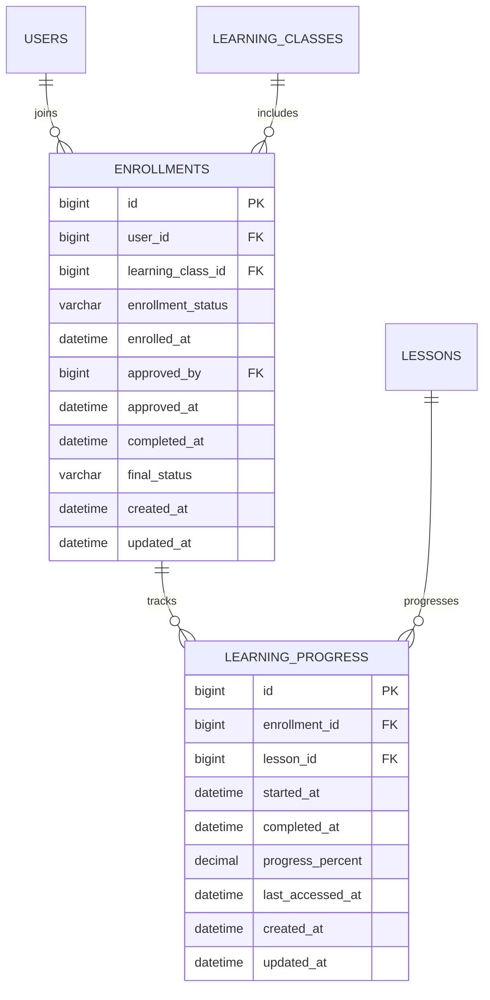
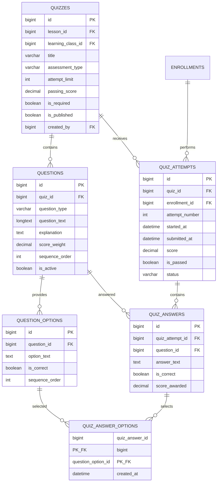
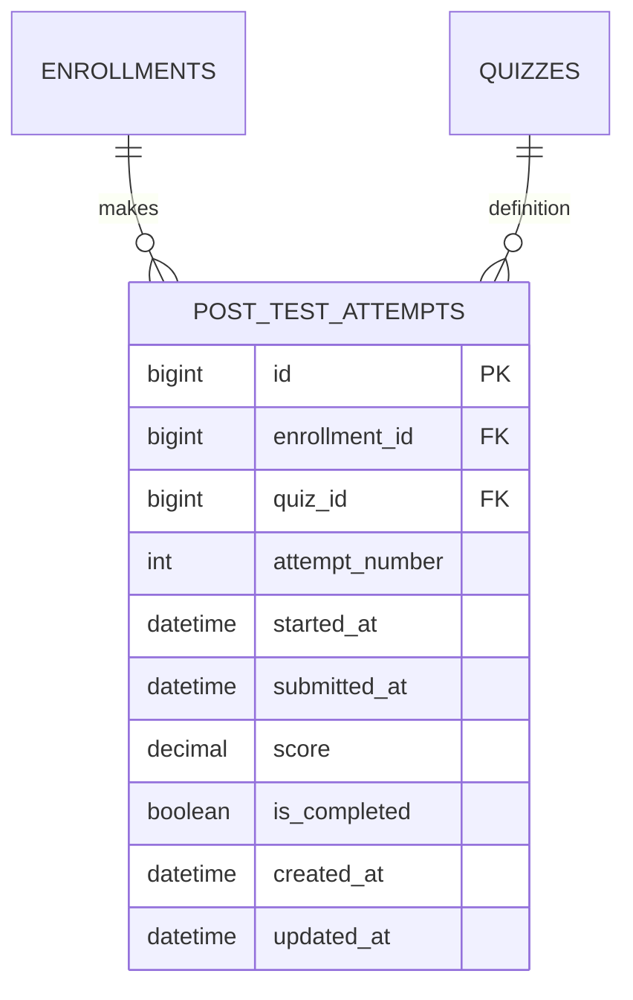

# BegawiPBJ Database ERD

## Entity Relationship Diagram Platform Ekosistem Digital PBJ Pemerintah Provinsi Lampung

Dokumen ini menjelaskan hubungan antarentitas database **BegawiPBJ**. ERD mendukung seluruh scope aplikasi: identity dan RBAC, organisasi, Arena Belajar, Bunga Rampai, regulasi PBJ, berita dan event, sertifikat digital, serta Government Intelligence PBJ Pemerintah Provinsi Lampung.

ERD ini digunakan sebagai acuan untuk migration CodeIgniter 4, model, service, seeder/import, validasi bisnis, pengujian database, dan dokumentasi integrasi fitur. Definisi kolom lengkap berada pada `begawipbj-data-dictionary.md`; aturan desain serta kebijakan database berada pada `begawipbj-database-blueprint.md`.

---

# 1. Konvensi ERD

| Simbol | Makna |
|---|---|
| `PK` | Primary key |
| `FK` | Foreign key |
| `UQ` | Unique key/constraint |
| `1 ──< N` | Satu record di kiri dapat memiliki banyak record di kanan |
| `0..1` | Relasi opsional, paling banyak satu record |
| `JSON` | Kolom data terstruktur fleksibel |
| `NULL` | Kolom dapat kosong |

Standar teknis:

```text
DBMS       : MySQL 8.4+
Engine     : InnoDB
Charset    : utf8mb4
Collation  : utf8mb4_0900_ai_ci atau Unicode collation konsisten
PK/FK      : BIGINT UNSIGNED, kecuali master berkode bisnis
Timestamp  : DATETIME UTC
```

Pengecualian resmi: `wilayah.kode` menggunakan `VARCHAR(13)` karena mengikuti format kode wilayah administratif.

```text
wilayah(kode VARCHAR(13), nama VARCHAR(100))
```

---

# 2. Peta Domain

```text
BegawiPBJ Database
│
├── Identity dan Access Control
│   ├── users
│   ├── user_profiles dan profil kategori
│   ├── roles, permissions, dan mapping
│   ├── password reset dan login attempts
│   ├── organization_units dan user_organizations
│   └── wilayah
│
├── Shared Platform Services
│   ├── file_assets
│   ├── approvals dan approval_histories
│   ├── audit_logs
│   └── notifications
│
├── Arena Belajar
│   ├── programs, courses, learning_classes
│   ├── class trainers/evaluators, module, lesson, material
│   ├── enrollment dan progress
│   ├── assessment configurations
│   ├── pre-test, quiz lesson, assignment, post-test
│   ├── manual grading dan participant feedback
│   └── final grades serta certificate eligibility
│
├── Bunga Rampai
│   ├── knowledge categories dan tags
│   ├── article, FAQ, case study
│   ├── document template
│   └── bookmark
│
├── Regulasi PBJ
│   ├── regulation categories
│   ├── regulations dan versions
│   ├── procurement stages dan competencies
│   └── keywords dan download logs
│
├── Communication Center
│   ├── news dan categories
│   ├── events
│   ├── event registrations/waitlist
│   └── attendances
│
├── Sertifikat Digital
│   ├── certificate templates dan sequences
│   ├── certificates
│   ├── verification logs
│   └── revocations
│
└── Government Intelligence PBJ
    ├── JF PPBJ personnel dan histories
    ├── competency certificates
    └── competency gap snapshots
```

---

# 3. ERD Tingkat Tinggi

```mermaid
erDiagram
    USERS ||--|| USER_PROFILES : has
    USERS ||--o| USER_ASN_PROFILES : has
    USERS ||--o| USER_PROVIDER_PROFILES : has
    USERS ||--o| USER_ACADEMIC_PROFILES : has
    USERS ||--o| USER_PUBLIC_PROFILES : has
    USERS ||--o{ USER_ROLES : receives
    ROLES ||--o{ USER_ROLES : assigned
    ROLES ||--o{ ROLE_PERMISSIONS : grants
    PERMISSIONS ||--o{ ROLE_PERMISSIONS : includes

    ORGANIZATION_UNITS ||--o{ ORGANIZATION_UNITS : parent_of
    USERS ||--o{ USER_ORGANIZATIONS : has_history
    ORGANIZATION_UNITS ||--o{ USER_ORGANIZATIONS : contains
    WILAYAH ||--o{ USER_PROFILES : referenced_by

    PROGRAMS ||--o{ COURSES : groups
    COURSES ||--o{ LEARNING_CLASSES : delivered_as
    COURSES ||--o{ LEARNING_MODULES : contains
    LEARNING_MODULES ||--o{ LESSONS : contains
    LESSONS ||--o{ LESSON_MATERIALS : uses
    FILE_ASSETS ||--o{ LESSON_MATERIALS : attached

    LEARNING_CLASSES ||--|| ASSESSMENT_CONFIGURATIONS : configures
    LEARNING_CLASSES ||--o{ CLASS_TRAINERS : assigns
    LEARNING_CLASSES ||--o{ CLASS_EVALUATORS : assigns
    LEARNING_CLASSES ||--o{ ENROLLMENTS : accepts
    USERS ||--o{ ENROLLMENTS : joins
    ENROLLMENTS ||--o{ LEARNING_PROGRESS : records
    LESSONS ||--o{ LEARNING_PROGRESS : tracks

    LEARNING_CLASSES ||--o{ QUIZZES : owns_tests
    LESSONS ||--o{ QUIZZES : owns_lesson_quiz
    QUIZZES ||--o{ QUESTIONS : contains
    QUESTIONS ||--o{ QUESTION_OPTIONS : has
    QUIZZES ||--o{ QUIZ_ATTEMPTS : receives
    ENROLLMENTS ||--o{ QUIZ_ATTEMPTS : makes
    QUIZ_ATTEMPTS ||--o{ QUIZ_ANSWERS : stores
    QUIZ_ANSWERS ||--o{ QUIZ_ANSWER_OPTIONS : selects

    ENROLLMENTS ||--o| PRE_TEST_ATTEMPTS : has_one
    ENROLLMENTS ||--o{ POST_TEST_ATTEMPTS : makes
    LEARNING_CLASSES ||--o{ ASSIGNMENTS : provides
    ASSIGNMENTS ||--o{ ASSIGNMENT_SUBMISSIONS : receives
    ENROLLMENTS ||--o{ ASSIGNMENT_SUBMISSIONS : submits
    ASSIGNMENT_SUBMISSIONS ||--o{ ASSIGNMENT_SUBMISSION_FILES : includes
    ASSIGNMENT_SUBMISSIONS ||--o| ASSIGNMENT_GRADES : receives
    ENROLLMENTS ||--o| PARTICIPANT_FEEDBACKS : gives
    ENROLLMENTS ||--o| FINAL_GRADES : produces

    KNOWLEDGE_CATEGORIES ||--o{ ARTICLES : categorizes
    KNOWLEDGE_CATEGORIES ||--o{ FAQS : categorizes
    KNOWLEDGE_CATEGORIES ||--o{ CASE_STUDIES : categorizes
    KNOWLEDGE_CATEGORIES ||--o{ DOCUMENT_TEMPLATES : categorizes
    ARTICLES ||--o{ ARTICLE_TAGS : tagged
    TAGS ||--o{ ARTICLE_TAGS : applies

    REGULATION_CATEGORIES ||--o{ REGULATIONS : categorizes
    REGULATIONS ||--o{ REGULATION_VERSIONS : versions
    FILE_ASSETS ||--o{ REGULATION_VERSIONS : stores
    REGULATIONS ||--o{ REGULATION_PROCUREMENT_STAGES : maps
    PROCUREMENT_STAGES ||--o{ REGULATION_PROCUREMENT_STAGES : applies
    REGULATIONS ||--o{ REGULATION_COMPETENCIES : maps
    COMPETENCIES ||--o{ REGULATION_COMPETENCIES : applies

    NEWS_CATEGORIES ||--o{ NEWS : categorizes
    EVENTS ||--o{ EVENT_REGISTRATIONS : receives
    USERS ||--o{ EVENT_REGISTRATIONS : registers
    EVENT_REGISTRATIONS ||--o| EVENT_ATTENDANCES : has

    USERS ||--o{ CERTIFICATES : receives
    CERTIFICATE_TEMPLATES ||--o{ CERTIFICATES : formats
    CERTIFICATES ||--o{ CERTIFICATE_VERIFICATION_LOGS : logged
    CERTIFICATES ||--o| CERTIFICATE_REVOCATIONS : revoked

    APPROVALS ||--o{ APPROVAL_HISTORIES : records
    USERS ||--o{ AUDIT_LOGS : acts
    USERS ||--o{ NOTIFICATIONS : receives
    USERS ||--o{ FILE_ASSETS : uploads

    ORGANIZATION_UNITS ||--o{ JF_PPBJ_PERSONNEL : contains
    JF_PPBJ_LEVELS ||--o{ JF_PPBJ_PERSONNEL : classifies
    JF_PPBJ_PERSONNEL ||--o{ JF_PPBJ_HISTORIES : records
    COMPETENCY_CERTIFICATE_TYPES ||--o{ COMPETENCY_CERTIFICATES : defines
    ORGANIZATION_UNITS ||--o{ COMPETENCY_CERTIFICATES : relates
    ORGANIZATION_UNITS ||--o{ COMPETENCY_GAP_SNAPSHOTS : measures
```



Catatan: relasi polymorphic seperti `approvals.subject_type + subject_id`, `bookmarks.bookmarkable_type + bookmarkable_id`, `certificates.source_type + source_id`, dan `audit_logs.subject_type + subject_id` tidak dapat dimodelkan sebagai foreign key generik. Integritasnya dikendalikan service dan validasi transaksi.

---

# 4. Identity dan RBAC

```mermaid
erDiagram
    USERS {
        bigint id PK
        varchar username UQ
        varchar email UQ
        varchar password_hash
        varchar account_status
        datetime email_verified_at
        datetime last_login_at
        datetime created_at
        datetime updated_at
        datetime deleted_at
    }

    USER_PROFILES {
        bigint id PK
        bigint user_id FK_UQ
        varchar profile_category
        varchar full_name
        varchar title_prefix
        varchar title_suffix
        varchar phone
        bigint avatar_file_asset_id FK
        varchar province_code FK
        varchar regency_code FK
        varchar district_code FK
        varchar village_code FK
        datetime created_at
        datetime updated_at
    }

    USER_ASN_PROFILES {
        bigint id PK
        bigint user_id FK_UQ
        varchar nip UQ
        varchar employment_status
        varchar position_name
        varchar rank_name
        varchar grade_name
        bigint organization_unit_id FK
        datetime created_at
        datetime updated_at
    }

    USER_PROVIDER_PROFILES {
        bigint id PK
        bigint user_id FK_UQ
        varchar nib UQ
        varchar company_name
        varchar responsible_person
        datetime created_at
        datetime updated_at
    }

    USER_ACADEMIC_PROFILES {
        bigint id PK
        bigint user_id FK_UQ
        varchar institution_name
        text expertise
        datetime created_at
        datetime updated_at
    }

    USER_PUBLIC_PROFILES {
        bigint id PK
        bigint user_id FK_UQ
        json additional_information
        datetime created_at
        datetime updated_at
    }

    ROLES {
        bigint id PK
        varchar code UQ
        varchar name
        text description
        boolean is_system
        datetime created_at
        datetime updated_at
    }

    PERMISSIONS {
        bigint id PK
        varchar module
        varchar action
        varchar code UQ
        varchar name
        text description
        datetime created_at
        datetime updated_at
    }

    USER_ROLES {
        bigint user_id PK_FK
        bigint role_id PK_FK
        bigint assigned_by FK
        datetime assigned_at
    }

    ROLE_PERMISSIONS {
        bigint role_id PK_FK
        bigint permission_id PK_FK
        datetime created_at
    }

    PASSWORD_RESET_TOKENS {
        bigint id PK
        bigint user_id FK
        varchar token_hash UQ
        datetime expires_at
        datetime used_at
        datetime created_at
    }

    LOGIN_ATTEMPTS {
        bigint id PK
        varchar identifier
        bigint user_id FK
        varchar ip_address
        boolean was_successful
        datetime attempted_at
    }

    USERS ||--|| USER_PROFILES : owns
    USERS ||--o| USER_ASN_PROFILES : has
    USERS ||--o| USER_PROVIDER_PROFILES : has
    USERS ||--o| USER_ACADEMIC_PROFILES : has
    USERS ||--o| USER_PUBLIC_PROFILES : has
    USERS ||--o{ USER_ROLES : receives
    ROLES ||--o{ USER_ROLES : assigned
    ROLES ||--o{ ROLE_PERMISSIONS : grants
    PERMISSIONS ||--o{ ROLE_PERMISSIONS : included
    USERS ||--o{ PASSWORD_RESET_TOKENS : requests
    USERS ||--o{ LOGIN_ATTEMPTS : may_match
```

## Aturan hubungan

- Satu `users` memiliki tepat satu `user_profiles`.
- Satu user hanya dapat memiliki maksimal satu profil spesifik sesuai `profile_category`.
- Satu user dapat memiliki banyak role; satu role dapat dimiliki banyak user.
- Satu role dapat memiliki banyak permission; satu permission dapat diberikan ke banyak role.
- `user_roles` menggunakan primary key gabungan `(user_id, role_id)`.
- `role_permissions` menggunakan primary key gabungan `(role_id, permission_id)`.
- Token reset disimpan sebagai hash; token mentah tidak disimpan di database.
- Role `operator`, `admin`, dan `super_admin` hanya dapat diberikan kepada user kategori `asn`; aturan ini dijaga `AccessControlService`.

---

# 5. Wilayah dan Organisasi

```mermaid
erDiagram
    WILAYAH {
        varchar kode PK
        varchar nama
    }

    ORGANIZATION_UNITS {
        bigint id PK
        bigint parent_id FK
        varchar code UQ
        varchar name
        varchar unit_type
        boolean is_active
        int sort_order
        datetime created_at
        datetime updated_at
    }

    USER_ORGANIZATIONS {
        bigint id PK
        bigint user_id FK
        bigint organization_unit_id FK
        boolean is_primary
        date start_date
        date end_date
        datetime created_at
        datetime updated_at
    }

    USER_PROFILES {
        bigint id PK
        varchar province_code FK
        varchar regency_code FK
        varchar district_code FK
        varchar village_code FK
    }

    ORGANIZATION_UNITS ||--o{ ORGANIZATION_UNITS : parent_of
    USERS ||--o{ USER_ORGANIZATIONS : has_history
    ORGANIZATION_UNITS ||--o{ USER_ORGANIZATIONS : contains
    WILAYAH ||--o{ USER_PROFILES : referenced_by
```

## Master wilayah

```text
wilayah(kode, nama)
```

Kode bersifat hierarkis:

```text
18              Provinsi Lampung
18.01           Kabupaten Lampung Selatan
18.01.04        Kecamatan Natar
18.01.04.2001   Desa/Kelurahan Hajimena
```

Empat kolom pada `user_profiles`—`province_code`, `regency_code`, `district_code`, dan `village_code`—masing-masing merujuk pada `wilayah.kode`.

Master wilayah merupakan data resmi/reference. Seeder dummy/development tidak boleh mengubah tabel `wilayah`.

## Organisasi

`organization_units` membentuk struktur organisasi Pemerintah Provinsi Lampung, dengan self-reference `parent_id`. `user_organizations` menyimpan hubungan organisasi beserta masa berlaku riwayat penugasan pengguna.

```text
UNIQUE(user_id, organization_unit_id, start_date)
```

---

# 6. Shared Platform Services

```mermaid
erDiagram
    FILE_ASSETS {
        bigint id PK
        varchar disk
        varchar path UQ
        varchar original_name
        varchar stored_name
        varchar mime_type
        varchar extension
        bigint size_bytes
        char checksum_sha256
        varchar visibility
        bigint uploaded_by FK
        datetime created_at
        datetime updated_at
        datetime deleted_at
    }

    APPROVALS {
        bigint id PK
        varchar subject_type
        bigint subject_id
        varchar workflow_status
        bigint submitted_by FK
        datetime submitted_at
        bigint reviewed_by FK
        datetime reviewed_at
        bigint approved_by FK
        datetime approved_at
        datetime published_at
        datetime created_at
        datetime updated_at
    }

    APPROVAL_HISTORIES {
        bigint id PK
        bigint approval_id FK
        varchar from_status
        varchar to_status
        varchar action
        text notes
        bigint acted_by FK
        datetime acted_at
    }

    AUDIT_LOGS {
        bigint id PK
        bigint actor_user_id FK
        varchar action
        varchar subject_type
        bigint subject_id
        varchar route_name
        varchar request_id
        varchar ip_address
        varchar user_agent
        json before_data
        json after_data
        json context_data
        datetime created_at
    }

    NOTIFICATIONS {
        bigint id PK
        bigint user_id FK
        varchar channel
        varchar notification_type
        varchar title
        text message
        json data
        datetime read_at
        datetime sent_at
        datetime failed_at
        datetime created_at
        datetime updated_at
    }

    USERS ||--o{ FILE_ASSETS : uploads
    APPROVALS ||--o{ APPROVAL_HISTORIES : has
    USERS ||--o{ APPROVALS : submits_reviews_approves
    USERS ||--o{ APPROVAL_HISTORIES : acts
    USERS ||--o{ AUDIT_LOGS : performs
    USERS ||--o{ NOTIFICATIONS : receives
```

## Catatan desain

- `file_assets.path` boleh `NULL`; unique index MySQL mengizinkan banyak nilai `NULL`.
- `path = NULL` berarti metadata file ada namun file fisik belum tersedia. Aplikasi harus menampilkan **File belum tersedia** dan tidak menyajikan download/preview aktif.
- `approvals` memakai `subject_type + subject_id`; validasi subject dilakukan `ApprovalService`.
- `audit_logs` menyimpan subject polymorphic sebagai tipe/ID dan bersifat append-only secara fungsional.
- Notifikasi dapat bersifat `in_app` atau `email`.

---

# 7. Arena Belajar

## 7.1 Program, course, class, dan materi

```mermaid
erDiagram
    PROGRAMS {
        bigint id PK
        varchar code UQ
        varchar title
        varchar slug UQ
        bigint cover_file_asset_id FK
        varchar workflow_status
        bigint created_by FK
        datetime published_at
    }

    COURSES {
        bigint id PK
        bigint program_id FK
        varchar code UQ
        varchar title
        varchar slug UQ
        varchar workflow_status
        bigint created_by FK
        datetime published_at
    }

    LEARNING_CLASSES {
        bigint id PK
        bigint course_id FK
        varchar code UQ
        varchar title
        varchar delivery_mode
        datetime start_at
        datetime end_at
        datetime enrollment_open_at
        datetime enrollment_close_at
        int quota
        varchar status
        bigint created_by FK
    }

    CLASS_TRAINERS {
        bigint learning_class_id PK_FK
        bigint user_id PK_FK
        boolean is_primary
        bigint assigned_by FK
        datetime assigned_at
    }

    CLASS_EVALUATORS {
        bigint learning_class_id PK_FK
        bigint user_id PK_FK
        bigint assigned_by FK
        datetime assigned_at
    }

    LEARNING_MODULES {
        bigint id PK
        bigint course_id FK
        varchar title
        text description
        int sequence_order
        boolean is_required
    }

    LESSONS {
        bigint id PK
        bigint learning_module_id FK
        varchar title
        varchar slug UQ
        varchar content_type
        longtext content_body
        varchar external_url
        int sequence_order
        boolean is_required
        boolean is_published
    }

    LESSON_MATERIALS {
        bigint id PK
        bigint lesson_id FK
        bigint file_asset_id FK
        varchar title
        int sequence_order
        boolean is_required
    }

    PROGRAMS ||--o{ COURSES : groups
    COURSES ||--o{ LEARNING_CLASSES : delivered_as
    COURSES ||--o{ LEARNING_MODULES : contains
    LEARNING_MODULES ||--o{ LESSONS : contains
    LESSONS ||--o{ LESSON_MATERIALS : attaches
    FILE_ASSETS ||--o{ LESSON_MATERIALS : supplies
    LEARNING_CLASSES ||--o{ CLASS_TRAINERS : assigns
    USERS ||--o{ CLASS_TRAINERS : serves
    LEARNING_CLASSES ||--o{ CLASS_EVALUATORS : assigns
    USERS ||--o{ CLASS_EVALUATORS : serves
```

Hubungan utama:

```text
Program 1 ──< N Course
Course 1 ──< N Learning Class
Course 1 ──< N Learning Module
Learning Module 1 ──< N Lesson
Lesson 1 ──< N Lesson Material
```

`courses.program_id` bersifat nullable agar course mandiri dapat disediakan.

## 7.2 Enrollment dan progress



Constraint penting:

```text
UNIQUE(user_id, learning_class_id)
UNIQUE(enrollment_id, lesson_id)
```

## 7.3 Konfigurasi assessment

```mermaid
erDiagram
    LEARNING_CLASSES {
        bigint id PK
        varchar code UQ
        varchar title
    }

    ASSESSMENT_CONFIGURATIONS {
        bigint id PK
        bigint learning_class_id FK_UQ
        boolean pre_test_enabled
        int pre_test_attempt_limit
        boolean quiz_enabled
        int quiz_attempt_limit
        boolean quiz_best_attempt_enabled
        boolean assignment_enabled
        boolean assignment_required_when_enabled
        boolean post_test_enabled
        int post_test_attempt_limit
        boolean post_test_best_attempt_enabled
        decimal quiz_weight
        decimal assignment_weight
        decimal post_test_weight
        decimal passing_grade
        boolean participant_feedback_required
        boolean certificate_enabled
    }

    LEARNING_CLASSES ||--|| ASSESSMENT_CONFIGURATIONS : has
```

Baseline aturan:

```text
pre_test_attempt_limit = 1
quiz_best_attempt_enabled = true
assignment_required_when_enabled = true
post_test_best_attempt_enabled = true
post_test_weight = 60 jika post-test aktif
quiz_weight + assignment_weight = 40 jika post-test aktif
passing_grade >= 70
```

## 7.4 Engine quiz dan pre-test

Quiz per lesson memakai engine question yang sama untuk assessment objektif. Pre-test dan post-test dapat merujuk ke definisi `quizzes` dengan `assessment_type` yang berbeda.



Constraint:

```text
UNIQUE(quiz_id, enrollment_id, attempt_number)
UNIQUE(quiz_attempt_id, question_id)
PRIMARY KEY(quiz_answer_id, question_option_id)
```

Aturan `quizzes`:

```text
assessment_type = lesson_quiz → lesson_id wajib, learning_class_id NULL
assessment_type = pre_test    → learning_class_id wajib, lesson_id NULL
assessment_type = post_test   → learning_class_id wajib, lesson_id NULL
```

## 7.5 Pre-test

```mermaid
erDiagram
    PRE_TEST_ATTEMPTS {
        bigint id PK
        bigint enrollment_id FK_UQ
        bigint quiz_id FK
        datetime started_at
        datetime submitted_at
        decimal score
        boolean is_completed
        datetime created_at
        datetime updated_at
    }

    ENROLLMENTS ||--o| PRE_TEST_ATTEMPTS : has_one
    QUIZZES ||--o{ PRE_TEST_ATTEMPTS : definition
```

Aturan:

- Satu enrollment hanya dapat mempunyai satu `pre_test_attempts`.
- Nilai pre-test berada pada rentang 0–100 dan dihasilkan auto-grading.
- Nilai pre-test tidak masuk formula `final_grades.final_score`.

## 7.6 Assignment, revisi, dan manual grading

```mermaid
erDiagram
    ASSIGNMENTS {
        bigint id PK
        bigint learning_class_id FK
        bigint lesson_id FK
        varchar title
        longtext instruction
        datetime due_at
        decimal max_score
        boolean is_required
        boolean is_active
        boolean allow_resubmission
        int max_submission_count
        bigint created_by FK
    }

    ASSIGNMENT_SUBMISSIONS {
        bigint id PK
        bigint assignment_id FK
        bigint enrollment_id FK
        int submission_number
        longtext submission_text
        varchar status
        datetime submitted_at
        datetime revision_requested_at
        datetime resubmission_due_at
        datetime created_at
        datetime updated_at
    }

    ASSIGNMENT_SUBMISSION_FILES {
        bigint id PK
        bigint assignment_submission_id FK
        bigint file_asset_id FK
        datetime created_at
    }

    ASSIGNMENT_GRADES {
        bigint id PK
        bigint assignment_submission_id FK_UQ
        bigint grader_user_id FK
        decimal score
        longtext feedback
        datetime graded_at
        datetime created_at
        datetime updated_at
    }

    LEARNING_CLASSES ||--o{ ASSIGNMENTS : provides
    LESSONS ||--o{ ASSIGNMENTS : optionally_contextualizes
    ASSIGNMENTS ||--o{ ASSIGNMENT_SUBMISSIONS : receives
    ENROLLMENTS ||--o{ ASSIGNMENT_SUBMISSIONS : submits
    ASSIGNMENT_SUBMISSIONS ||--o{ ASSIGNMENT_SUBMISSION_FILES : includes
    FILE_ASSETS ||--o{ ASSIGNMENT_SUBMISSION_FILES : attached
    ASSIGNMENT_SUBMISSIONS ||--o| ASSIGNMENT_GRADES : receives
    USERS ||--o{ ASSIGNMENT_GRADES : grades
```

Constraint:

```text
UNIQUE(assignment_id, enrollment_id, submission_number)
UNIQUE(assignment_submission_id)
UNIQUE(assignment_submission_id, file_asset_id)
```

Aturan:

- Assignment bersifat optional pada class; jika diaktifkan/tersedia, assignment yang berlaku wajib diselesaikan.
- Revisi tidak menimpa submission lama. Upload ulang dicatat sebagai `submission_number` baru.
- Nilai assignment berasal dari manual grading evaluator berizin.

## 7.7 Post-test



Constraint:

```text
UNIQUE(enrollment_id, attempt_number)
```

Aturan:

- Post-test menggunakan auto-grading dan nilai attempt terbaik.
- Post-test memiliki bobot tetap 60% pada final score ketika diaktifkan.

## 7.8 Feedback, final grade, dan eligibility

```mermaid
erDiagram
    PARTICIPANT_FEEDBACKS {
        bigint id PK
        bigint enrollment_id FK_UQ
        tinyint rating
        longtext feedback_text
        datetime submitted_at
        datetime created_at
        datetime updated_at
    }

    FINAL_GRADES {
        bigint id PK
        bigint enrollment_id FK_UQ
        decimal quiz_score
        decimal assignment_score
        decimal post_test_score
        decimal final_score
        decimal passing_grade
        boolean is_passed
        boolean all_required_lessons_completed
        boolean all_required_assessments_completed
        boolean participant_feedback_completed
        boolean certificate_eligible
        datetime calculated_at
        bigint calculated_by FK
        text notes
        datetime created_at
        datetime updated_at
    }

    ENROLLMENTS ||--o| PARTICIPANT_FEEDBACKS : provides
    ENROLLMENTS ||--o| FINAL_GRADES : produces
    USERS ||--o{ FINAL_GRADES : calculates
```

Formula final score:

```text
final_score = (quiz_score × quiz_weight / 100)
            + (assignment_score × assignment_weight / 100)
            + (post_test_score × post_test_weight / 100)
```

Dengan baseline:

```text
post_test_weight = 60
quiz_weight + assignment_weight = 40
passing_grade >= 70
```

`pre_test_score` sengaja tidak ada pada `final_grades`, karena pre-test tidak dihitung.

---

# 8. Bunga Rampai

```mermaid
erDiagram
    KNOWLEDGE_CATEGORIES {
        bigint id PK
        bigint parent_id FK
        varchar name
        varchar slug UQ
        boolean is_active
    }

    TAGS {
        bigint id PK
        varchar name UQ
        varchar slug UQ
    }

    ARTICLES {
        bigint id PK
        bigint knowledge_category_id FK
        varchar title
        varchar slug UQ
        longtext content
        bigint cover_file_asset_id FK
        varchar workflow_status
        bigint author_id FK
        datetime published_at
    }

    ARTICLE_TAGS {
        bigint article_id PK_FK
        bigint tag_id PK_FK
    }

    FAQS {
        bigint id PK
        bigint knowledge_category_id FK
        text question
        longtext answer
        varchar workflow_status
        bigint created_by FK
        datetime published_at
    }

    CASE_STUDIES {
        bigint id PK
        bigint knowledge_category_id FK
        varchar title
        varchar slug UQ
        longtext content
        varchar workflow_status
        bigint author_id FK
        datetime published_at
    }

    DOCUMENT_TEMPLATES {
        bigint id PK
        bigint knowledge_category_id FK
        varchar title
        varchar slug UQ
        bigint file_asset_id FK
        varchar workflow_status
        bigint created_by FK
        datetime published_at
    }

    BOOKMARKS {
        bigint id PK
        bigint user_id FK
        varchar bookmarkable_type
        bigint bookmarkable_id
        datetime created_at
    }

    KNOWLEDGE_CATEGORIES ||--o{ KNOWLEDGE_CATEGORIES : parent_of
    KNOWLEDGE_CATEGORIES ||--o{ ARTICLES : classifies
    KNOWLEDGE_CATEGORIES ||--o{ FAQS : classifies
    KNOWLEDGE_CATEGORIES ||--o{ CASE_STUDIES : classifies
    KNOWLEDGE_CATEGORIES ||--o{ DOCUMENT_TEMPLATES : classifies
    ARTICLES ||--o{ ARTICLE_TAGS : tagged
    TAGS ||--o{ ARTICLE_TAGS : applies
    USERS ||--o{ BOOKMARKS : saves
```

`bookmarks` adalah relasi polymorphic. Tipe yang diizinkan:

```text
article
case_study
document_template
regulation
```

Constraint:

```text
UNIQUE(user_id, bookmarkable_type, bookmarkable_id)
```

---

# 9. Regulasi PBJ

```mermaid
erDiagram
    REGULATION_CATEGORIES {
        bigint id PK
        bigint parent_id FK
        varchar name
        varchar slug UQ
        boolean is_active
    }

    PROCUREMENT_STAGES {
        bigint id PK
        varchar code UQ
        varchar name
        boolean is_active
    }

    COMPETENCIES {
        bigint id PK
        varchar code UQ
        varchar name
        boolean is_active
    }

    REGULATIONS {
        bigint id PK
        bigint regulation_category_id FK
        varchar title
        varchar regulation_number
        smallint year
        varchar legal_status
        varchar workflow_status
        bigint created_by FK
        datetime published_at
    }

    REGULATION_VERSIONS {
        bigint id PK
        bigint regulation_id FK
        int version_number
        bigint file_asset_id FK
        boolean is_current
        varchar workflow_status
        bigint uploaded_by FK
        datetime published_at
    }

    REGULATION_PROCUREMENT_STAGES {
        bigint regulation_id PK_FK
        bigint procurement_stage_id PK_FK
    }

    REGULATION_COMPETENCIES {
        bigint regulation_id PK_FK
        bigint competency_id PK_FK
    }

    REGULATION_KEYWORDS {
        bigint id PK
        bigint regulation_id FK
        varchar keyword
    }

    REGULATION_DOWNLOAD_LOGS {
        bigint id PK
        bigint regulation_version_id FK
        bigint user_id FK
        varchar ip_address
        datetime downloaded_at
    }

    REGULATION_CATEGORIES ||--o{ REGULATIONS : categorizes
    REGULATIONS ||--o{ REGULATION_VERSIONS : versions
    FILE_ASSETS ||--o{ REGULATION_VERSIONS : stores
    REGULATIONS ||--o{ REGULATION_PROCUREMENT_STAGES : maps
    PROCUREMENT_STAGES ||--o{ REGULATION_PROCUREMENT_STAGES : applies
    REGULATIONS ||--o{ REGULATION_COMPETENCIES : maps
    COMPETENCIES ||--o{ REGULATION_COMPETENCIES : applies
    REGULATIONS ||--o{ REGULATION_KEYWORDS : indexed
    REGULATION_VERSIONS ||--o{ REGULATION_DOWNLOAD_LOGS : downloaded
    USERS ||--o{ REGULATION_DOWNLOAD_LOGS : optionally_downloads
```

Constraint utama:

```text
UNIQUE(regulation_category_id, regulation_number, year)
UNIQUE(regulation_id, version_number)
PRIMARY KEY(regulation_id, procurement_stage_id)
PRIMARY KEY(regulation_id, competency_id)
UNIQUE(regulation_id, keyword)
```

Aturan tambahan: satu regulasi hanya boleh memiliki satu `regulation_versions.is_current = 1`. Penegakan dilakukan `RegulationVersionService` dengan transaction/locking karena MySQL tidak menyediakan partial unique index standar.

---

# 10. Berita, Agenda, dan Event

```mermaid
erDiagram
    NEWS_CATEGORIES {
        bigint id PK
        varchar name
        varchar slug UQ
        boolean is_active
    }

    NEWS {
        bigint id PK
        bigint news_category_id FK
        varchar title
        varchar slug UQ
        longtext content
        bigint cover_file_asset_id FK
        varchar workflow_status
        bigint author_id FK
        datetime published_at
        bigint view_count
    }

    EVENTS {
        bigint id PK
        varchar title
        varchar slug UQ
        varchar event_type
        varchar delivery_mode
        datetime start_at
        datetime end_at
        datetime registration_open_at
        datetime registration_close_at
        int quota
        varchar event_status
        varchar workflow_status
        boolean certificate_enabled
        bigint created_by FK
    }

    EVENT_REGISTRATIONS {
        bigint id PK
        bigint event_id FK
        bigint user_id FK
        varchar registration_status
        datetime registered_at
        datetime cancelled_at
        bigint approved_by FK
    }

    EVENT_ATTENDANCES {
        bigint id PK
        bigint event_registration_id FK_UQ
        varchar attendance_status
        datetime checked_in_at
        datetime checked_out_at
        bigint recorded_by FK
    }

    NEWS_CATEGORIES ||--o{ NEWS : categorizes
    EVENTS ||--o{ EVENT_REGISTRATIONS : accepts
    USERS ||--o{ EVENT_REGISTRATIONS : makes
    EVENT_REGISTRATIONS ||--o| EVENT_ATTENDANCES : has
    USERS ||--o{ EVENT_ATTENDANCES : records
```

Constraint:

```text
UNIQUE(event_id, user_id)
UNIQUE(event_registration_id) pada event_attendances
```

Aturan kuota, waitlist, pembatalan, serta promosi waitlist dijalankan dalam transaction pada `EventRegistrationService`.

---

# 11. Sertifikat Digital

```mermaid
erDiagram
    CERTIFICATE_TEMPLATES {
        bigint id PK
        varchar code UQ
        varchar name
        varchar certificate_type
        longtext html_template
        bigint layout_file_asset_id FK
        boolean is_active
        bigint created_by FK
    }

    CERTIFICATE_SEQUENCES {
        bigint id PK
        varchar sequence_scope
        smallint year
        bigint last_number
        datetime updated_at
    }

    CERTIFICATES {
        bigint id PK
        bigint recipient_user_id FK
        bigint certificate_template_id FK
        varchar source_type
        bigint source_id
        varchar certificate_number UQ
        datetime issued_at
        varchar status
        bigint file_asset_id FK
        varchar verification_token UQ
        bigint issued_by FK
        datetime expires_at
        datetime created_at
        datetime updated_at
    }

    CERTIFICATE_VERIFICATION_LOGS {
        bigint id PK
        bigint certificate_id FK
        varchar verification_token
        varchar result
        varchar ip_address
        varchar user_agent
        datetime verified_at
    }

    CERTIFICATE_REVOCATIONS {
        bigint id PK
        bigint certificate_id FK_UQ
        bigint revoked_by FK
        datetime revoked_at
        longtext reason
        bigint replacement_certificate_id FK
        datetime created_at
    }

    USERS ||--o{ CERTIFICATES : receives
    CERTIFICATE_TEMPLATES ||--o{ CERTIFICATES : formats
    FILE_ASSETS ||--o{ CERTIFICATES : stored_as
    CERTIFICATES ||--o{ CERTIFICATE_VERIFICATION_LOGS : verifies
    CERTIFICATES ||--o| CERTIFICATE_REVOCATIONS : revoked
    CERTIFICATES ||--o{ CERTIFICATE_REVOCATIONS : replaces
```

Sumber sertifikat:

```text
learning_enrollment → enrollments.id
event_registration  → event_registrations.id
```

Constraint:

```text
UNIQUE(certificate_number)
UNIQUE(verification_token)
UNIQUE(source_type, source_id)
UNIQUE(sequence_scope, year)
UNIQUE(certificate_id) pada certificate_revocations
```

Tidak ada tabel `event_certificates` terpisah. Seluruh sertifikat memakai tabel `certificates`; pembeda sumber berasal dari `source_type` dan `source_id`.

## Eligibility sertifikat learning

Relasi source `learning_enrollment` hanya valid bila enrollment mempunyai `final_grades.certificate_eligible = true` dan konfigurasi class mengaktifkan sertifikat. Validasi dilakukan `CertificateEligibilityService` sebelum record sertifikat diterbitkan.

---

# 12. Government Intelligence PBJ

```mermaid
erDiagram
    JF_PPBJ_LEVELS {
        bigint id PK
        varchar code UQ
        varchar name
        int sort_order
        boolean is_active
    }

    JF_PPBJ_PERSONNEL {
        bigint id PK
        bigint user_id FK_UQ
        bigint organization_unit_id FK
        varchar employee_name
        varchar employee_identifier UQ
        bigint jf_ppbj_level_id FK
        varchar employment_status
        date effective_start_date
        date effective_end_date
        text notes
    }

    JF_PPBJ_HISTORIES {
        bigint id PK
        bigint jf_ppbj_personnel_id FK
        varchar event_type
        date effective_date
        bigint from_organization_unit_id FK
        bigint to_organization_unit_id FK
        bigint from_level_id FK
        bigint to_level_id FK
        bigint recorded_by FK
        text notes
    }

    COMPETENCY_CERTIFICATE_TYPES {
        bigint id PK
        varchar code UQ
        varchar name
        text description
        boolean is_active
    }

    COMPETENCY_CERTIFICATES {
        bigint id PK
        bigint user_id FK
        bigint organization_unit_id FK
        varchar holder_name
        varchar holder_identifier
        bigint competency_certificate_type_id FK
        varchar certificate_number
        date issued_at
        date expires_at
        varchar status
        bigint evidence_file_asset_id FK
        bigint verified_by FK
        datetime verified_at
    }

    COMPETENCY_GAP_SNAPSHOTS {
        bigint id PK
        bigint organization_unit_id FK
        date period_date
        varchar metric_code
        int required_count
        int available_count
        int gap_count
        datetime generated_at
        bigint generated_by FK
    }

    ORGANIZATION_UNITS ||--o{ JF_PPBJ_PERSONNEL : contains
    USERS ||--o| JF_PPBJ_PERSONNEL : optional_account
    JF_PPBJ_LEVELS ||--o{ JF_PPBJ_PERSONNEL : classifies
    JF_PPBJ_PERSONNEL ||--o{ JF_PPBJ_HISTORIES : tracks
    JF_PPBJ_LEVELS ||--o{ JF_PPBJ_HISTORIES : changes_level
    ORGANIZATION_UNITS ||--o{ JF_PPBJ_HISTORIES : changes_unit
    COMPETENCY_CERTIFICATE_TYPES ||--o{ COMPETENCY_CERTIFICATES : classifies
    ORGANIZATION_UNITS ||--o{ COMPETENCY_CERTIFICATES : relates
    USERS ||--o{ COMPETENCY_CERTIFICATES : optional_account
    FILE_ASSETS ||--o{ COMPETENCY_CERTIFICATES : proves
    ORGANIZATION_UNITS ||--o{ COMPETENCY_GAP_SNAPSHOTS : measures
```

## Aturan intelligence

- `user_id` pada `jf_ppbj_personnel` dan `competency_certificates` bersifat nullable; tidak semua data SDM harus memiliki akun BegawiPBJ.
- `employee_identifier` dan `holder_identifier` adalah data terbatas.
- Statistik publik hanya menggunakan data agregat.
- Scope intelligence organisasi awal adalah Pemerintah Provinsi Lampung.
- Snapshot gap disimpan per organisasi, periode, dan metrik.

Constraint snapshot:

```text
UNIQUE(organization_unit_id, period_date, metric_code)
gap_count = required_count - available_count
```

---

# 13. Relasi Polymorphic

Beberapa relasi menggunakan pasangan `type + id` agar tabel bersama dapat melayani beberapa domain.

| Tabel | Kolom | Tipe yang diizinkan | Service pengendali |
|---|---|---|---|
| `approvals` | `subject_type`, `subject_id` | `learning_program`, `learning_course`, `learning_class`, `article`, `case_study`, `document_template`, `regulation`, `regulation_version`, `news`, `event`, `certificate` | `ApprovalService` |
| `bookmarks` | `bookmarkable_type`, `bookmarkable_id` | `article`, `case_study`, `document_template`, `regulation` | `BookmarkService` |
| `certificates` | `source_type`, `source_id` | `learning_enrollment`, `event_registration` | `CertificateEligibilityService` |
| `audit_logs` | `subject_type`, `subject_id` | Subject audit terdaftar | `AuditService` |

Service pengendali wajib:

1. Memvalidasi type terhadap daftar yang diizinkan.
2. Memastikan record sumber tersedia.
3. Memastikan status sumber memenuhi syarat proses.
4. Memvalidasi role, permission, account status, penugasan, dan ownership user.
5. Menjalankan transaction untuk perubahan lintas tabel.
6. Menyimpan audit log untuk proses sensitif.

---

# 14. Constraint Bisnis Kunci

```text
users.username                                           unik
users.email                                              unik
roles.code                                               unik
permissions.code                                         unik
user_roles(user_id, role_id)                             primary key gabungan
role_permissions(role_id, permission_id)                 primary key gabungan

programs.code dan programs.slug                          unik
courses.code dan courses.slug                            unik
learning_classes.code                                    unik
assessment_configurations.learning_class_id              unik
enrollments(user_id, learning_class_id)                  unik
learning_progress(enrollment_id, lesson_id)              unik
pre_test_attempts.enrollment_id                          unik
quiz_attempts(quiz_id, enrollment_id, attempt_number)    unik
quiz_answers(quiz_attempt_id, question_id)               unik
assignment_submissions(assignment_id, enrollment_id,
submission_number)                                       unik
assignment_grades.assignment_submission_id               unik
post_test_attempts(enrollment_id, attempt_number)        unik
participant_feedbacks.enrollment_id                      unik
final_grades.enrollment_id                               unik

knowledge_categories.slug                                unik
articles.slug                                            unik
tags.name dan tags.slug                                  unik
article_tags(article_id, tag_id)                         primary key gabungan
bookmarks(user_id, bookmarkable_type, bookmarkable_id)   unik

regulations(category, number, year)                      unik
regulation_versions(regulation_id, version_number)       unik
regulation_procurement_stages                            primary key gabungan
regulation_competencies                                  primary key gabungan
regulation_keywords(regulation_id, keyword)              unik

news_categories.slug                                     unik
news.slug                                                unik
events.slug                                              unik
event_registrations(event_id, user_id)                   unik
event_attendances.event_registration_id                  unik

certificate_templates.code                               unik
certificates.certificate_number                          unik
certificates.verification_token                          unik
certificates(source_type, source_id)                     unik
certificate_sequences(sequence_scope, year)              unik
certificate_revocations.certificate_id                   unik

jf_ppbj_levels.code                                      unik
competency_certificate_types.code                        unik
competency_certificates(type, certificate_number)        unik
competency_gap_snapshots(unit, period, metric)           unik
```

---

# 15. Implementasi dan Validasi

Urutan implementasi migration:

```text
1. Identity dan RBAC
2. Organisasi dan struktur master wilayah
3. File asset, approval, audit, dan notifikasi
4. Learning core
5. Assessment, grading, feedback, dan completion
6. Bunga Rampai
7. Regulasi
8. Berita dan event
9. Sertifikat digital
10. Government Intelligence PBJ
11. Index tambahan dan optimasi
```

Validasi baseline:

```bash
php spark migrate:fresh
php spark db:seed DatabaseSeeder
php spark test
```

Import master wilayah resmi dilakukan terpisah dan tidak melalui development seeder:

```bash
mysql -u <username> -p <database_name> < database/reference/wilayah.sql
```

Checklist minimum:

- Semua migration berhasil pada database kosong.
- Master wilayah tersedia sebelum data profil yang memakai FK wilayah dibuat.
- Semua FK memiliki tipe/unsigned yang konsisten.
- Semua tabel pivot dan business key memiliki unique constraint yang sesuai.
- Pre-test maksimal satu attempt dan tidak masuk final score.
- Quiz/post-test memakai best attempt; post-test berkontribusi 60%.
- Assignment yang diaktifkan mendukung revision/upload ulang dan manual grading.
- Satu source sertifikat tidak menghasilkan dua sertifikat resmi.
- File dengan `path = NULL` tidak dapat diunduh.
- Role/permission dan ownership diverifikasi server-side.
- Statistik publik hanya menggunakan data agregat tanpa data pribadi ASN.
- Sertifikat, final grade, approval history, dan audit log tidak hilang akibat cascade tidak disengaja.
