# BegawiPBJ Workflow State Machine

## Standar Workflow, State Transition, dan Approval Platform Ekosistem Digital PBJ Pemerintah Provinsi Lampung

Dokumen ini menetapkan state machine untuk proses konten, administrasi, pembelajaran, event, sertifikat, dan data intelligence dalam BegawiPBJ.

Tujuan workflow adalah memastikan setiap perubahan penting memiliki status yang jelas, aktor yang berwenang, histori keputusan, notifikasi yang relevan, dan audit trail yang dapat ditelusuri.

---

# 1. Prinsip Workflow

BegawiPBJ menggunakan prinsip berikut:

- Setiap objek memiliki state yang eksplisit.
- Perubahan state hanya dilakukan melalui transition yang valid.
- Setiap transition memiliki actor, waktu, alasan/catatan, dan audit log bila diperlukan.
- Permission menentukan siapa yang dapat melakukan transition.
- Role menentukan konteks kerja, tetapi permission tetap menjadi otorisasi utama.
- State akhir tidak dapat diubah sembarangan tanpa transition resmi.
- Entity yang telah dipublish atau issued tidak dihapus fisik; gunakan archive, revoke, cancel, atau revisi sesuai domain.
- Semua transition lintas tabel dijalankan dalam database transaction.

Kontrol akses pada workflow:

```text
Authentication
↓
Account Status Validation
↓
Role Validation
↓
Permission Validation
↓
Scope / Ownership Validation
↓
State Transition Validation
```

---

# 2. Konsep State Machine

## 2.1 Istilah

| Istilah | Makna |
|---|---|
| Entity | Objek bisnis yang memiliki lifecycle, misalnya course atau regulasi |
| State | Kondisi saat ini dari entity |
| Transition | Perpindahan dari satu state ke state lain |
| Trigger | Aksi yang memulai transition |
| Guard | Syarat yang harus terpenuhi sebelum transition diizinkan |
| Actor | User atau system yang melakukan transition |
| Terminal state | State akhir yang memerlukan aksi resmi untuk berubah lagi |
| Audit trail | Jejak perubahan state, actor, waktu, dan catatan |

## 2.2 Komponen implementasi

| Komponen | Lokasi/Media | Fungsi |
|---|---|---|
| State entity | Kolom `status`, `workflow_status`, atau state domain | Menyimpan kondisi objek |
| Approval utama | `approvals` | Menyimpan status workflow dan reviewer aktif |
| Histori approval | `approval_histories` | Menyimpan setiap transition workflow |
| Audit | `audit_logs` | Mencatat aksi sensitif dan perubahan konteks |
| Business rule | Service domain | Memvalidasi guard dan menjalankan transaction |
| Authorization | Filter + service | Memeriksa role/permission dan scope data |
| Notification | `NotificationService` | Mengirim notifikasi setelah transition tertentu |

---

# 3. Status Workflow Konten

Workflow konten dipakai untuk course, kelas, artikel, studi kasus, template, regulasi, versi regulasi, berita, dan event.

## 3.1 State utama

```text
DRAFT
↓
SUBMITTED
↓
IN_REVIEW
↓
APPROVED
↓
PUBLISHED
```

State tambahan:

```text
REVISION_REQUIRED
REJECTED
ARCHIVED
CANCELLED
```

## 3.2 Diagram workflow konten

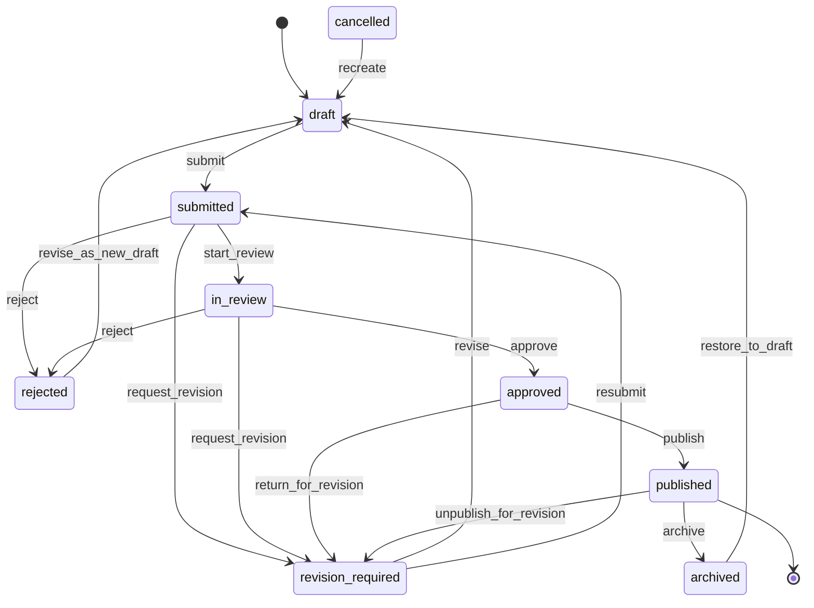

## 3.3 Definisi state konten

| State | Keterangan | Dapat dilihat publik? | Dapat diubah editor? |
|---|---|---:|---:|
| `draft` | Konten disimpan dan belum diajukan | Tidak | Ya |
| `submitted` | Konten diajukan untuk review | Tidak | Tidak, kecuali ditarik kembali bila diizinkan |
| `in_review` | Reviewer sedang memeriksa konten | Tidak | Tidak |
| `revision_required` | Konten perlu perbaikan | Tidak | Ya |
| `approved` | Konten disetujui dan siap publish | Tidak | Terbatas |
| `published` | Konten aktif untuk target audiens | Ya, bila konten publik | Terbatas |
| `rejected` | Konten ditolak | Tidak | Ya, melalui draft baru |
| `archived` | Konten tidak ditampilkan aktif tetapi disimpan | Tidak | Terbatas |
| `cancelled` | Konten/proses dibatalkan | Tidak | Tidak tanpa reaktivasi resmi |

## 3.4 Transition matrix konten

| Dari | Trigger | Ke | Actor minimum | Permission minimum | Guard |
|---|---|---|---|---|---|
| `draft` | `submit` | `submitted` | Author/Owner | Permission manage domain | Field wajib valid, lampiran wajib tersedia bila diperlukan |
| `submitted` | `start_review` | `in_review` | Reviewer | `approval.review` | Reviewer memiliki scope domain |
| `submitted` | `request_revision` | `revision_required` | Reviewer | `approval.review` | Catatan wajib |
| `submitted` | `reject` | `rejected` | Reviewer | `approval.review` | Alasan wajib |
| `in_review` | `approve` | `approved` | Reviewer/Approver | Permission publish/approve domain | Review selesai, metadata valid |
| `in_review` | `request_revision` | `revision_required` | Reviewer | `approval.review` | Catatan wajib |
| `in_review` | `reject` | `rejected` | Reviewer | `approval.review` | Alasan wajib |
| `revision_required` | `revise` | `draft` | Author/Owner | Permission manage domain | Perubahan disimpan |
| `revision_required` | `resubmit` | `submitted` | Author/Owner | Permission manage domain | Semua catatan review ditangani |
| `approved` | `publish` | `published` | Admin/Approver | Permission publish domain | Publish permission dan public metadata lengkap |
| `approved` | `return_for_revision` | `revision_required` | Admin/Approver | `approval.review` | Catatan wajib |
| `published` | `archive` | `archived` | Admin | Permission manage/publish domain | Alasan archive dicatat |
| `published` | `unpublish_for_revision` | `revision_required` | Admin | Permission publish domain | Catatan wajib |
| `archived` | `restore_to_draft` | `draft` | Admin | Permission manage domain | Alasan restore dicatat |
| `rejected` | `revise_as_new_draft` | `draft` | Author/Owner | Permission manage domain | Salinan/perbaikan konten valid |

---

# 4. Approval Record State Machine

Tabel `approvals` menyimpan status workflow lintas domain.

## 4.1 Subject type

```text
learning_course
learning_class
article
case_study
document_template
regulation
regulation_version
news
event
certificate
```

## 4.2 Data approval

```text
approvals
├── subject_type
├── subject_id
├── workflow_status
├── submitted_by
├── submitted_at
├── current_reviewer_id
├── decided_by
├── decided_at
└── decision_notes

approval_histories
├── approval_id
├── from_status
├── to_status
├── action
├── acted_by
├── notes
└── created_at
```

## 4.3 Aturan histori

Setiap transition workflow membuat satu record `approval_histories`.

Contoh:

```text
from_status = in_review
to_status   = approved
action      = approve
acted_by    = user_id reviewer
notes       = "Metadata dan lampiran telah diverifikasi"
created_at  = UTC timestamp
```

Tidak boleh mengubah atau menghapus histori untuk memperbaiki tampilan status. Koreksi dilakukan melalui transition baru yang sah.

---

# 5. User Registration State Machine

Registrasi user memiliki lifecycle akun yang terpisah dari workflow konten.

## 5.1 Diagram registrasi

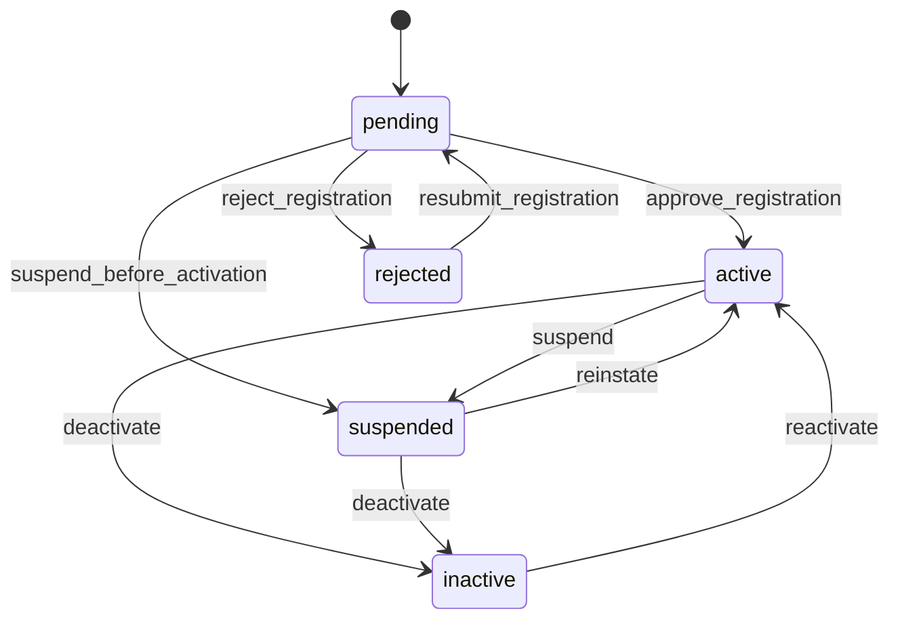

## 5.2 State akun

| State | Login | Workspace/Dashboard | Penjelasan |
|---|---:|---:|---|
| `pending` | Tidak | Tidak | Menunggu validasi akun |
| `active` | Ya | Sesuai role | Akun dapat digunakan |
| `inactive` | Tidak | Tidak | Akun dinonaktifkan |
| `rejected` | Tidak | Tidak | Registrasi ditolak |
| `suspended` | Tidak | Tidak | Akses ditangguhkan |

## 5.3 Transition registrasi

| Dari | Trigger | Ke | Actor | Guard |
|---|---|---|---|---|
| `pending` | `approve_registration` | `active` | Operator/Admin | Profil wajib lengkap, identitas sesuai kebijakan |
| `pending` | `reject_registration` | `rejected` | Operator/Admin | Alasan penolakan wajib |
| `pending` | `suspend_before_activation` | `suspended` | Admin | Indikasi penyalahgunaan/risiko |
| `active` | `deactivate` | `inactive` | Admin | Alasan dicatat |
| `active` | `suspend` | `suspended` | Admin | Alasan dicatat dan audit dibuat |
| `inactive` | `reactivate` | `active` | Admin | Validasi ulang bila diperlukan |
| `suspended` | `reinstate` | `active` | Admin/Super Admin | Alasan pemulihan dicatat |
| `rejected` | `resubmit_registration` | `pending` | Applicant/Operator | Data koreksi tersedia |

Role administratif hanya dapat diberikan setelah account state `active` dan kategori profil memenuhi kebijakan.

---

# 6. Arena Belajar State Machines

## 6.1 Program dan Course

Program dan course menggunakan workflow konten.

```text
draft → submitted → in_review → approved → published
```

Course yang `published` dapat ditampilkan di katalog publik sesuai kebijakan visibility. Course `archived` tidak muncul pada katalog aktif, tetapi histori kelas dan enrollment tetap dipertahankan.

## 6.2 Learning Class

Kelas memakai lifecycle operasional.

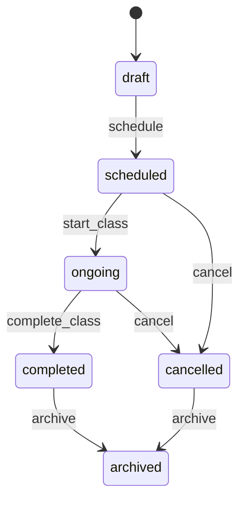

| State | Keterangan | Enrollment baru | Aktivitas belajar |
|---|---|---:|---:|
| `draft` | Kelas belum siap | Tidak | Tidak |
| `scheduled` | Jadwal kelas ditetapkan | Sesuai periode enrollment | Belum/sesuai konfigurasi |
| `ongoing` | Kelas sedang berjalan | Sesuai kebijakan | Ya |
| `completed` | Kelas selesai | Tidak | Read-only sesuai kebijakan |
| `cancelled` | Kelas dibatalkan | Tidak | Tidak, kecuali akses arsip |
| `archived` | Arsip operasional | Tidak | Read-only administrasi |

Transition:

| Dari | Trigger | Ke | Actor | Guard |
|---|---|---|---|---|
| `draft` | `schedule` | `scheduled` | Trainer/Admin | Jadwal, quota, trainer/evaluator, dan materi minimum valid |
| `scheduled` | `start_class` | `ongoing` | Trainer/Admin/System | Waktu mulai tercapai atau action manual berizin |
| `scheduled` | `cancel` | `cancelled` | Admin | Alasan pembatalan wajib |
| `ongoing` | `complete_class` | `completed` | Trainer/Admin | Periode selesai atau penutupan manual berizin |
| `ongoing` | `cancel` | `cancelled` | Admin | Alasan pembatalan wajib |
| `completed` | `archive` | `archived` | Admin | Histori dipertahankan |
| `cancelled` | `archive` | `archived` | Admin | Catatan pembatalan tersedia |

## 6.3 Enrollment

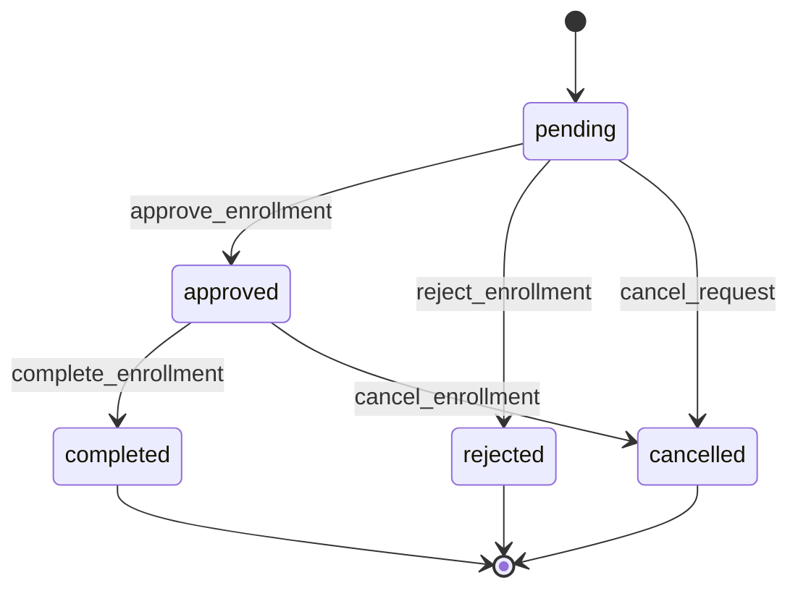

`final_status` memiliki lifecycle terpisah:

```text
in_progress → passed
in_progress → failed
in_progress → withdrawn
```

| Transition | Actor | Guard |
|---|---|---|
| `pending → approved` | Operator/Trainer/Admin | Kelas membuka enrollment, kuota tersedia, syarat peserta terpenuhi |
| `pending → rejected` | Operator/Admin | Alasan wajib |
| `pending → cancelled` | Peserta/Operator | Belum diproses atau sesuai kebijakan |
| `approved → completed` | System/Trainer/Admin | Kelas selesai atau peserta memenuhi proses selesai |
| `approved → cancelled` | Peserta/Operator/Admin | Sesuai kebijakan pembatalan |
| `in_progress → passed` | GradingService/Admin | Final grade memenuhi passing grade |
| `in_progress → failed` | GradingService/Admin | Final grade di bawah passing grade |
| `in_progress → withdrawn` | Operator/Admin | Peserta mengundurkan diri atau enrollment dibatalkan |

## 6.4 Lesson Progress

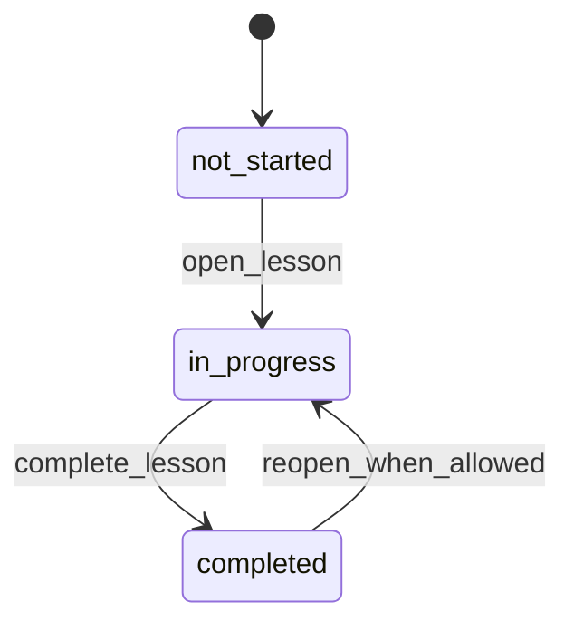

Status `not_started` tidak harus disimpan sebagai record. Record `learning_progress` dibuat saat lesson pertama kali dibuka.

| Kondisi | Representasi |
|---|---|
| Belum mulai | Tidak ada record progress |
| Sedang dipelajari | `started_at` terisi, `completed_at` NULL |
| Selesai | `completed_at` terisi |

## 6.5 Quiz Attempt

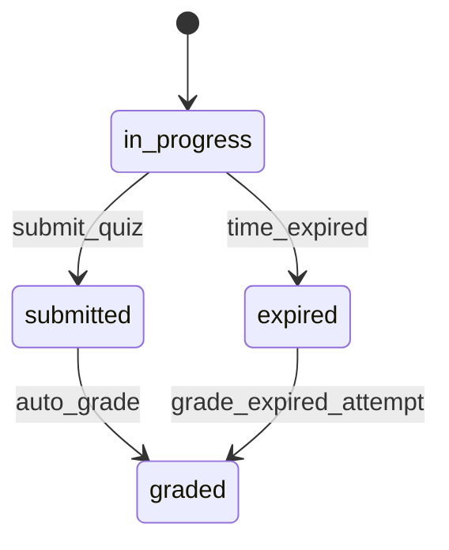

| State | Keterangan |
|---|---|
| `in_progress` | Peserta mengerjakan quiz |
| `submitted` | Jawaban terkunci setelah submit |
| `graded` | Nilai otomatis/final tersedia |
| `expired` | Waktu attempt habis sebelum submit |

Guard utama:

- Enrollment peserta harus `approved`.
- Kelas/quiz harus berada dalam periode yang diizinkan.
- Attempt belum melampaui `attempt_limit`.
- Peserta hanya dapat mengubah jawaban ketika attempt `in_progress`.
- Jawaban tidak dapat diubah setelah `submitted`, `graded`, atau `expired`.

## 6.6 Assignment Submission

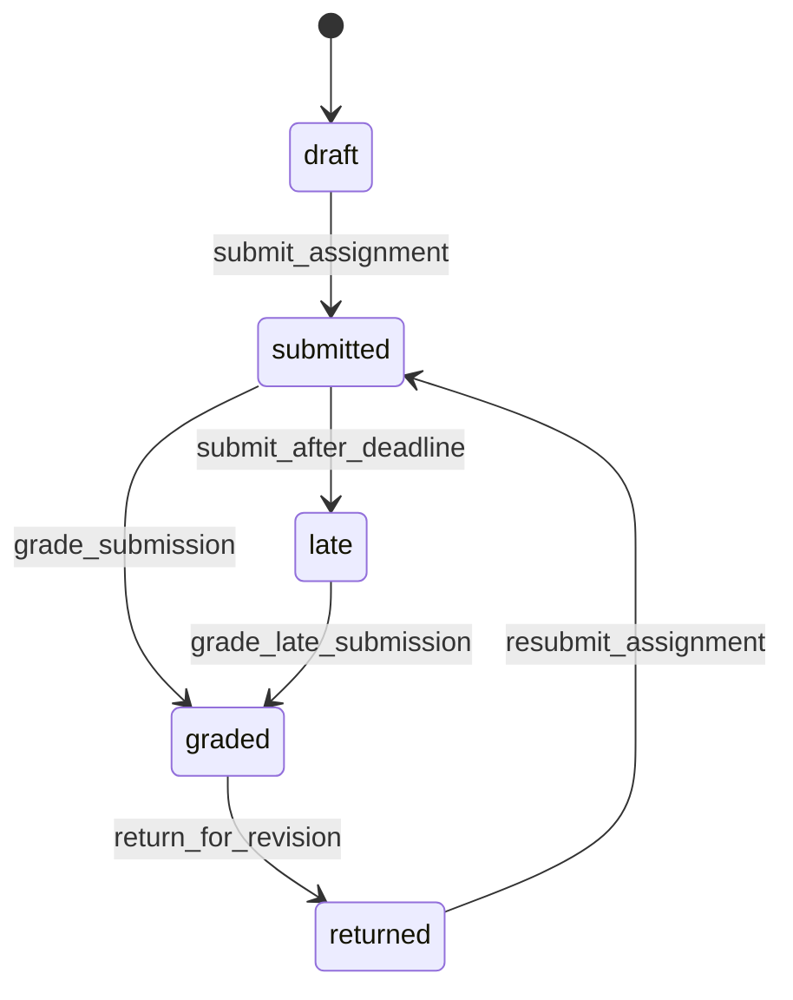

| State | Keterangan |
|---|---|
| `draft` | Peserta menyimpan jawaban tanpa submit |
| `submitted` | Jawaban terkirim sebelum deadline |
| `late` | Jawaban dikirim melewati deadline dengan izin |
| `graded` | Evaluator memberi nilai |
| `returned` | Evaluator meminta perbaikan/revisi |

Guard:

- Submission harus berasal dari enrollment yang sah.
- `allow_late_submission` harus aktif untuk transition ke `late`.
- Evaluator harus ditugaskan pada kelas atau memiliki permission grading.
- Nilai tidak boleh melebihi `assignments.max_score`.

## 6.7 Final Grade dan Kelulusan

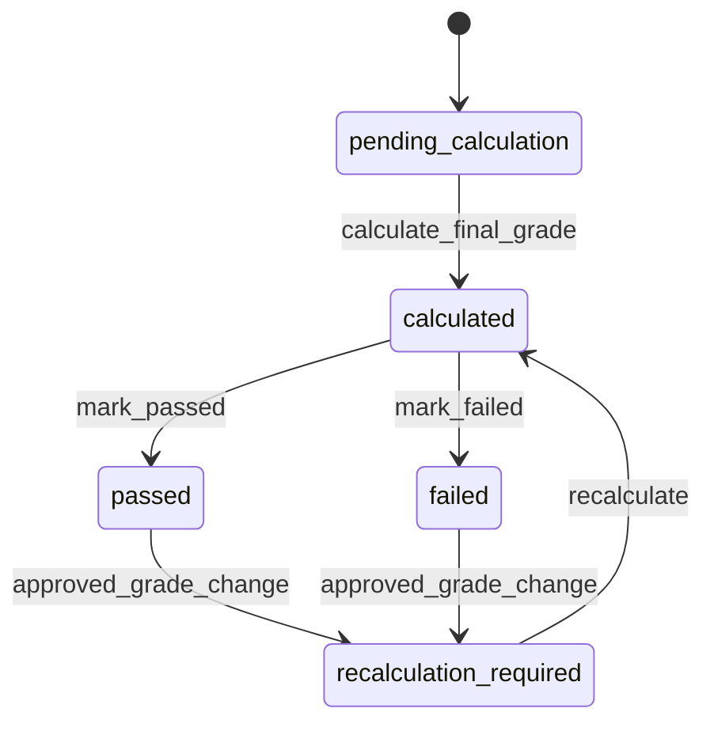

Aturan:

```text
final_score = (quiz_score × quiz_weight)
            + (assignment_score × assignment_weight)
```

Transition ke `passed` atau `failed` ditentukan berdasarkan:

```text
final_score >= learning_classes.passing_grade → passed
final_score <  learning_classes.passing_grade → failed
```

Perubahan nilai setelah kelulusan harus memiliki permission khusus, alasan, audit log, dan perhitungan ulang.

---

# 7. Bunga Rampai State Machines

Artikel, studi kasus, template dokumen, dan FAQ menggunakan workflow konten.

## 7.1 Artikel dan studi kasus

```text
draft → submitted → in_review → approved → published
```

State `revision_required`, `rejected`, dan `archived` mengikuti aturan workflow konten umum.

## 7.2 Template dokumen

Template dokumen memiliki guard tambahan:

```text
- Metadata template lengkap.
- Kategori tersedia.
- File asset tersedia atau status placeholder diizinkan untuk draft.
- File wajib tersedia sebelum transition ke published.
- File path tidak boleh NULL saat template published dan downloadable.
```

## 7.3 FAQ

FAQ dapat menggunakan workflow yang sama, tetapi konfigurasi dapat menyederhanakan approval untuk konten berisiko rendah.

```text
draft → published
```

Penyederhanaan hanya diperbolehkan bila tetap ada audit dan permission publish yang jelas.

---

# 8. Regulasi PBJ State Machines

## 8.1 Regulasi

Regulasi memiliki dua dimensi state:

```text
workflow_status  → lifecycle pengelolaan/publikasi metadata
legal_status     → status hukum regulasi
```

### Workflow metadata

```text
draft → submitted → in_review → approved → published
```

### Status hukum

```text
active
amended
revoked
expired
```

Perubahan `legal_status` tidak sama dengan archive workflow. Regulasi yang dicabut dapat tetap `published` agar menjadi referensi publik dengan penanda status hukum `revoked`.

## 8.2 Versi regulasi

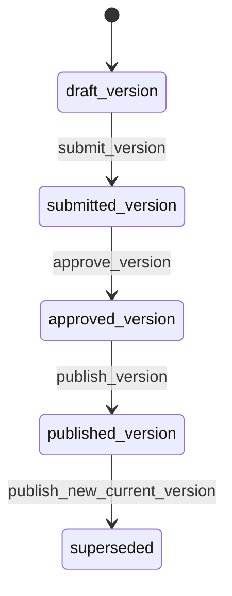

Aturan versi:

- Satu regulasi dapat memiliki banyak versi.
- Hanya satu versi dapat memiliki `is_current = 1`.
- Saat versi baru dipublish sebagai current, versi sebelumnya menjadi `is_current = 0` dalam satu transaction.
- Dokumen regulasi published harus memiliki `file_asset_id` yang mengarah ke file fisik tersedia (`file_assets.path IS NOT NULL`).
- Versi lama tetap dipertahankan untuk histori.

## 8.3 Download regulasi

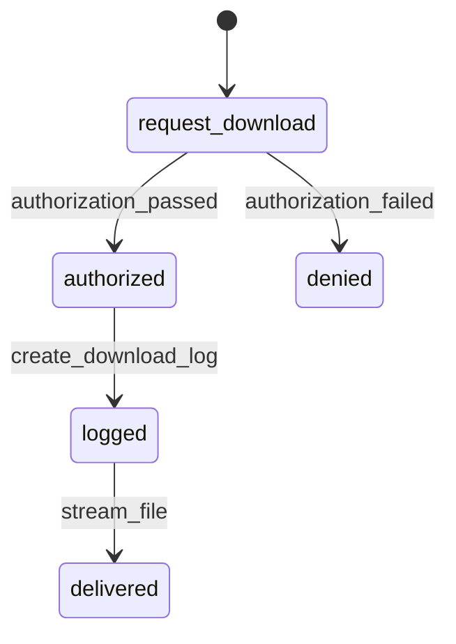

Jika file asset memiliki `path = NULL`, transition `authorized → logged` tidak boleh dilakukan; sistem mengembalikan status file belum tersedia.

---

# 9. Berita dan Event State Machines

## 9.1 Berita

Berita menggunakan workflow konten umum:

```text
draft → submitted → in_review → approved → published → archived
```

## 9.2 Event lifecycle

Event memiliki dua dimensi:

```text
workflow_status  → approval dan publikasi
 event_status    → keadaan operasional event
```

### Event operational state

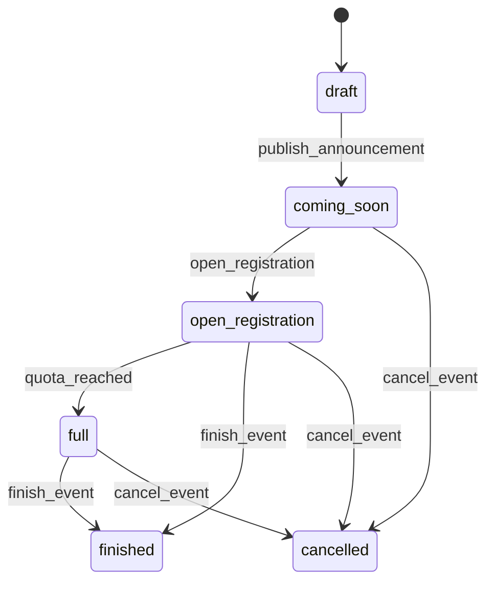

| Event state | Keterangan | Registrasi |
|---|---|---:|
| `draft` | Event belum siap/publik | Tidak |
| `coming_soon` | Informasi event tersedia | Tidak |
| `open_registration` | Pendaftaran dibuka | Ya |
| `full` | Kuota penuh | Waitlist/ditutup sesuai kebijakan |
| `finished` | Event telah selesai | Tidak |
| `cancelled` | Event dibatalkan | Tidak |

Guard event:

- `start_at` wajib tersedia.
- `end_at` harus sama atau setelah `start_at` bila diisi.
- Pendaftaran hanya dapat dibuka setelah event published.
- Quota diperiksa dalam transaction saat registrasi.
- Pembatalan event wajib memiliki alasan dan notifikasi peserta.

## 9.3 Event Registration

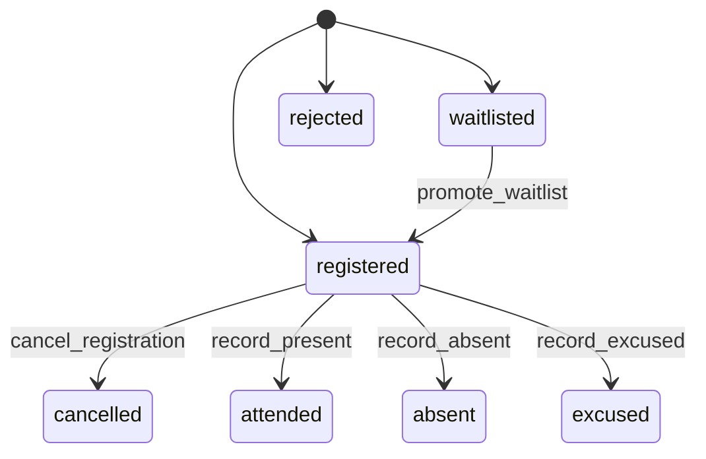

Tabel menyimpan `registration_status` dan `event_attendances` terpisah.

### Registration status

```text
registered
waitlisted
cancelled
rejected
```

### Attendance status

```text
present
absent
excused
```

Sertifikat event hanya dapat dievaluasi bila event telah `finished`, registrasi valid, dan absensi memenuhi kebijakan event.

---

# 10. Sertifikat Digital State Machine

Sertifikat memiliki lifecycle yang ketat karena menjadi bukti resmi.

## 10.1 Diagram sertifikat

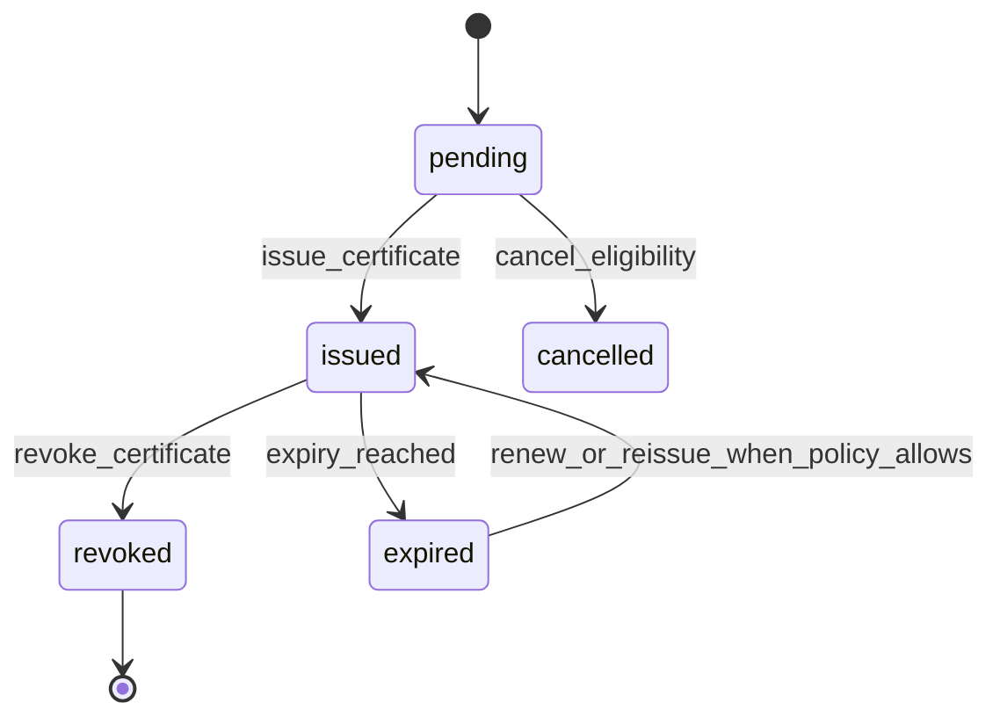

## 10.2 State sertifikat

| State | Keterangan | Verifikasi publik |
|---|---|---:|
| `pending` | Eligibility sedang diproses | Menampilkan belum diterbitkan |
| `issued` | Sertifikat resmi diterbitkan | Valid |
| `revoked` | Sertifikat dibatalkan | Tidak valid, tampilkan revoked |
| `expired` | Masa berlaku berakhir | Tidak valid/expired sesuai kebijakan |
| `cancelled` | Eligibility dibatalkan sebelum penerbitan | Tidak valid |

`cancelled` dapat disimpan sebagai state aplikasi atau sebagai catatan approval bila diperlukan oleh konfigurasi database.

## 10.3 Eligibility sertifikat pembelajaran

Sumber:

```text
source_type = learning_enrollment
source_id   = enrollments.id
```

Guard penerbitan:

```text
- Enrollment berstatus approved/completed sesuai kebijakan.
- Final grade tersedia.
- final_grades.is_passed = true.
- Tidak ada sertifikat lain untuk source yang sama.
- Template sertifikat aktif tersedia.
- Recipient user aktif dan valid.
```

## 10.4 Eligibility sertifikat event

Sumber:

```text
source_type = event_registration
source_id   = event_registrations.id
```

Guard penerbitan:

```text
- Event certificate_enabled = true.
- Event status = finished.
- Registration status = registered.
- Attendance status = present atau memenuhi aturan event.
- Tidak ada sertifikat lain untuk source yang sama.
- Template event aktif tersedia.
```

## 10.5 Penerbitan sertifikat

Transition `pending → issued` wajib dijalankan dalam transaction:

```text
1. Validasi eligibility.
2. Lock atau update certificate sequence.
3. Bangun certificate_number unik.
4. Buat certificate record dan verification_token unik.
5. Generate PDF/file bila layanan file tersedia.
6. Perbarui file_asset_id jika PDF berhasil dibuat.
7. Buat audit log.
8. Kirim notifikasi penerbitan.
9. Commit transaction.
```

Constraint database:

```text
UNIQUE(certificate_number)
UNIQUE(verification_token)
UNIQUE(source_type, source_id)
```

## 10.6 Reissue file sertifikat

Pembuatan ulang file PDF tidak membuat sertifikat baru dan tidak mengubah `source_type + source_id`.

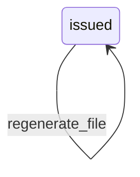

Guard:

- Actor memiliki `certificate.reissue`.
- Sertifikat masih `issued` atau sesuai kebijakan expired.
- Alasan reissue dicatat.
- File asset baru/versi file dicatat.
- Audit log dibuat.

## 10.7 Revocation

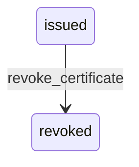

Guard:

```text
- Actor memiliki certificate.revoke.
- Alasan revocation wajib.
- certificate_revocations dibuat satu kali.
- Status certificates diubah ke revoked.
- Halaman publik menampilkan status revoked.
- Audit dan notifikasi dibuat.
```

Sertifikat revoked tidak dihapus fisik sebagai bukti histori.

## 10.8 Public verification

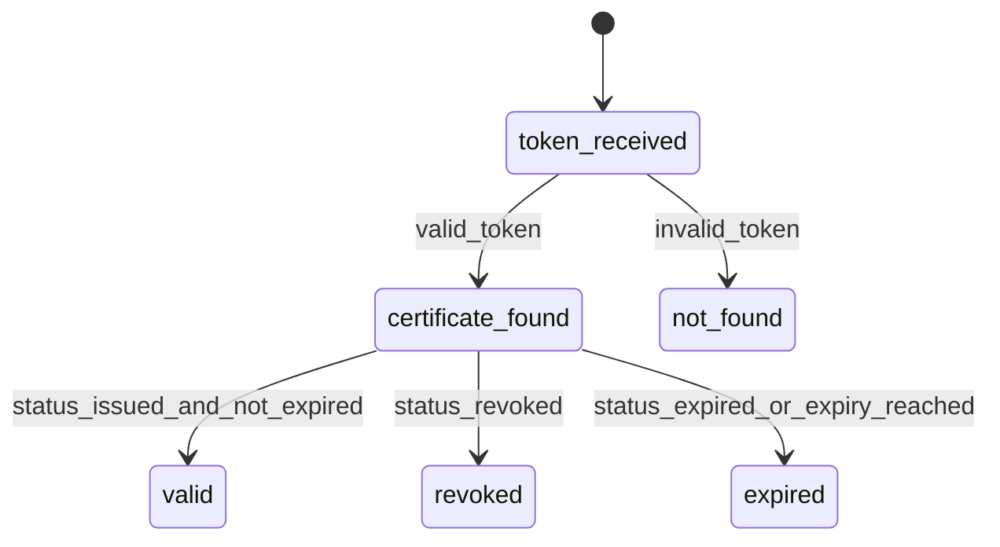

Hasil verifikasi publik:

```text
valid
revoked
expired
not_found
```

Data minimum yang dapat ditampilkan publik ditentukan oleh kebijakan privasi, misalnya nomor sertifikat, nama penerima yang dimasking bila diperlukan, jenis kegiatan, tanggal terbit, dan status validitas. Jangan menampilkan NIP/NIK atau data internal lain.

---

# 11. Government Intelligence State Machines

## 11.1 JF PPBJ Personnel

Status personel:

```text
active
inactive
retired
transferred
```

Perubahan status tidak menghapus data personel. Setiap perubahan membuat `jf_ppbj_histories`.

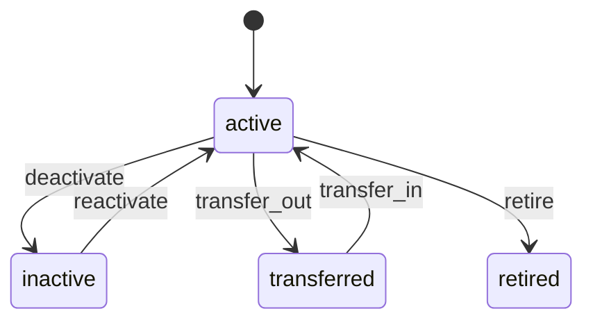

Jenis histori:

```text
added
transferred_in
transferred_out
promoted
retired
deactivated
updated
```

Guard:

- OPD/unit tujuan harus aktif.
- Jenjang tujuan harus aktif bila terdapat perubahan jenjang.
- Effective date wajib tersedia.
- Actor memiliki `intelligence.jf_ppbj.manage`.
- Perubahan dicatat pada audit log.

## 11.2 Sertifikat Kompetensi PBJ

Status sertifikat kompetensi:

```text
unknown
active
expired
revoked
```

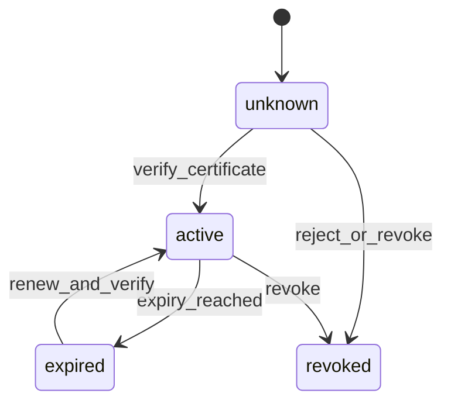

Guard:

```text
- Jenis sertifikat tersedia dan aktif.
- Nomor sertifikat unik pada jenis yang sama.
- Bukti file tersedia jika kebijakan mewajibkan.
- Verifikator memiliki intelligence.competency.manage.
- Tanggal expired tidak boleh lebih awal dari issued_at.
```

## 11.3 Competency Gap Snapshot

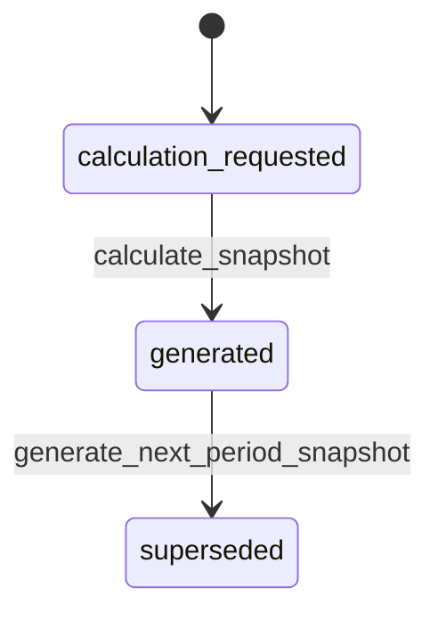

Guard:

```text
- OPD/unit tersedia.
- Period date valid.
- Metric code valid.
- required_count dan available_count tersedia.
- gap_count = required_count - available_count.
- Actor memiliki intelligence.snapshot.generate.
```

Snapshot bersifat agregat dan tidak mengubah data personel atau sertifikat sumber.

---

# 12. File Availability State

Metadata file dan ketersediaan file fisik diperlakukan sebagai kondisi terpisah.

## 12.1 Status implisit file

| Kondisi `file_assets` | Status efektif | Aksi download |
|---|---|---|
| Record ada, `path IS NULL` | Placeholder / belum tersedia | Ditolak; tampilkan File belum tersedia |
| Record ada, `path` terisi tetapi file fisik tidak ada | Broken storage reference | Ditolak; log error dan tandai untuk perbaikan |
| Record ada, `path` terisi dan file fisik ada | Available | Periksa authorization lalu stream file |
| `deleted_at` terisi | Archived/deleted metadata | Ditolak kecuali recovery admin |

## 12.2 File upload lifecycle

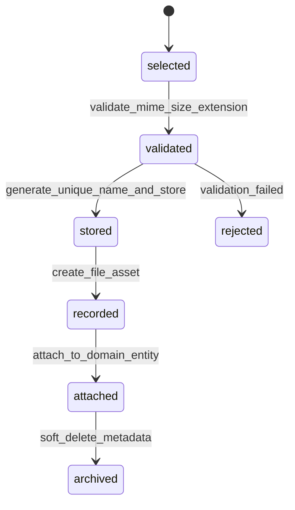

Validasi minimal:

```text
- MIME type tervalidasi.
- Ekstensi sesuai kebijakan domain.
- Ukuran sesuai batas domain.
- Nama fisik unik.
- Path tidak dibentuk dari input user.
- Authorization upload dipastikan.
```

---

# 13. Notifikasi Workflow

| Peristiwa | Penerima | Channel minimum |
|---|---|---|
| Registrasi akun pending | Operator/Admin | In-app/email |
| Registrasi akun approved/rejected | Applicant | In-app/email |
| Konten submitted | Reviewer | In-app |
| Konten revision required/rejected | Author | In-app/email |
| Konten published | Author | In-app |
| Enrollment approved/rejected | Peserta | In-app/email |
| Assignment submitted | Evaluator | In-app |
| Assignment graded/returned | Peserta | In-app/email |
| Event registration berubah | Peserta | In-app/email |
| Event cancelled | Semua peserta terdaftar | In-app/email |
| Certificate issued | Penerima | In-app/email |
| Certificate revoked | Penerima dan Admin | In-app/email |
| Sertifikat kompetensi akan expired | Pengelola berizin | In-app/email |

Notifikasi tidak boleh menjadi satu-satunya sumber kebenaran. State entity dan histori database tetap menjadi sumber status utama.

---

# 14. Audit Requirements

Aksi berikut wajib menghasilkan audit log:

```text
- Login sukses/gagal sesuai kebijakan log.
- Perubahan status akun.
- Penugasan/pencabutan role.
- Perubahan permission atau konfigurasi.
- Submit, approve, reject, publish, archive, dan unpublish konten.
- Approval enrollment.
- Perubahan nilai final dan status kelulusan.
- Penerbitan, reissue, dan revocation sertifikat.
- Upload atau penghapusan dokumen penting.
- Perubahan data JF PPBJ dan sertifikat kompetensi.
- Export laporan intelligence atau data terbatas.
```

Audit log minimum:

```text
action
actor_user_id
subject_type
subject_id
before_data
after_data
context_data
route_name
request_id
ip_address
created_at
```

---

# 15. Error Handling dan Idempotency

## 15.1 Transition tidak valid

Jika transition tidak diizinkan, aplikasi harus:

```text
1. Menolak request dengan HTTP 422 atau 403 sesuai penyebab.
2. Tidak mengubah state entity.
3. Tidak membuat approval history palsu.
4. Mengembalikan pesan yang jelas tanpa membocorkan data sensitif.
5. Mencatat audit security event bila ada indikasi akses tidak sah.
```

## 15.2 Aksi idempotent

Aksi berikut harus dirancang idempotent atau terlindungi unique constraint:

| Aksi | Proteksi |
|---|---|
| Enrollment peserta | `UNIQUE(user_id, learning_class_id)` |
| Event registration | `UNIQUE(event_id, user_id)` |
| Quiz attempt nomor | `UNIQUE(quiz_id, enrollment_id, attempt_number)` |
| Assignment submission attempt | `UNIQUE(assignment_id, enrollment_id, attempt_number)` |
| Final grade | `UNIQUE(enrollment_id)` |
| Sertifikat | `UNIQUE(source_type, source_id)` |
| Sertifikat nomor | `UNIQUE(certificate_number)` |
| Token verifikasi | `UNIQUE(verification_token)` |
| Absensi event | `UNIQUE(event_registration_id)` |
| Revocation sertifikat | `UNIQUE(certificate_id)` |

## 15.3 Concurrency

Proses berikut wajib memakai transaction dan locking/atomic update bila diperlukan:

```text
- Pengisian quota event.
- Approval enrollment ketika quota terbatas.
- Pembuatan quiz attempt number.
- Kalkulasi final grade.
- Pengambilan certificate sequence.
- Penerbitan certificate record.
- Menetapkan regulation version sebagai current.
- Pembuatan gap snapshot unik per periode/metrik.
```

---

# 16. State Constants

State dan transition sebaiknya disimpan sebagai constant atau enum aplikasi agar tidak tersebar sebagai string bebas.

```text
app/Domain/Shared/WorkflowStatus.php
app/Domain/Learning/LearningClassStatus.php
app/Domain/Learning/EnrollmentStatus.php
app/Domain/Learning/FinalStatus.php
app/Domain/Learning/QuizAttemptStatus.php
app/Domain/Learning/SubmissionStatus.php
app/Domain/Communication/EventStatus.php
app/Domain/Certificate/CertificateStatus.php
app/Domain/Intelligence/PersonnelStatus.php
app/Domain/Intelligence/CompetencyCertificateStatus.php
```

Jika folder `Domain/` digunakan untuk enum/value object, folder tersebut hanya berisi objek domain ringan. Controller, model, service, dan view tetap mengikuti arsitektur utama `App\...` yang ditetapkan.

---

# 17. Checklist Implementasi

- Setiap workflow memiliki state list dan transition map yang eksplisit.
- Setiap transition memiliki permission, actor scope, guard, dan catatan bila wajib.
- `ApprovalService` menangani workflow konten lintas domain.
- Service domain menangani lifecycle operasional spesifik: kelas, enrollment, quiz, assignment, event, sertifikat, dan intelligence.
- Semua transition penting memakai database transaction.
- Semua transisi state penting membuat history atau audit record.
- Notifikasi dipicu setelah transaction berhasil commit.
- UI hanya menampilkan aksi yang mungkin, tetapi server tetap memvalidasi semua transition.
- State published/issued tidak dihapus fisik tanpa prosedur archive/revoke resmi.
- File `path = NULL` tidak dapat diperlakukan sebagai berkas tersedia.
- Test mencakup transition valid, transition terlarang, permission, ownership, concurrency, dan audit.

---

# 18. Ringkasan Alur Utama

```text
Konten
Draft → Submit → Review → Approve → Publish → Archive

Registrasi
Pending → Active / Rejected / Suspended

Kelas
Draft → Scheduled → Ongoing → Completed → Archived

Enrollment
Pending → Approved → Completed
                    ↓
               Passed / Failed / Withdrawn

Quiz
In Progress → Submitted → Graded

Assignment
Draft → Submitted/Late → Graded → Returned → Resubmitted

Event
Draft → Coming Soon → Open Registration → Full → Finished
                                      ↓
                                  Cancelled

Sertifikat
Pending → Issued → Revoked / Expired

JF PPBJ
Active → Inactive / Transferred / Retired

Sertifikat Kompetensi
Unknown → Active → Expired / Revoked
```

Workflow state machine memastikan proses BegawiPBJ dapat berjalan konsisten, aman, transparan, dan dapat dipertanggungjawabkan pada seluruh ekosistem PBJ Pemerintah Provinsi Lampung.
