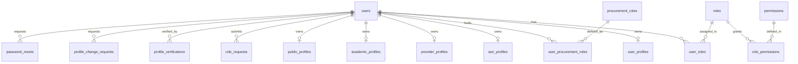
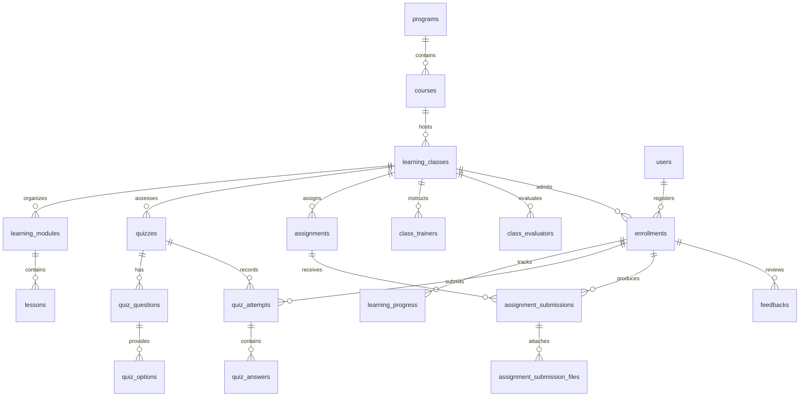
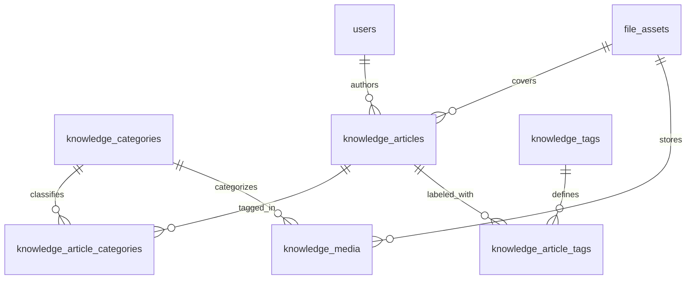
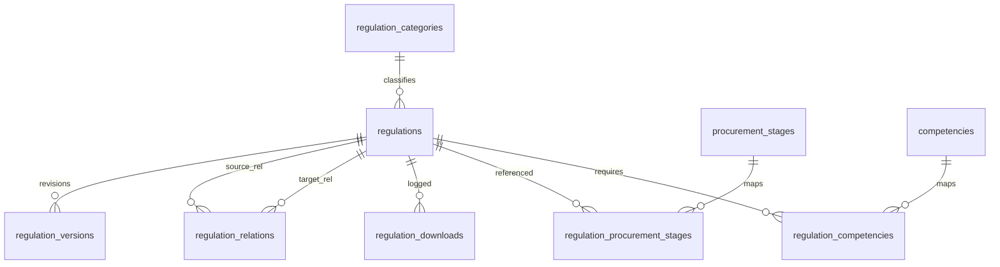
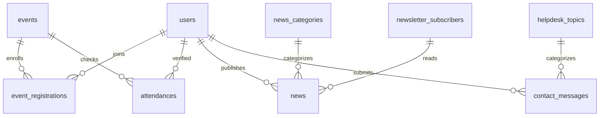
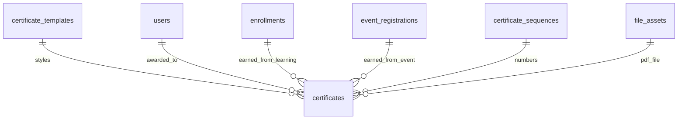
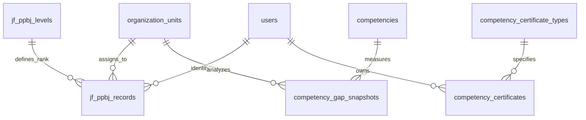
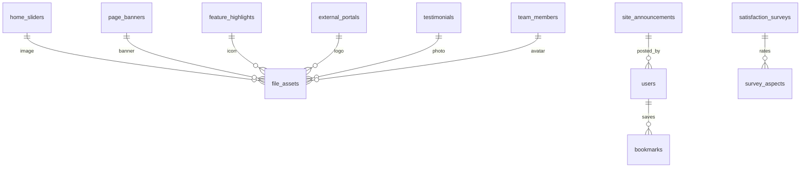
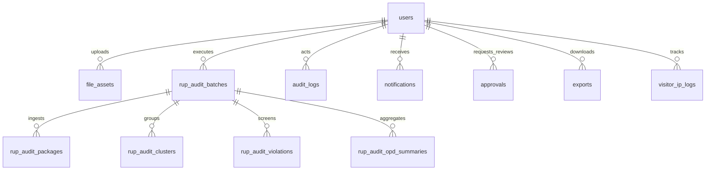

# BegawiPengadaan — Database Entity Relationship Diagram (ERD)

> **Metadata Dokumen:**
> - **Versi:** 4.2 (Production Ready)
> - **Tanggal Sinkronisasi:** 7 November 2026
> - **Sumber Kebenaran:** MySQL Live `db_begawipbj` (95 Tabel, 1.127 Kolom, 22 CHECK Constraints, 17 Migrasi) & Codebase Aktual

---

## 1. Pendahuluan & Prinsip ERD Modular

Diagram Relasi Entitas (*Entity-Relationship Diagram* / ERD) BegawiPengadaan mendokumentasikan pemetaan struktural 95 tabel pada basis data `db_begawipbj`. Mengingat kompleksitas 157 relasi Foreign Key yang saling terhubung, dokumentasi ini dipecah menjadi **9 Sub-Diagram Domain** berbasis sintaks resmi **Mermaid (`erDiagram`)** agar mudah dipahami, dirender secara interaktif, dan dijadikan acuan pengembang.

---

## 2. Sub-Diagram 1: Identity, Multi-Profile & RBAC Engine

---

## 3. Sub-Diagram 2: Learning Management System (LMS) & Assessment

---

## 4. Sub-Diagram 3: Knowledge Management System (KMS) & Bunga Rampai

---

## 5. Sub-Diagram 4: Naskah Hukum & Regulasi PBJ

---

## 6. Sub-Diagram 5: Events, Agendas, Presensi & Komunikasi Publik

---

## 7. Sub-Diagram 6: Master Sertifikat & Tanda Tangan Elektronik (TTE)

---

## 8. Sub-Diagram 7: Government Intelligence & SDM Fungsional PBJ

---

## 9. Sub-Diagram 8: Landing CMS & Interaksi Publik

---

## 10. Sub-Diagram 9: Central File Storage & Automated RUP Audit Engine

---

## 11. Kesimpulan Integritas Relasi

Seluruh 95 tabel memiliki relasi terarah tanpa adanya tabel 'yatim piatu' (*orphan table*). Penggunaan konvensi `id` (Auto-Increment) dan Foreign Key bertipe data identik menjamin kinerja indeks optimal, integritas referensial terjaga, dan isolasi privasi data terjamin secara menyeluruh.
