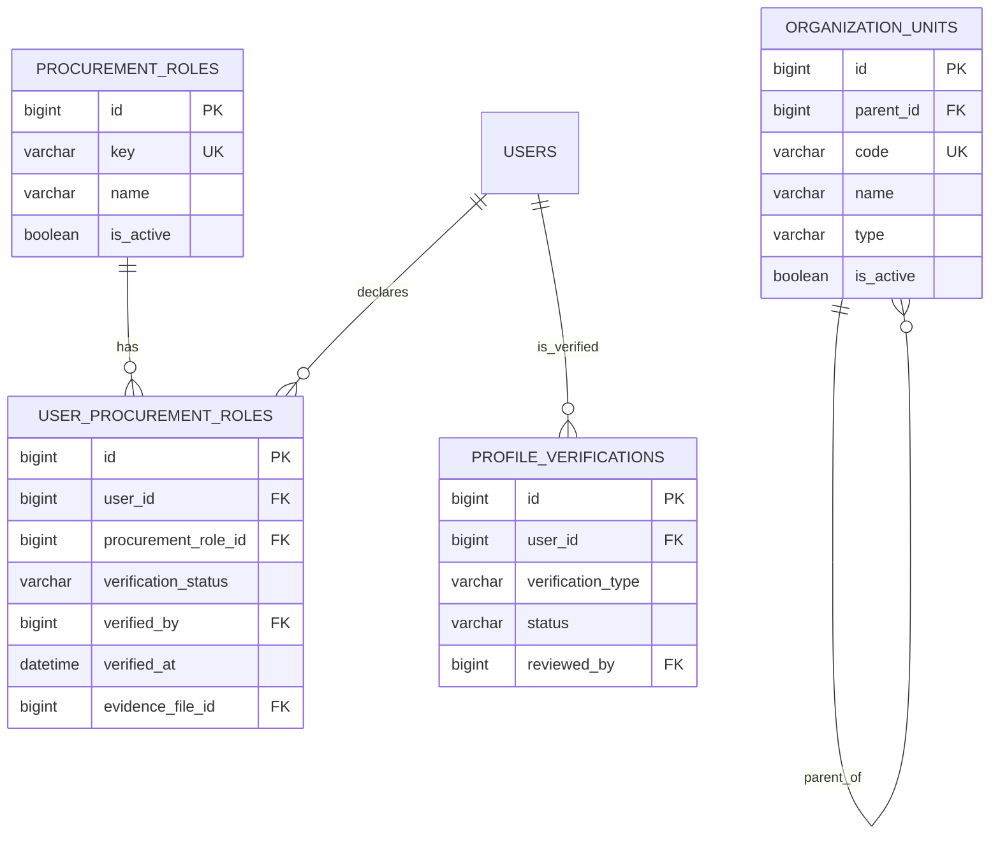
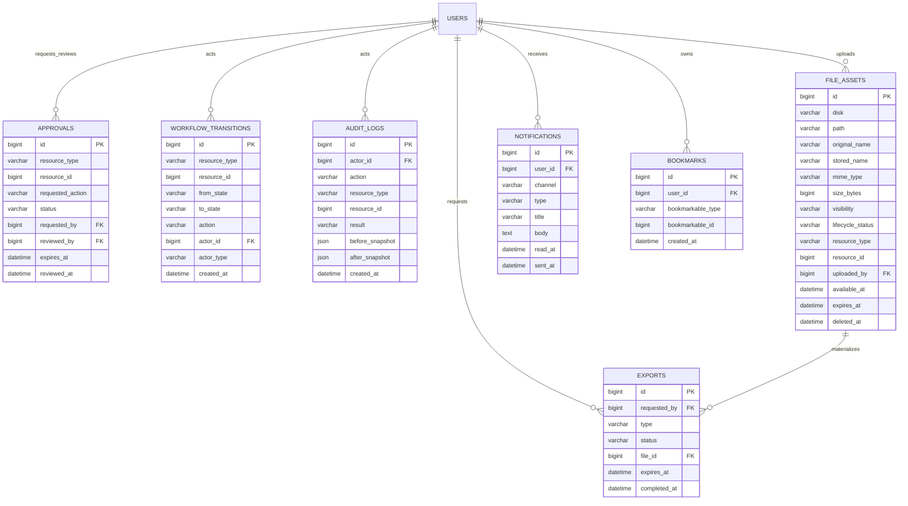
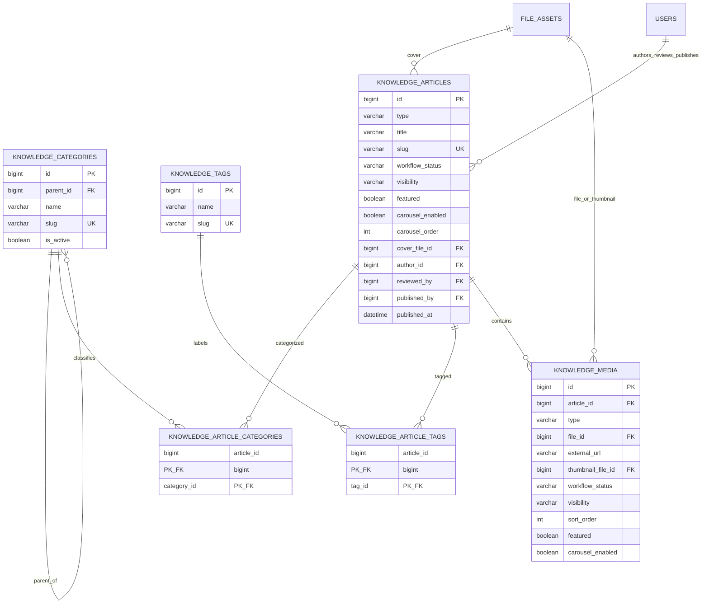
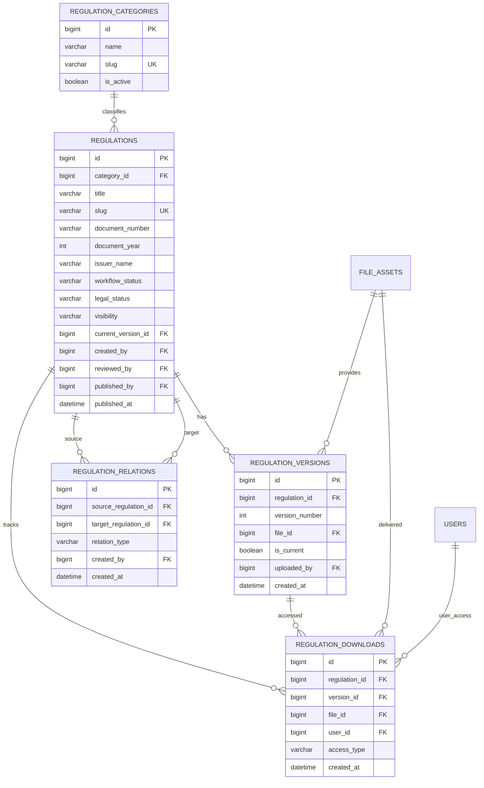
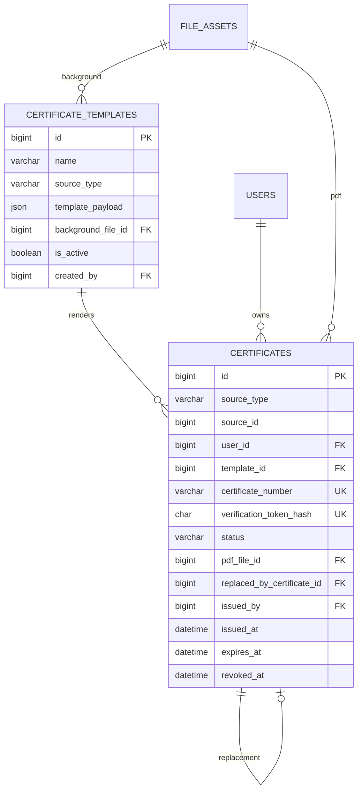
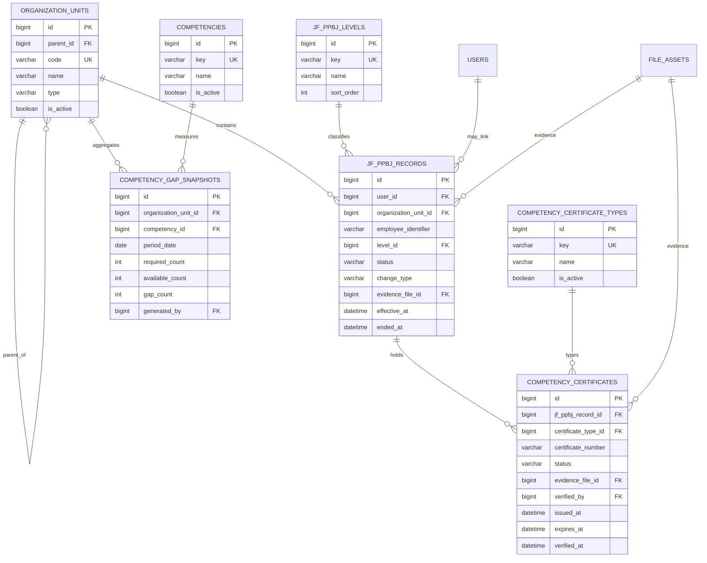

# BegawiPengadaan — Database ERD

## Tujuan

Dokumen ini menyajikan Entity Relationship Diagram (ERD) konseptual dan relasional untuk BegawiPengadaan. ERD ini menjelaskan entitas, hubungan, kardinalitas, ownership, pivot table, serta batas domain database.

Dokumen ini merupakan visualisasi dan penjelasan relasi dari `dokumen/database-blueprint.md`. Dokumen ini melengkapi dan tidak mengubah kontrak yang telah ditetapkan dalam:

```text
README.md
dokumen/directory-tree.md
dokumen/route-contract.md
dokumen/ui-boundary.md
dokumen/auth-and-rbac.md
dokumen/workflow-contract.md
dokumen/file-storage-policy.md
dokumen/database-blueprint.md
```

Nama tabel, status, constraint, tipe kolom, index, dan migration order yang bersifat definitif mengikuti Database Blueprint. ERD berfokus pada hubungan dan struktur konseptual agar implementasi migration, model, service, dan query memiliki pemahaman relasional yang sama.

---

## Konvensi ERD

```text
A ||--o{ B
A memiliki tepat satu atau lebih B, bergantung pada FK/nullable.

A ||--|| B
A memiliki tepat satu B.

A }o--o{ B
Relasi many-to-many melalui tabel pivot.

PK
Primary Key.

FK
Foreign Key.

UK
Unique Key/constraint.

Nullable
Relasi dapat belum tersedia atau opsional.
```

Pada diagram Mermaid, notasi berikut digunakan:

```text
||--||  one-to-one
||--o{  one-to-many
}o--o{  many-to-many konseptual; implementasi menggunakan pivot table
```

---

## Peta Domain

```text
Identity dan RBAC
├── User, Profile, Role, Permission, Role Request, Token
├── Organisasi, Peran Pengadaan, Profile Verification/Change
└── Account lifecycle, authorization, assignment

Shared Governance
├── Approval, Workflow Transition, Audit Log
├── File Asset, Export, Notification, Bookmark
└── Ownership, visibility, lifecycle file

Arena Belajar
├── Program, Course, Class, Module, Lesson
├── Enrollment, Trainer/Evaluator assignment
├── Quiz, Attempt, Answer, Assignment, Submission, Grade
├── Progress dan Feedback
└── Certificate eligibility source

Bunga Rampai
├── Knowledge Article/FAQ/Case Study/Template
├── Category, Tag, Media
└── Publication, carousel, bookmark

Regulasi
├── Regulation, Category, Version, Relation
├── Download log dan Bookmark
└── Workflow/editorial status serta legal status

Communication
├── News dan Category
├── Event, Registration, Attendance
└── Certificate eligibility source

Certificate
├── Certificate Template
└── Certificate dari Learning Enrollment atau Event Registration

Government Intelligence
├── Organization Unit
├── JF PPBJ Record dan Level
├── Competency, Competency Certificate Type/Record
└── Competency Gap Snapshot
```

---

## ERD Tingkat Tinggi

```mermaid
erDiagram
    USERS ||--|| USER_PROFILES : has
    USERS ||--o| ASN_PROFILES : may_have
    USERS ||--o| PROVIDER_PROFILES : may_have
    USERS ||--o| ACADEMIC_PROFILES : may_have
    USERS ||--o| PUBLIC_PROFILES : may_have

    USERS ||--o{ USER_ROLES : receives
    ROLES ||--o{ USER_ROLES : assigned_to
    ROLES ||--o{ ROLE_PERMISSIONS : grants
    PERMISSIONS ||--o{ ROLE_PERMISSIONS : included_in

    USERS ||--o{ ROLE_REQUESTS : submits
    ROLES ||--o{ ROLE_REQUESTS : requested_for
    USERS ||--o{ PROFILE_CHANGE_REQUESTS : submits
    USERS ||--o{ PROFILE_VERIFICATIONS : subject_of

    ORGANIZATION_UNITS ||--o{ ASN_PROFILES : contains
    ORGANIZATION_UNITS ||--o{ JF_PPBJ_RECORDS : contains
    USERS ||--o{ USER_PROCUREMENT_ROLES : declares
    PROCUREMENT_ROLES ||--o{ USER_PROCUREMENT_ROLES : selected

    USERS ||--o{ FILE_ASSETS : uploads
    FILE_ASSETS ||--o{ EXPORTS : materializes
    USERS ||--o{ EXPORTS : requests
    USERS ||--o{ NOTIFICATIONS : receives
    USERS ||--o{ BOOKMARKS : owns

    PROGRAMS ||--o{ COURSES : contains
    COURSES ||--o{ LEARNING_CLASSES : offers
    LEARNING_CLASSES ||--o{ LEARNING_MODULES : contains
    LEARNING_MODULES ||--o{ LESSONS : contains
    LEARNING_CLASSES ||--o{ ENROLLMENTS : has
    USERS ||--o{ ENROLLMENTS : joins
    LEARNING_CLASSES ||--o{ CLASS_TRAINERS : assigns
    LEARNING_CLASSES ||--o{ CLASS_EVALUATORS : assigns
    USERS ||--o{ CLASS_TRAINERS : teaches
    USERS ||--o{ CLASS_EVALUATORS : evaluates

    LEARNING_CLASSES ||--o{ QUIZZES : provides
    LESSONS ||--o{ QUIZZES : may_have
    QUIZZES ||--o{ QUIZ_QUESTIONS : has
    QUIZ_QUESTIONS ||--o{ QUIZ_OPTIONS : has
    QUIZZES ||--o{ QUIZ_ATTEMPTS : receives
    ENROLLMENTS ||--o{ QUIZ_ATTEMPTS : owns
    QUIZ_ATTEMPTS ||--o{ QUIZ_ANSWERS : records

    LEARNING_CLASSES ||--o{ ASSIGNMENTS : provides
    LESSONS ||--o{ ASSIGNMENTS : may_have
    ASSIGNMENTS ||--o{ ASSIGNMENT_SUBMISSIONS : receives
    ENROLLMENTS ||--o{ ASSIGNMENT_SUBMISSIONS : creates
    ASSIGNMENT_SUBMISSIONS ||--o{ ASSIGNMENT_SUBMISSION_FILES : attaches
    FILE_ASSETS ||--o{ ASSIGNMENT_SUBMISSION_FILES : attached_to
    ENROLLMENTS ||--o{ LEARNING_PROGRESS : tracks
    LESSONS ||--o{ LEARNING_PROGRESS : progresses
    ENROLLMENTS ||--o| FEEDBACKS : provides

    KNOWLEDGE_CATEGORIES ||--o{ KNOWLEDGE_CATEGORIES : parent_of
    KNOWLEDGE_ARTICLES ||--o{ KNOWLEDGE_ARTICLE_CATEGORIES : categorizes
    KNOWLEDGE_CATEGORIES ||--o{ KNOWLEDGE_ARTICLE_CATEGORIES : contains
    KNOWLEDGE_ARTICLES ||--o{ KNOWLEDGE_ARTICLE_TAGS : tags
    KNOWLEDGE_TAGS ||--o{ KNOWLEDGE_ARTICLE_TAGS : labels
    KNOWLEDGE_ARTICLES ||--o{ KNOWLEDGE_MEDIA : contains
    FILE_ASSETS ||--o{ KNOWLEDGE_MEDIA : supplies

    REGULATION_CATEGORIES ||--o{ REGULATIONS : classifies
    REGULATIONS ||--o{ REGULATION_VERSIONS : versions
    REGULATIONS ||--o{ REGULATION_RELATIONS : source
    REGULATIONS ||--o{ REGULATION_RELATIONS : target
    FILE_ASSETS ||--o{ REGULATION_VERSIONS : file
    REGULATIONS ||--o{ REGULATION_DOWNLOADS : tracks
    FILE_ASSETS ||--o{ REGULATION_DOWNLOADS : delivered

    NEWS_CATEGORIES ||--o{ NEWS : classifies
    FILE_ASSETS ||--o{ NEWS : cover
    EVENTS ||--o{ EVENT_REGISTRATIONS : receives
    USERS ||--o{ EVENT_REGISTRATIONS : registers
    EVENT_REGISTRATIONS ||--o| ATTENDANCES : records

    CERTIFICATE_TEMPLATES ||--o{ CERTIFICATES : renders
    USERS ||--o{ CERTIFICATES : owns
    FILE_ASSETS ||--o{ CERTIFICATES : stores_pdf

    ORGANIZATION_UNITS ||--o{ JF_PPBJ_RECORDS : contains
    JF_PPBJ_LEVELS ||--o{ JF_PPBJ_RECORDS : classifies
    JF_PPBJ_RECORDS ||--o{ COMPETENCY_CERTIFICATES : holds
    COMPETENCY_CERTIFICATE_TYPES ||--o{ COMPETENCY_CERTIFICATES : types
    ORGANIZATION_UNITS ||--o{ COMPETENCY_GAP_SNAPSHOTS : aggregates
    COMPETENCIES ||--o{ COMPETENCY_GAP_SNAPSHOTS : measures

    USERS ||--o{ APPROVALS : requests_or_reviews
    USERS ||--o{ WORKFLOW_TRANSITIONS : acts
    USERS ||--o{ AUDIT_LOGS : acts
```



Diagram tingkat tinggi menunjukkan relasi utama. Relasi polymorphic pada approval, workflow transition, audit, bookmark, dan file resource dijelaskan pada bagian Shared Governance.

---

## Identity dan RBAC ERD

```mermaid
erDiagram
    USERS {
        bigint id PK
        varchar name
        varchar email UK
        varchar username UK
        varchar password_hash
        varchar phone
        varchar profile_type
        varchar account_status
        datetime email_verified_at
        bigint session_version
        datetime created_at
        datetime updated_at
        datetime deleted_at
    }

    USER_PROFILES {
        bigint id PK
        bigint user_id FK_UK
        varchar province_code
        varchar regency_code
        varchar district_code
        varchar village_code
        text address_line
        varchar profile_completion_status
    }

    ASN_PROFILES {
        bigint id PK
        bigint user_id FK_UK
        bigint organization_unit_id FK
        varchar employee_identifier
        varchar employment_status
        varchar origin_type
        varchar position_name
    }

    PROVIDER_PROFILES {
        bigint id PK
        bigint user_id FK_UK
        varchar business_name
        varchar business_form
        varchar business_identifier
    }

    ACADEMIC_PROFILES {
        bigint id PK
        bigint user_id FK_UK
        varchar institution_name
        varchar institution_type
        varchar role_name
    }

    PUBLIC_PROFILES {
        bigint id PK
        bigint user_id FK_UK
        varchar occupation_status
        varchar organization_name
    }

    ROLES {
        bigint id PK
        varchar key UK
        varchar name
        boolean is_system
    }

    PERMISSIONS {
        bigint id PK
        varchar key UK
        varchar name
        varchar domain
        boolean is_system
    }

    USER_ROLES {
        bigint id PK
        bigint user_id FK
        bigint role_id FK
        varchar status
        bigint granted_by FK
        datetime granted_at
        bigint revoked_by FK
        datetime revoked_at
    }

    ROLE_PERMISSIONS {
        bigint role_id PK_FK
        bigint permission_id PK_FK
        bigint granted_by FK
        datetime created_at
    }

    EMAIL_VERIFICATIONS {
        bigint id PK
        bigint user_id FK
        char token_hash UK
        datetime expires_at
        datetime verified_at
    }

    PASSWORD_RESETS {
        bigint id PK
        bigint user_id FK
        char token_hash UK
        datetime expires_at
        datetime used_at
    }

    ROLE_REQUESTS {
        bigint id PK
        bigint user_id FK
        bigint requested_role_id FK
        varchar status
        bigint reviewed_by FK
        datetime reviewed_at
    }

    PROFILE_CHANGE_REQUESTS {
        bigint id PK
        bigint user_id FK
        varchar status
        json requested_payload
        bigint reviewed_by FK
        datetime reviewed_at
        datetime applied_at
    }

    PROFILE_VERIFICATIONS {
        bigint id PK
        bigint user_id FK
        varchar verification_type
        varchar status
        bigint requested_by FK
        bigint reviewed_by FK
        datetime reviewed_at
    }

    USERS ||--|| USER_PROFILES : has
    USERS ||--o| ASN_PROFILES : has
    USERS ||--o| PROVIDER_PROFILES : has
    USERS ||--o| ACADEMIC_PROFILES : has
    USERS ||--o| PUBLIC_PROFILES : has
    ORGANIZATION_UNITS ||--o{ ASN_PROFILES : belongs_to

    USERS ||--o{ USER_ROLES : receives
    ROLES ||--o{ USER_ROLES : assigned
    ROLES ||--o{ ROLE_PERMISSIONS : contains
    PERMISSIONS ||--o{ ROLE_PERMISSIONS : grants

    USERS ||--o{ EMAIL_VERIFICATIONS : requests
    USERS ||--o{ PASSWORD_RESETS : requests
    USERS ||--o{ ROLE_REQUESTS : submits
    ROLES ||--o{ ROLE_REQUESTS : target_role
    USERS ||--o{ PROFILE_CHANGE_REQUESTS : submits
    USERS ||--o{ PROFILE_VERIFICATIONS : subject
```

### Interpretasi

- Satu `users` record memiliki tepat satu `user_profiles` record.
- Satu user mempunyai maksimal satu record pada masing-masing profil spesifik. `profile_type` menentukan profil spesifik utama yang relevan.
- User menerima banyak role melalui `user_roles`; role memiliki banyak permission melalui `role_permissions`.
- Email verification dan password reset bersifat one-to-many secara historis terhadap user, meskipun hanya token aktif yang seharusnya dapat digunakan menurut policy.
- Role request mengarah ke satu target role; self-service hanya berlaku untuk role yang diizinkan oleh policy.

---

## Organisasi, Peran Pengadaan, dan Verifikasi



### Interpretasi

- `organization_units.parent_id` membentuk hierarki organisasi.
- User dapat mendeklarasikan banyak peran pengadaan melalui pivot `user_procurement_roles`.
- Evidence file untuk peran pengadaan bersifat opsional dan mengarah ke `file_assets` pada diagram shared file.
- Verifikasi profil dipisahkan dari profile data agar riwayat review tidak melekat hanya pada snapshot profil saat ini.

---

## Shared Governance ERD



### Polymorphic relationship

Tabel berikut memakai pasangan `resource_type` dan `resource_id` atau pasangan serupa:

| Tabel | Kolom polymorphic | Kegunaan |
|---|---|---|
| `approvals` | `resource_type`, `resource_id` | Approval lintas domain |
| `workflow_transitions` | `resource_type`, `resource_id` | Riwayat transisi lintas domain |
| `audit_logs` | `resource_type`, `resource_id` | Audit lintas domain |
| `file_assets` | `resource_type`, `resource_id` | Pemilik file lintas domain |
| `bookmarks` | `bookmarkable_type`, `bookmarkable_id` | Bookmark lintas domain |

Relasi polymorphic tidak memiliki FK database langsung ke setiap tabel domain. Integritasnya dijaga melalui service/domain policy, tipe resource yang di-whitelist, test, serta audit.

---

## Arena Belajar ERD

```mermaid
erDiagram
    PROGRAMS {
        bigint id PK
        varchar title
        varchar slug UK
        varchar status
        varchar visibility
        bigint cover_file_id FK
        bigint created_by FK
    }

    COURSES {
        bigint id PK
        bigint program_id FK
        varchar title
        varchar slug UK
        varchar status
        varchar visibility
        bigint cover_file_id FK
    }

    LEARNING_CLASSES {
        bigint id PK
        bigint course_id FK
        varchar code
        varchar name
        varchar status
        int capacity
        boolean certificate_enabled
        decimal passing_grade
    }

    CLASS_TRAINERS {
        bigint class_id PK_FK
        bigint user_id PK_FK
        bigint assigned_by FK
        varchar status
    }

    CLASS_EVALUATORS {
        bigint class_id PK_FK
        bigint user_id PK_FK
        bigint assigned_by FK
        varchar status
    }

    LEARNING_MODULES {
        bigint id PK
        bigint class_id FK
        varchar title
        int sort_order
        boolean is_required
    }

    LESSONS {
        bigint id PK
        bigint module_id FK
        varchar title
        varchar content_type
        bigint file_id FK
        varchar external_url
        int sort_order
        boolean is_required
    }

    ENROLLMENTS {
        bigint id PK
        bigint class_id FK
        bigint user_id FK
        varchar status
        decimal final_score
        datetime certificate_eligible_at
    }

    PRE_TESTS {
        bigint id PK
        bigint class_id FK_UK
        boolean is_enabled
        int attempt_limit
    }

    QUIZZES {
        bigint id PK
        bigint class_id FK
        bigint lesson_id FK
        varchar type
        int attempt_limit
        boolean is_required
        varchar status
    }

    QUIZ_QUESTIONS {
        bigint id PK
        bigint quiz_id FK
        varchar type
        text prompt
        decimal points
        int sort_order
    }

    QUIZ_OPTIONS {
        bigint id PK
        bigint question_id FK
        text option_text
        boolean is_correct
        int sort_order
    }

    QUIZ_ATTEMPTS {
        bigint id PK
        bigint quiz_id FK
        bigint enrollment_id FK
        int attempt_number
        varchar status
        decimal score
    }

    QUIZ_ANSWERS {
        bigint id PK
        bigint attempt_id FK
        bigint question_id FK
        json answer_payload
        decimal score_awarded
    }

    ASSIGNMENTS {
        bigint id PK
        bigint class_id FK
        bigint lesson_id FK
        varchar title
        datetime due_at
        boolean is_required
        int max_attempts
    }

    ASSIGNMENT_SUBMISSIONS {
        bigint id PK
        bigint assignment_id FK
        bigint enrollment_id FK
        int attempt_number
        varchar status
        text content
        bigint graded_by FK
        decimal score
    }

    ASSIGNMENT_SUBMISSION_FILES {
        bigint submission_id PK_FK
        bigint file_id PK_FK
    }

    LEARNING_PROGRESS {
        bigint id PK
        bigint enrollment_id FK
        bigint lesson_id FK
        varchar status
        decimal progress_percent
    }

    FEEDBACKS {
        bigint id PK
        bigint enrollment_id FK_UK
        int rating
        varchar status
    }

    PROGRAMS ||--o{ COURSES : contains
    COURSES ||--o{ LEARNING_CLASSES : offers
    LEARNING_CLASSES ||--o{ CLASS_TRAINERS : assigns
    USERS ||--o{ CLASS_TRAINERS : trainer
    LEARNING_CLASSES ||--o{ CLASS_EVALUATORS : assigns
    USERS ||--o{ CLASS_EVALUATORS : evaluator
    LEARNING_CLASSES ||--o{ LEARNING_MODULES : contains
    LEARNING_MODULES ||--o{ LESSONS : contains
    LEARNING_CLASSES ||--o{ ENROLLMENTS : receives
    USERS ||--o{ ENROLLMENTS : joins

    LEARNING_CLASSES ||--o| PRE_TESTS : may_have
    LEARNING_CLASSES ||--o{ QUIZZES : has
    LESSONS ||--o{ QUIZZES : may_have
    QUIZZES ||--o{ QUIZ_QUESTIONS : has
    QUIZ_QUESTIONS ||--o{ QUIZ_OPTIONS : has
    QUIZZES ||--o{ QUIZ_ATTEMPTS : receives
    ENROLLMENTS ||--o{ QUIZ_ATTEMPTS : makes
    QUIZ_ATTEMPTS ||--o{ QUIZ_ANSWERS : contains

    LEARNING_CLASSES ||--o{ ASSIGNMENTS : has
    LESSONS ||--o{ ASSIGNMENTS : may_have
    ASSIGNMENTS ||--o{ ASSIGNMENT_SUBMISSIONS : receives
    ENROLLMENTS ||--o{ ASSIGNMENT_SUBMISSIONS : submits
    ASSIGNMENT_SUBMISSIONS ||--o{ ASSIGNMENT_SUBMISSION_FILES : attaches
    FILE_ASSETS ||--o{ ASSIGNMENT_SUBMISSION_FILES : attached

    ENROLLMENTS ||--o{ LEARNING_PROGRESS : tracks
    LESSONS ||--o{ LEARNING_PROGRESS : progress
    ENROLLMENTS ||--o| FEEDBACKS : provides
```

### Interpretasi

- Program memiliki banyak course; course memiliki banyak class.
- Class memiliki banyak module, lesson, enrollment, Trainer assignment, Evaluator assignment, quiz, dan assignment.
- Enrollment adalah pusat ownership aktivitas belajar peserta.
- Quiz attempt, assignment submission, progress, dan feedback selalu mengarah ke enrollment agar akses Participant dapat divalidasi.
- `assignment_submission_files` adalah pivot terhadap `file_assets`; file submission tidak disimpan langsung di tabel submission.
- Certificate eligibility dihitung dari data enrollment, progress, assessment, grade, feedback, dan policy class.

---

## Bunga Rampai ERD



### Interpretasi

- `knowledge_articles.type` menyatukan artikel, FAQ, studi kasus, dan template dokumen dalam satu model konten berworkflow.
- Kategori bertingkat memakai self-reference pada `knowledge_categories.parent_id`.
- Konten memiliki banyak kategori/tag melalui pivot table.
- Media dapat terikat pada artikel atau berdiri sendiri sesuai `article_id` nullable dan policy domain.
- Hanya konten/media berstatus `published` dan visibility `public` yang dapat dirender di Landing/Public Area.

---

## Regulasi ERD



### Interpretasi

- Regulasi memiliki satu kategori, banyak versi, dan banyak relasi hukum ke regulasi lain.
- `current_version_id` pada regulasi adalah pointer ke satu `regulation_versions` record; versi juga memiliki `is_current` untuk kontrol konsistensi melalui service/transaction.
- Workflow/editorial status dan legal status dipisahkan.
- Download log bersifat historis dan tidak menjadi authorization source; authorization tetap dilakukan sebelum download.

---

## Communication ERD

```mermaid
erDiagram
    NEWS_CATEGORIES {
        bigint id PK
        varchar name
        varchar slug UK
        boolean is_active
    }

    NEWS {
        bigint id PK
        bigint category_id FK
        varchar title
        varchar slug UK
        varchar workflow_status
        varchar visibility
        bigint cover_file_id FK
        bigint author_id FK
        bigint reviewed_by FK
        bigint published_by FK
        datetime published_at
        datetime scheduled_at
    }

    EVENTS {
        bigint id PK
        varchar title
        varchar slug UK
        varchar type
        varchar mode
        varchar status
        varchar visibility
        bigint cover_file_id FK
        datetime start_at
        datetime end_at
        int capacity
        boolean waitlist_enabled
        boolean certificate_enabled
    }

    EVENT_REGISTRATIONS {
        bigint id PK
        bigint event_id FK
        bigint user_id FK
        varchar status
        datetime registered_at
        datetime cancelled_at
        datetime promoted_at
    }

    ATTENDANCES {
        bigint id PK
        bigint event_registration_id FK_UK
        varchar status
        bigint recorded_by FK
        datetime recorded_at
    }

    NEWS_CATEGORIES ||--o{ NEWS : classifies
    FILE_ASSETS ||--o{ NEWS : cover
    FILE_ASSETS ||--o{ EVENTS : cover
    EVENTS ||--o{ EVENT_REGISTRATIONS : receives
    USERS ||--o{ EVENT_REGISTRATIONS : registers
    EVENT_REGISTRATIONS ||--o| ATTENDANCES : has
    USERS ||--o{ ATTENDANCES : records
```

### Interpretasi

- Berita memiliki kategori dan workflow publikasi sendiri.
- Event memiliki lifecycle operasional: draft, coming soon, open registration, full, finished, cancelled.
- Satu user maksimal memiliki satu event registration per event.
- Satu event registration maksimal memiliki satu attendance record.
- Event registration dan attendance adalah sumber evaluasi eligibility sertifikat event.

---

## Certificate ERD



### Certificate source relation

```text
CERTIFICATES.source_type = learning_enrollment
CERTIFICATES.source_id   = ENROLLMENTS.id

atau

CERTIFICATES.source_type = event_registration
CERTIFICATES.source_id   = EVENT_REGISTRATIONS.id
```

Relasi source certificate bersifat polymorphic untuk menyatukan dua sumber sertifikat. Unique constraint `(source_type, source_id)` mencegah penerbitan sertifikat ganda untuk sumber yang sama. Replacement tetap dicatat melalui `replaced_by_certificate_id` serta audit/workflow history.

---

## Government Intelligence ERD



### Interpretasi

- `jf_ppbj_records` menyimpan record SDM JF PPBJ internal/restricted dan dapat dikaitkan dengan user account jika tersedia, tetapi tidak harus selalu memiliki account aplikasi.
- Sertifikat kompetensi PBJ disimpan pada `competency_certificates`, terpisah dari sertifikat digital BegawiPengadaan pada `certificates`.
- Gap snapshot adalah agregasi per organisasi, kompetensi, dan periode; digunakan untuk analitik internal serta sumber yang telah dianonimkan untuk statistik publik sesuai policy.

---

## Relasi File Asset

`file_assets` digunakan sebagai metadata file lintas domain. Hubungan file yang memiliki FK eksplisit mencakup:

| Tabel | Kolom FK file | Kegunaan |
|---|---|---|
| `user_procurement_roles` | `evidence_file_id` | Bukti peran pengadaan bila ada |
| `programs` | `cover_file_id` | Cover program |
| `courses` | `cover_file_id` | Cover course |
| `lessons` | `file_id` | Materi file lesson |
| `assignment_submission_files` | `file_id` | Lampiran submission |
| `knowledge_articles` | `cover_file_id` | Cover konten |
| `knowledge_media` | `file_id`, `thumbnail_file_id` | Media/thumbnail |
| `regulation_versions` | `file_id` | Berkas regulasi versi tertentu |
| `news` | `cover_file_id` | Cover berita |
| `events` | `cover_file_id` | Cover event |
| `certificate_templates` | `background_file_id` | Background/template certificate |
| `certificates` | `pdf_file_id` | PDF certificate generated |
| `exports` | `file_id` | File export hasil generate |
| `jf_ppbj_records` | `evidence_file_id` | Bukti JF PPBJ |
| `competency_certificates` | `evidence_file_id` | Bukti sertifikat kompetensi |

File juga dapat memiliki relasi polymorphic melalui `file_assets.resource_type/resource_id` jika domain membutuhkan relasi satu-ke-banyak yang tidak direpresentasikan FK eksplisit. Implementasi harus menghindari duplikasi hubungan yang tidak diperlukan.

---

## Relasi Bookmark

`bookmarks` adalah relasi polymorphic milik user untuk resource yang dapat dibookmark, misalnya:

```text
knowledge_article
regulation
course
news
event
```

Constraint unik:

```text
UNIQUE(user_id, bookmarkable_type, bookmarkable_id)
```

Bookmark tidak memberi permission akses. Saat resource tidak lagi visible atau user tidak lagi berhak, bookmark dapat tetap tercatat tetapi resource tidak boleh dirender/dibuka tanpa authorization.

---

## Matriks Ownership Utama

| Resource | Owner/Scope utama | Akses tambahan |
|---|---|---|
| User profile | User sendiri | Operator/Admin reviewer berwenang |
| Profile change request | Requester | Reviewer berwenang |
| Role request | Requester | Reviewer role request |
| Bookmark | User pembuat | Tidak ada user lain |
| Notification | User penerima | System/Admin sesuai policy terbatas |
| Enrollment | Participant/user pada enrollment | Trainer/Evaluator assigned, Operator/Admin sesuai scope |
| Quiz attempt/answer | Enrollment owner | Trainer/Evaluator/Admin sesuai assignment/policy |
| Assignment submission/file | Enrollment owner | Evaluator assigned, Trainer/Admin sesuai policy |
| Feedback | Enrollment owner | Trainer/Admin sesuai policy terbatas |
| Knowledge draft | Author | Reviewer/Admin sesuai permission |
| Regulation draft/version | Creator/Admin domain | Reviewer/Admin sesuai permission |
| Event registration | User pendaftar | Operator/Admin event scope |
| Attendance | Event registration terkait | Operator/Admin event scope |
| Certificate | User pemilik | Issuer/Admin berwenang; public verification minimum |
| Intelligence record | Internal organization scope | Actor dengan permission Intelligence |
| Export | Requester | Actor dengan permission/scope export |

---

## Integritas dan Kardinalitas Kritis

Implementasi migration/service wajib menjaga aturan berikut:

```text
users 1 — 1 user_profiles
users 1 — 0..1 profile spesifik sesuai profile_type
users M — N roles melalui user_roles
roles M — N permissions melalui role_permissions
users M — N procurement roles melalui user_procurement_roles

programs 1 — N courses
courses 1 — N learning_classes
learning_classes 1 — N modules/enrollments/quizzes/assignments
learning_modules 1 — N lessons
enrollments 1 — N progress/quiz attempts/submissions
enrollments 1 — 0..1 feedback

regulations 1 — N regulation_versions
regulations N — N regulations melalui regulation_relations

events 1 — N event_registrations
event_registrations 1 — 0..1 attendances

certificate_templates 1 — N certificates
source learning/event 1 — 0..1 certificate berdasarkan source_type/source_id

organization_units 1 — N jf_ppbj_records
jf_ppbj_records 1 — N competency_certificates
organization_units + competency + period 1 — 1 competency_gap_snapshot
```

---

## Checklist ERD

Sebelum ERD dan implementasi relasional dinyatakan siap:

- [ ] Semua tabel dalam ERD tersedia atau direncanakan pada database blueprint dan migration order.
- [ ] Setiap FK memiliki arah relasi, index, dan delete policy yang jelas.
- [ ] Many-to-many relation menggunakan pivot table dengan unique/primary constraint yang tepat.
- [ ] Polymorphic relation memiliki whitelist resource type dan service-level integrity check.
- [ ] Account/role/permission/ownership/assignment dapat mendukung authorization pada route contract.
- [ ] Enrollment, assignment, progress, assessment, grade, feedback, dan certificate eligibility terhubung konsisten.
- [ ] Publication workflow, legal status regulasi, event lifecycle, certificate lifecycle, dan file lifecycle tidak tercampur.
- [ ] File byte tidak dimodelkan sebagai blob domain tanpa keputusan eksplisit; hanya metadata file yang direlasikan.
- [ ] Restricted data dapat dibatasi pada query/service/export sesuai privacy policy.
- [ ] ERD, blueprint, migration, dan data dictionary diperbarui bersama bila struktur relasi berubah.
