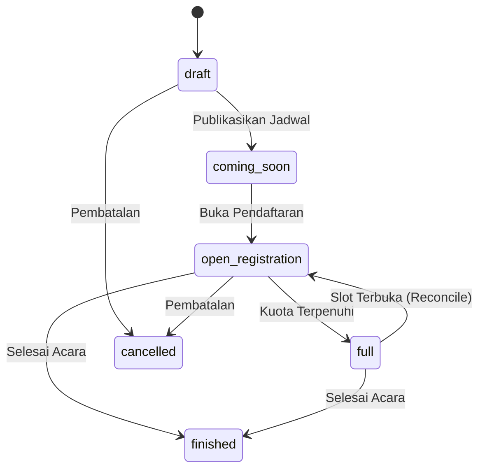

# BegawiPengadaan — Workflow Contract & State Machine Specification

> **Metadata Dokumen:**
> - **Versi:** 4.2 (Production Ready)
> - **Tanggal Sinkronisasi:** 7 November 2026
> - **Sumber Kebenaran:** MySQL Live `db_begawipbj` (95 Tabel, 1.127 Kolom, 22 CHECK Constraints, 17 Migrasi) & Codebase Aktual

---

## 1. Prinsip Dasar State Machine Terkendali

Seluruh proses transisi status pada BegawiPengadaan mengacu secara ketat pada **22 CHECK Constraints Otoritatif MySQL** dan diproteksi oleh `PublicVisibilityGuard`. Perubahan status tidak boleh dilakukan melalui update langsung di controller tanpa melalui service layer terkait yang mengeksekusi validasi aturan bisnis, pencatatan transaksi atomik, dan logging audit.

---

## 2. Siklus Hidup Event & Agenda PBJ (`events.status`)

Nilai status yang sah pada tabel `events` sesuai CHECK constraint `events_status_chk`:
- `draft`: Acara baru dibuat oleh staf dan belum dibuka untuk pendaftaran.
- `coming_soon`: Publikasi awal agenda ke publik untuk pemberitahuan (pendaftaran belum dibuka).
- `open_registration`: Masa registrasi aktif dibuka untuk peserta publik/internal.
- `full`: Kuota peserta telah penuh (kapasitas tercapai); pendaftar baru masuk antrean tunggu (*waitlist*).
- `finished`: Kegiatan telah berakhir; peserta yang hadir berhak menerima sertifikat.
- `cancelled`: Acara dibatalkan karena alasan operasional/keadaan darurat.

---

## 3. Siklus Pendaftaran Event & Algoritma FIFO Waitlist (`event_registrations.status`)

Nilai status sah pada `event_registrations` sesuai `event_registrations_status_chk`: `registered`, `waitlisted`, `cancelled`, `rejected`.

### Algoritma Rekonsiliasi Otomatis Kuota & Waitlist (`CommunicationService::reconcileEventCapacityAndWaitlist`):
1. Dijalankan secara atomik saat pendaftaran dibatalkan (`cancelled`) atau ditolak oleh operator (`rejected`).
2. Sistem menghitung sisa slot: `availableSlots = capacity - registeredCount`.
3. Jika `availableSlots > 0` dan terdapat pendaftar berstatus `waitlisted`, sistem mempromosikan pendaftar urutan pertama secara **FIFO** (`ORDER BY id ASC LIMIT 1`) menjadi `registered`.
4. Sistem mengirimkan notifikasi promosi kepada peserta dan mencatatnya ke `audit_logs`.
5. Status event disinkronkan: jika masih ada sisa kuota, `events.status` berubah menjadi `open_registration`; jika tetap penuh, menjadi `full`.

---

## 4. Siklus Workflow Konten (`workflow_status` pada News, Regulation, Bunga Rampai)

Sesuai CHECK constraint pada `news`, `regulations`, dan `knowledge_articles`:
1. `draft`: Dibuat oleh author.
2. `submitted`: Diajukan untuk verifikasi editor/reviewer.
3. `in_review`: Sedang diperiksa oleh verifikator berwenang.
4. `revision_required`: Dikembalikan ke author untuk perbaikan naskah.
5. `approved`: Disetujui redaksi dan siap tayang.
6. `published`: Ditayangkan ke publik (hanya terlihat jika `visibility = 'public'` dan `deleted_at IS NULL`).
7. `rejected`: Ditolak penerbitannya.
8. `archived`: Diarsipkan dari penayangan aktif.

---

## 5. Siklus LMS: Kursus, Kelas, dan Pendaftaran Peserta (`enrollments.status`)

- **`courses.status`:** `published` (dikurasi untuk katalog mandiri).
- **`learning_classes.status`:** `scheduled` -> `open` / `active` -> `ongoing` -> `completed` / `archived`.
- **`enrollments.status`:** `pending` -> `active` (sedang belajar) -> `completed` (lulus seluruh modul & kuis) -> `withdrawn` / `cancelled`.
