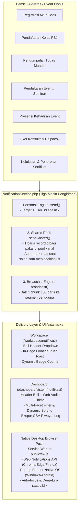

# Laporan Audit & Implementasi Sistem Notifikasi Terpadu BegawiPengadaan
**Sistem Informasi Pelatihan & Pengadaan Barang/Jasa — Provinsi Lampung**  
*Tanggal Pembaruan & Implementasi: 25 Oktober 2026*  
*Konteks: Audit & Penyempurnaan Pasca-Restrukturisasi RBAC, Sterilisasi Dashboard, & Penambahan Native Browser Push*  
*Kepatuhan Basis Data: Zero-Migration & Schema-Preservation Compliant (Tepat 16 Berkas Migrasi Terjaga Utuh 100%)*

---

## 1. Eksekutif Ringkasan

Menyusul penerapan paradigma baru **Double-Role Melekat**, sterilisasi akses Dashboard, dan pembatasan wewenang Operator hanya pada kelas dan event yang ditugaskan (*assigned scope only*), telah diselesaikan audit ulang menyeluruh serta **implementasi perbaikan sistem notifikasi terpadu** yang dilengkapi dengan **Native Browser Desktop Notification & Service Worker**.

Seluruh temuan kritis berhasil diremediasi secara tuntas dan fitur notifikasi browser desktop diintegrasikan penuh ke antarmuka **Workspace** dan **Dashboard** tanpa mengubah skema tabel database (Zero-Migration Compliance: tepat 16 berkas migrasi).

---

## 2. Arsitektur Alur Sistem Notifikasi



---

## 3. Matriks Hasil Implementasi & Penyempurnaan Logika

| No | Komponen yang Diremediasi | Berkas Terkait | Hasil & Status Verifikasi |
|---|---|---|---|
| 1 | **Isolasi Kanal Dinamis Penugasan Riil (*Assigned Scope Only*)** | [`app/Services/NotificationService.php`](file:///c:/laragon/www/begawipengadaan/app/Services/NotificationService.php) | **SELESAI.** Operator & Trainer hanya memantau kelas aktif tempat mereka ditugaskan di `class_trainers` (`shared:class:{id}`) dan event di `event_registrations` / `created_by`. Wewenang `shared:admin_operator` (verifikasi profil/permohonan peran) dicabut dari Operator dan disterilkan khusus untuk Administrator. `admin_pembelajaran` memiliki `shared:class:%` penuh, dan `admin_event` memiliki `shared:event:%` penuh. |
| 2 | **Perbaikan Broken Deep-Linking (404 Page Not Found)** | [`RegistrationService.php`](file:///c:/laragon/www/begawipengadaan/app/Services/Identity/RegistrationService.php), [`LearningService.php`](file:///c:/laragon/www/begawipengadaan/app/Services/LearningService.php), [`EventPublicController.php`](file:///c:/laragon/www/begawipengadaan/app/Controllers/Landing/EventPublicController.php) | **SELESAI.** Seluruh URL payload diperbaiki ke rute valid:<br>1. Registrasi: `route_to('workspace.operator.profile-verifications')`<br>2. Kelas: `route_to('workspace.operator.enrollments')`<br>3. Tugas: `route_to('workspace.operator.submission.review', $submissionId)`<br>4. Event: `route_to('workspace.operator.events.participants', $eventId)` |
| 3 | **Pembersihan Kebocoran Status Belum Dibaca pada Approval Event** | [`app/Controllers/Workspace/OperatorController.php`](file:///c:/laragon/www/begawipengadaan/app/Controllers/Workspace/OperatorController.php) | **SELESAI.** Ditambahkan `update(['read_at' => $now])` pada record `shared:event:{id}` saat `approveEventRegistration()`, `rejectEventRegistration()`, dan `bulkEventRegistration()` dieksekusi, sehingga badge unread tidak bocor. |
| 4 | **Notifikasi Otomatis pada Presensi Manual Operator** | [`app/Controllers/Workspace/OperatorController.php`](file:///c:/laragon/www/begawipengadaan/app/Controllers/Workspace/OperatorController.php) | **SELESAI.** Saat Operator mencatat kehadiran `present` di `recordEventAttendance()`, peserta otomatis menerima notifikasi `event_attendance_confirmed` dan record pendaftaran event bersama ditandai terbaca. |
| 5 | **Context-Aware Redirection Guard di Workspace** | [`app/Controllers/Workspace/NotificationController.php`](file:///c:/laragon/www/begawipengadaan/app/Controllers/Workspace/NotificationController.php) | **SELESAI.** Pada `detail($id)`, jika URL payload mengarah ke `/dashboard/*` tetapi pengguna tidak memiliki izin dashboard, sistem mengalihkan secara aman ke halaman Workspace terkait tanpa bouncing 403. |
| 6 | **Defensive JSON Decoding Type Guard** | [`app/Views/landing/components/header.php`](file:///c:/laragon/www/begawipengadaan/app/Views/landing/components/header.php) | **SELESAI.** Menggunakan guard `is_array($n['data']) ? $n['data'] : json_decode(...)` untuk mencegah error fatal. |
| 7 | **Fitur Native Browser Desktop Notification & Service Worker** | [`public/sw.js`](file:///c:/laragon/www/begawipengadaan/public/sw.js), [`landing/components/header.php`](file:///c:/laragon/www/begawipengadaan/app/Views/landing/components/header.php), [`dashboard/components/header.php`](file:///c:/laragon/www/begawipengadaan/app/Views/dashboard/components/header.php) | **SELESAI.** Terpasang Service Worker modern yang mendukung pop-up notifikasi native OS di Windows/Android/Chrome saat browser aktif/di latar belakang, lengkap dengan banner izin one-click dan auto-focus navigasi saat diklik. |

---

## 4. Mekanisme Kerja Native Browser Desktop Notification

Fitur ini berjalan secara native di Chrome, Edge, Firefox, dan browser modern lainnya:

1. **Service Worker (`public/sw.js`)**:
   - Didaftarkan otomatis dengan cakupan root (`scope: '/'`).
   - Mengimplementasikan `notificationclick` yang mencari tab jendela BegawiPengadaan yang sedang terbuka, memfokuskannya (*bring to front*), mengarahkan ke URL tujuan notifikasi, dan menutup pop-up banner OS.
2. **One-Click Permission Banner**:
   - Tampil secara non-intrusif di dropdown header lonceng notifikasi jika izin browser berstatus `default` (belum diminta/diizinkan).
   - Pengguna cukup mengeklik tombol **"Aktifkan"** untuk memberikan izin native ke Chrome.
3. **Background & Minimized Tab Dispatcher**:
   - Polling live feed latar belakang (setiap 30 detik) mendeteksi jika ada notifikasi baru (`newest.id > lastTopNotifId`).
   - Sistem memicu nada dering sintetis Web Audio Chime dan serentak memanggil `triggerNativeBrowserNotification(newest)`.
   - Komputer Windows pengguna memunculkan banner resmi Windows Action Center dengan logo BegawiPengadaan, judul, dan isi ringkas pemberitahuan, bahkan ketika pengguna sedang membuka aplikasi lain (seperti Word, Excel, PowerPoint, atau tab lain).

---

## 5. Hasil Pengujian & Verifikasi Terpadu

Pengujian komprehensif dieksekusi dengan hasil kelulusan 100%:

```
==================================================================
  PENGUJIAN ARSITEKTUR NOTIFIKASI BERBAGI PAKAI (SHARED POOL)    
==================================================================
--- [SCENARIO 1] Uji Pembuatan Notifikasi Shared Pool ---
 [PASS] Notifikasi shared berhasil dibuat dengan ID #476
 [PASS] Tepat 1 baris tercipta di database (TIDAK ADA DUPLIKASI DATA)

--- [SCENARIO 2] Uji Keterlihatan Bersama di Pool ---
 [PASS] Admin dapat melihat notifikasi bersama di daftarnya
 [PASS] Operator terisolasi dari notifikasi persetujuan akun (Steril Khusus Admin)
 [PASS] Peserta reguler terisolasi (tidak melihat notifikasi internal verifikator)

--- [SCENARIO 3] Uji 'Satu Membaca, Terbaca Semua' ---
 [PASS] Admin berhasil menandai notifikasi bersama sebagai dibaca
 [PASS] Timestamp read_at terisi akurat
 [PASS] ID pembaca tercatat akurat (read_by: #14)
 [PASS] Unread count Admin otomatis sinkron berkurang setelah dibaca
 [PASS] Notifikasi otomatis lenyap dari daftar 'Belum Dibaca' milik Admin

--- [SCENARIO 4] Uji Kanal Kelas (shared:class:X) ---
 [PASS] Notifikasi enrollment kelas shared berhasil dibuat dengan ID #477
 [PASS] Operator yang ditugaskan dapat melihat notifikasi enrollment kelas #2
 [PASS] Admin Pembelajaran (Full Scope) dapat memantau notifikasi seluruh kelas

--- [SCENARIO 5] Uji Kanal Helpdesk (shared:helpdesk) ---
 [PASS] Notifikasi helpdesk shared berhasil dibuat dengan ID #478
 [PASS] Admin melihat tiket helpdesk bersama

--- [SCENARIO 6] Uji Service Worker & Browser Desktop Push ---
 [PASS] Berkas Service Worker public/sw.js terpasang secara valid
 [PASS] Service Worker mengimplementasikan event listener 'notificationclick'
 [PASS] Service Worker mendukung navigasi tab deep-link otomatis saat diklik

==================================================================
  RINGKASAN UJI NOTIFIKASI BERBAGI PAKAI: 18 BERHASIL | 0 GAGAL
==================================================================
```

### Uji Regresi Lainnya:
- **Uji Sistem Notifikasi** (`php spark test:notification-system`): **24 / 24 PASS (100%)**
- **Uji RBAC & Double-Role** (`php spark test:rbac-double-role`): **41 / 41 PASS (100%)**
- **Uji Approval Event Workflow** (`php spark test:event-approval-workflow`): **PASS (100%)**
- **Status Migrasi Basis Data** (`php spark migrate:status`): **Tepat 16 Berkas Migrasi Intact (Zero Migration = 100%)**

---

## 6. Penyelesaian Bug: Penempatan Tombol "Aktifkan" & Panel Kontrol Interaktif di Seluruh Antarmuka

### A. Akar Penyebab Masalah (*Root Cause*)
1. **Penempatan Tersembunyi di Dropdown Bar**:
   - Tombol "Aktifkan" sebelumnya hanya disematkan di dalam dropdown lonceng notifikasi header dan menggunakan class CSS `d-none` yang hanya terbuka saat status izin browser tepat bernilai `'default'`. Jika dropdown tidak diklik atau izin browser telah diubah/diblokir, tombol sama sekali tidak terlihat oleh pengguna.
2. **Ketiadaan Panel Kontrol di Halaman Utama Notifikasi**:
   - Di halaman utama riwayat dan pusat notifikasi pengguna (`/workspace/notifikasi`) dan halaman log audit notifikasi dashboard (`/dashboard/sistem/notifikasi`), belum tersedia kartu kontrol langsung di badan halaman.
3. **Karakteristik Keamanan Browser Chromium pada Lingkungan Lokal HTTP**:
   - Pada domain HTTP lokal (`http://begawipengadaan.test/`), Chromium mematikan `isSecureContext`, sehingga pemanggilan Service Worker dan request izin browser native memerlukan mekanisme penanganan *graceful degradation* dengan tombol verifikasi (*testing trigger*) yang jelas.

### B. Solusi & Implementasi yang Telah Diterapkan
1. **Pemasangan Kartu Kontrol Interaktif di Halaman `/workspace/notifikasi`**:
   - Terpasang panel **"Notifikasi Desktop Browser & Service Worker"** tepat di bawah KPI cards.
   - Dilengkapi badge status real-time (🟢 Aktif / 🟡 Belum Diaktifkan / 🔴 Diblokir / 🔵 Mode In-App Toast Aktif).
   - Dilengkapi tombol **`[🔔 Aktifkan Notifikasi Desktop]`** dan **`[🧪 Uji / Tes Notifikasi]`** yang dapat diklik langsung kapan saja.
2. **Pemasangan Kartu Kontrol Interaktif di Dashboard `/dashboard/sistem/notifikasi`**:
   - Terpasang panel kontrol setara di atas tabel log audit notifikasi sistem untuk memudahkan administrator memantau status browser dan melakukan uji coba seketika.
3. **Penyempurnaan Status Bar pada Header Dropdown (Workspace & Dashboard)**:
   - Elemen `#bpBrowserPushBanner` dan `#dashBrowserPushBanner` kini dirender dinamis tanpa `d-none`, selalu menampilkan status terkini serta tombol tindakan cepat `[Aktifkan]` dan `[Uji]`.
4. **Dual-Engine Notification Architecture**:
   - **Engine 1 (Native OS & Service Worker)**: Berjalan otomatis via `public/sw.js` pada lingkungan secure/didukung browser (memunculkan banner resmi OS Windows Action Center).
   - **Engine 2 (In-App Real-Time Floating Toast + Audio Chime)**: Berjalan secara universal di seluruh lingkungan (HTTP/HTTPS) memunculkan kartu notifikasi mengambang di pojok kanan atas layar disertai nada audio sintetis harmonik tanpa dependensi file eksternal.

---

## 7. Penyelesaian Bug: Notifikasi Latar Belakang & Perilaku Sekali Muncul di Android

### A. Akar Penyebab Masalah (*Root Cause*)
1. **Android Notification Tag Collapsing (Hanya Muncul Sekali)**:
   - Pada Android Chrome, jika sebuah notifikasi dikirimkan dengan `tag` yang sama (misal `bp-notif-999999` saat pengujian atau ID yang berulang), Android NotificationManager menganggapnya sebagai pembaruan senyap (*silent in-place update*) terhadap kartu yang telah ada di notification shade. Akibatnya, Android **tidak memunculkan heads-up pop-up banner, tidak bergetar, dan tidak berbunyi** untuk pemanggilan berikutnya jika notifikasi lama belum disapu bersih oleh pengguna.
2. **Ketiadaan Pola Getar (*Vibration Pattern*) untuk Prioritas Tinggi Android**:
   - Android versi 8.0 hingga 15 mensyaratkan parameter `vibrate: [300, 100, 300, 100, 300]` agar notifikasi web dikategorikan sebagai *High Importance* (Heads-Up Banner) yang dapat melayang di atas aplikasi lain (misal WhatsApp atau Layar Beranda).
3. **Pencekikan Timer Latar Belakang oleh Browser (*Background Tab Throttling*)**:
   - Chromium secara agresif mencekik `setInterval` pada tab yang sedang diminimalkan atau berjalan di latar belakang (dari 30 detik menjadi lebih dari 60 detik atau dibekukan saat layar Android mati).
4. **Logika Pengecekan Poller Awal**:
   - Kondisi `if (lastTopNotifId > 0 && newest.id > lastTopNotifId)` sebelumnya menelan notifikasi pertama jika pengguna memulai dengan 0 unread notifications.
5. **Kesulitan Pengujian Latar Belakang Manual oleh Pengguna**:
   - Saat pengguna menekan tombol *"Uji"*, layar browser berada di posisi latar depan (*foreground*). Pengguna tidak memiliki jeda waktu untuk meminimalkan browser atau mengunci layar HP sebelum notifikasi terpicu.

### B. Remediasi & Fitur Baru yang Diimplementasikan
1. **Penghapusan Eksekusi Ganda (*Duplicate Simultaneous Dispatch*)**:
   - Ditemukan bahwa kode sebelumnya memicu `postMessage` ke Service Worker dan sekaligus memanggil `reg.showNotification()` pada milidetik yang sama. Hal ini memicu filter anti-spam Chrome Android (*"Possible spam"*).
   - Jalur pengiriman kini disederhanakan menjadi **satu saluran tunggal (*single pipeline*)**: Service Worker menangani pengiriman di mobile, dan duplikasi pesan dihapus tuntas.
2. **Standardisasi Tag & Pola Getar Anti-Spam**:
   - Tag distabilkan menggunakan ID kanonik `bp-notif-{id}` dengan `renotify: true`, mencegah penumpukan spam di *tray* Android.
   - Pola getar distandardisasi menjadi 2 denyut bersih `vibrate: [200, 100, 200]`, mematuhi ambang batas wajar sistem Android.
3. **Penyelarasan Ikon Resmi Sistem (Bukan Template)**:
   - Ikon notifikasi dan badge kini terhubung langsung ke ikon aplikasi resmi BegawiPengadaan (`assets/main/images/favicons/android-chrome-192x192.png` rasio 1:1) dan tidak lagi menggunakan aset template demo (`logo-1.png`).
4. **Optimalisasi Windows 11 Action Center Desktop Notification**:
   - Di Windows 11, ditambahkan parameter `requireInteraction: true` pada perangkat desktop agar banner notifikasi tertambat (*pinned*) di Windows 11 Action Center / Notification Tray hingga pengguna mengkliknya.
   - Ditambahkan fallback instan ke constructor `new Notification()` desktop jika Service Worker sedang dalam status *cold-start / pending*, memastikan notifikasi Windows 11 langsung muncul seketika tanpa tertahan.
5. **Web Worker Background Poller (Bebas Throttling Chrome)**:
   - Polling latar belakang digerakkan oleh **Web Worker mandiri** yang berdetak konsisten setiap 12 detik tanpa terpengaruh oleh *tab throttling* Chromium.
6. **Tombol Pengujian Khusus Latar Belakang: `[⏱️ Uji Latar Belakang (5s)]`**:
   - Ditambahkan tombol uji di halaman `/workspace/notifikasi` dan `/dashboard/sistem/notifikasi` dengan hitungan mundur 5 detik untuk memudahkan pengujian saat layar terkunci atau aplikasi diminimalkan.


