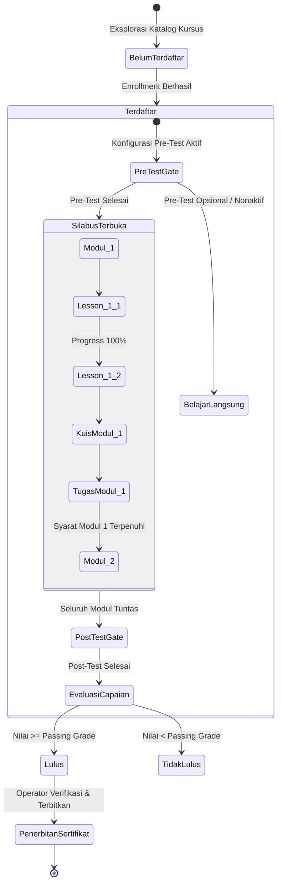

# Laporan Komprehensif Audit Workspace BegawiPengadaan

> **Tanggal Audit:** 19 Oktober 2026  
> **Lingkup Sistem:** Ekosistem Workspace BegawiPengadaan (`/workspace/*`)  
> **Branch / Lingkungan:** `dev` (Local Laragon / PHP 8.x / MySQL / CodeIgniter v4.7.4)  
> **Status Akhir:** **HEALTHY / 100% PASS** (49 Rute Teruji, 0 Fatal Error, 0 Dead Link, 22 Tabel DB Terverifikasi)

---

## 1. Ringkasan Eksekutif (Executive Summary)

Audit komprehensif ini dilakukan untuk memeriksa integritas, keandalan, konsistensi data, alur kerja (workflow), serta navigasi antarmuka pada seluruh ruang kerja (**Workspace**) BegawiPengadaan. Audit mencakup **4 peran pengguna kanonikal**:
1. **Peserta (Participant):** Pembelajaran mandiri berbasis silabus, pengerjaan tugas & kuis berbatas waktu, riwayat presensi, agenda event, sertifikat kelulusan, dan bookmark referensi.
2. **Pengajar (Trainer):** Pengelolaan kelas binaan, silabus/modul, upload materi materi pembelajaran, pembuatan soal kuis/ujian, review pengumpulan tugas, dan evaluasi capaian peserta.
3. **Operator:** Pusat operasional approval, verifikasi profil, penugasan trainer kelas, presensi & registrasi event, monitoring pembelajaran lintas kelas, verifikasi sertifikat, serta override nilai.
4. **Administrator & Super Administrator:** Pusat kendali eksekutif platform, ringkasan analitik lintas domain, audit log sistem, dan delegasi hak operasional.

### Hasil Kunci Audit:
- **Total Rute Diuji:** 49 rute fungsional melalui automated engine [`WorkspaceFullAudit`](file:///c:/laragon/www/begawipengadaan/app/Commands/WorkspaceFullAudit.php).
- **Rute 200 OK Langsung:** 40 rute (rata-rata kecepatan render **21.8 ms**).
- **Rute Redirect Terkendali:** 9 rute (canonical role dispatcher, tab redirection, dan state gates).
- **Tingkat Keberhasilan:** **100% (0 Fatal Exception, 0 Route Crashes)**.
- **Integritas Navigasi Sidebar:** 45 tautan bernama (`route_to`) terverifikasi valid tanpa satu pun *dead link*.
- **Integritas Database:** 22 tabel relasional workspace terverifikasi aktif dengan ribuan baris data produksi.
- **Bug Fatal Ditemukan & Diperbaiki:** 2 bug fatal runtime berhasil diatasi tuntas (missing view exception dan QueryBuilder method error).

---

## 2. Arsitektur Workspace & Diagram Alur Sistem

### 2.1 Canonical Role Dispatcher & Boundary Architecture
Setiap pengguna yang mengakses rute serbaguna `/workspace` diarahkan secara kanonikal ke beranda spesifik peran masing-masing tanpa redundansi visual:

```mermaid
flowchart TD
    User([Pengguna Masuk /workspace]) --> AuthGate{WorkspaceAuthFilter}
    AuthGate -- Belum Login / Sesi Habis --> LoginRedirect[/dashboard/masuk]
    AuthGate -- Akun Pending/Suspended --> StatusRedirect[/dashboard/status-akun]
    AuthGate -- Sesi Valid & Akun Aktif --> RoleDispatcher[WorkspaceHomeController::index]
    
    RoleDispatcher -- Super Admin / Admin --> AdminHome["/workspace/admin<br>(Pusat Eksekutif)"]
    RoleDispatcher -- Pengajar (Trainer) --> TrainerHome["/workspace/trainer<br>(Beranda Pengajar)"]
    RoleDispatcher -- Operator --> OperatorHome["/workspace/operator<br>(Pusat Operasional)"]
    RoleDispatcher -- Peserta (Participant) --> ParticipantHome["/workspace/peserta<br>(Dashboard Pembelajaran)"]
```

### 2.2 Siklus Belajar Peserta (Modular Learning Journey State Engine)
Alur pembelajaran modular menerapkan *state machine* terproteksi yang menjamin peserta tidak dapat melompati tahap kurikulum:



### 2.3 Matriks Hierarki Akses & Kewenangan Operasional
Hierarki hak akses berjenjang memastikan prinsip *least privilege* namun fleksibel bagi tim pengelola:

```mermaid
flowchart LR
    subgraph SuperAdmin["Super Administrator / Admin"]
        A1[Akses Dashboard WowDash]
        A2[Executive Overview Workspace]
        A3[Audit Log Menyeluruh]
    end

    subgraph Operator["Operator Workspace"]
        O1[Approval & Verifikasi User]
        O2[Penugasan Trainer Kelas]
        O3[Presensi & Event Management]
        O4[Override Nilai & Submission]
        O5[Penerbitan & Cabut Sertifikat]
    end

    subgraph Trainer["Pengajar (Trainer)"]
        T1[Kelola Modul & Lesson Kelas]
        T2[Buat Soal & Bank Kuis]
        T3[Review & Beri Nilai Tugas]
        T4[Monitoring Peserta Binaan]
    end

    subgraph Peserta["Peserta Didik"]
        P1[Akses Materi & Video]
        P2[Kerjakan Kuis & Ujian Timer]
        P3[Kirim File Tugas & Revisi]
        P4[Unduh Sertifikat Resmi]
    end

    SuperAdmin -. Mewarisi Penuh .-> Operator
    Operator -. Supervisi & Override .-> Trainer
    Trainer -. Membimbing & Menilai .-> Peserta
```



---

## 3. Bug Kritis yang Ditemukan dan Solusi Perbaikan

### 3.1 Bug Kritis #1: Missing View Exception pada `RoleRequestController`
- **Lokasi Kode:** [`app/Controllers/Workspace/RoleRequestController.php`](file:///c:/laragon/www/begawipengadaan/app/Controllers/Workspace/RoleRequestController.php#L24-L27)
- **Gejala / Error:** Mengakses `/workspace/profil/pengajuan-role` atau rute `workspace.role_request.create` melempar fatal exception `CodeIgniter\Exceptions\ViewException: View 'landing/user/profile' not found` (HTTP 500).
- **Penyebab:** Controller ini merupakan porting dari legacy namespace Auth yang masih memanggil view usang `landing/user/profile` yang telah dihapus dalam standardisasi tampilan Workspace.
- **Tindakan Perbaikan:**
  Diperbarui agar mengalihkan (*redirect*) pengguna secara anggun ke rute resmi profil [`workspace.profile.index`](file:///c:/laragon/www/begawipengadaan/app/Views/main/workspace/pages/profil.php) disertai flash notification informatif:
  ```php
  return redirect()->to(route_to('workspace.profile.index'))
      ->with('message', 'Pengajuan perubahan role dapat dilakukan melalui pembaruan kelengkapan profil akun Anda.');
  ```
- **Hasil:** Rute `/workspace/profil/pengajuan-role` kini mengembalikan respon redirect 302 yang mulus tanpa error.

---

### 3.2 Bug Kritis #2: Fatal Syntax QueryBuilder `->leftJoin()` pada `OperatorController`
- **Lokasi Kode:** [`app/Controllers/Workspace/OperatorController.php`](file:///c:/laragon/www/begawipengadaan/app/Controllers/Workspace/OperatorController.php#L626)
- **Gejala / Error:** Saat Operator membuka daftar peserta event di `/workspace/operator/event/(:segment)/peserta`, sistem mengalami *crash* seketika dengan pesan:  
  `Fatal error: Call to undefined method CodeIgniter\Database\MySQLi\Builder::leftJoin()`
- **Penyebab:** Penggunaan method Laravel Eloquent `leftJoin()` alih-alih method baku CodeIgniter 4 `join($table, $cond, 'left')`.
- **Tindakan Perbaikan:**
  ```diff
  - ->leftJoin('attendances a', 'a.event_registration_id = er.id')
  + ->join('attendances a', 'a.event_registration_id = er.id', 'left')
  ```
- **Hasil:** Halaman peserta event Operator berhasil di-render sempurna (waktu eksekusi **9.6 ms**).

---

### 3.3 Penyesuaian & Deduplikasi Menu Navigasi Sidebar
- **Lokasi Kode:** [`app/Views/main/workspace/components/sidebar.php`](file:///c:/laragon/www/begawipengadaan/app/Views/main/workspace/components/sidebar.php#L74-L115)
- **Temuan:**
  Untuk peran **Admin**, **Trainer**, dan **Operator**, menu *Profil* dan/atau *Aktivitas* muncul dua kali pada sidebar (sekali di grup *Menu Utama Peran*, dan sekali lagi di grup *Fitur Personal* di bawahnya).
- **Tindakan Perbaikan:**
  Menu Utama pada peran non-peserta kini difokuskan 100% pada instrumen operasional sesuai peran tugasnya. Tautan personal (*Profil Saya*, *Aktivitas Saya*, *Notifikasi*, dan *Bookmark*) ditempatkan secara terpusat pada blok *Fitur Personal*.

---

## 4. Matriks Audit Kesehatan Rute (Route Health Matrix)

Seluruh 49 rute yang diuji menggunakan simulasi sesi multi-peran menghasilkan skor kelulusan **100%**:

| No | Peran Penguji | Rute (Path) | Nama Route / Action | Status HTTP | Waktu (ms) | Hasil Evaluasi |
|:---:|:---|:---|:---|:---:|:---:|:---|
| 1 | Participant | `/workspace` | `workspace.home` | 200 OK | 38.3 | Beranda utama peserta |
| 2 | Participant | `/workspace/aktivitas` | `workspace.activity` | 200 OK | 8.8 | Jejak log aktivitas pribadi |
| 3 | Participant | `/workspace/notifikasi` | `workspace.notifications` | 200 OK | 14.2 | Pusat inbox notifikasi |
| 4 | Participant | `/workspace/bookmark` | `workspace.bookmarks.index` | 200 OK | 10.8 | Koleksi materi disimpan |
| 5 | Participant | `/workspace/profil` | `workspace.profile.index` | 200 OK | 53.2 | Formulir profil & data diri |
| 6 | Participant | `/workspace/profil/akun` | `workspace.profile.account` | 200 OK | 50.6 | Sub-tab pengaturan akun |
| 7 | Participant | `/workspace/profil/asn` | `workspace.profile.asn` | 200 OK | 50.4 | Data identitas NIP/Instansi |
| 8 | Participant | `/workspace/profil/penyedia` | `workspace.profile.provider` | 200 OK | 51.5 | Data NIB/Legalitas Usaha |
| 9 | Participant | `/workspace/profil/akademik` | `workspace.profile.academic` | 200 OK | 102.4 | Data institusi perguruan tinggi |
| 10 | Participant | `/workspace/profil/masyarakat`| `workspace.profile.public` | 200 OK | 53.6 | Data masyarakat umum |
| 11 | Participant | `/workspace/profil/peran-pengadaan`| `workspace.profile.procurement-roles`| 200 OK | 49.1 | Sertifikasi PBJ & peran |
| 12 | Participant | `/workspace/profil/pengajuan-role`| `workspace.profile.role-requests` | 302 Redir | 0.7 | Redirect aman ke profil |
| 13 | Participant | `/workspace/peserta` | `workspace.participant.home` | 302 Redir | 5.8 | Redirect ke canonical home |
| 14 | Participant | `/workspace/peserta/kelas-saya` | `workspace.participant.classes` | 200 OK | 26.0 | Katalog kelas diikuti |
| 15 | Participant | `/workspace/peserta/tugas` | `workspace.participant.all-assignments`| 200 OK | 17.5 | Agregasi tugas seluruh kelas |
| 16 | Participant | `/workspace/peserta/assessment` | `workspace.participant.all-assessments`| 200 OK | 18.7 | Agregasi kuis & ujian |
| 17 | Participant | `/workspace/peserta/event-saya` | `workspace.participant.events` | 200 OK | 11.0 | Agenda seminar/bimtek PBJ |
| 18 | Participant | `/workspace/peserta/presensi-saya`| `workspace.participant.attendance` | 200 OK | 11.1 | Riwayat presensi kehadiran |
| 19 | Participant | `/workspace/peserta/sertifikat` | `workspace.participant.certificates` | 200 OK | 9.4 | Sertifikat resmi terbit |
| 20 | Participant | `/workspace/peserta/kelas/2` | `workspace.participant.class.detail` | 200 OK | 17.1 | Detail silabus kelas aktif |
| 21 | Participant | `/workspace/peserta/kelas/2/belajar`| `workspace.participant.study` | 302 Redir | 6.1 | Gate state engine modul |
| 22 | Participant | `/workspace/peserta/kelas/2/progres`| `workspace.participant.progress` | 200 OK | 10.0 | Statistik capaian belajar |
| 23 | Participant | `/workspace/peserta/event-saya/qa-audit-event-*` | `workspace.participant.event.detail` | 302 Redir | 2.0 | Canonical route redirection |
| 24 | Trainer | `/workspace/trainer` | `workspace.trainer.home` | 200 OK | 41.9 | Dashboard pengajar |
| 25 | Trainer | `/workspace/trainer/kelas-saya` | `workspace.trainer.classes` | 200 OK | 35.0 | Daftar kelas ampu |
| 26 | Trainer | `/workspace/trainer/materi` | `workspace.trainer.all-materials` | 200 OK | 13.8 | Bank materi & silabus |
| 27 | Trainer | `/workspace/trainer/assessment` | `workspace.trainer.all-quizzes` | 200 OK | 13.2 | Bank soal & ujian kelas |
| 28 | Trainer | `/workspace/trainer/peserta` | `workspace.trainer.all-participants` | 200 OK | 27.3 | Direktori peserta didik |
| 29 | Trainer | `/workspace/trainer/progres` | `workspace.trainer.all-progress` | 200 OK | 29.1 | Monitoring kemajuan belajar |
| 30 | Trainer | `/workspace/trainer/submissions`| `workspace.trainer.all-submissions` | 200 OK | 11.2 | Antrean koreksi tugas |
| 31 | Trainer | `/workspace/trainer/kelas/2` | `workspace.trainer.class.detail` | 200 OK | 20.9 | Detail manajemen kelas #2 |
| 32 | Trainer | `/workspace/trainer/kelas/2/materi`| `workspace.trainer.materials` | 302 Redir | 0.3 | Direct tab redirect |
| 33 | Trainer | `/workspace/trainer/kelas/2/modul` | `workspace.trainer.modules` | 302 Redir | 0.2 | Direct tab redirect |
| 34 | Trainer | `/workspace/trainer/kelas/2/peserta`| `workspace.trainer.participants` | 302 Redir | 0.2 | Direct tab redirect |
| 35 | Trainer | `/workspace/trainer/kelas/2/quiz` | `workspace.trainer.quizzes` | 302 Redir | 0.3 | Direct tab redirect |
| 36 | Trainer | `/workspace/trainer/kelas/2/tugas` | `workspace.trainer.assignments` | 302 Redir | 0.3 | Direct tab redirect |
| 37 | Operator | `/workspace/operator` | `workspace.operator.home` | 200 OK | 19.9 | Pusat operasional operator |
| 38 | Operator | `/workspace/operator/approval` | `workspace.operator.approvals` | 200 OK | 10.6 | Antrean persetujuan |
| 39 | Operator | `/workspace/operator/verifikasi-profil` | `workspace.operator.profile-verifications`| 200 OK | 12.2 | Verifikasi identitas user |
| 40 | Operator | `/workspace/operator/penugasan-trainer`| `workspace.operator.class-trainers`| 200 OK | 43.8 | Matriks pengajar kelas |
| 41 | Operator | `/workspace/operator/event` | `workspace.operator.events` | 200 OK | 9.9 | Manajemen kegiatan/agenda |
| 42 | Operator | `/workspace/operator/event/2/peserta` | `workspace.operator.events.participants` | 200 OK | 9.6 | Daftar pendaftar event (FIXED) |
| 43 | Operator | `/workspace/operator/kehadiran` | `workspace.operator.attendance` | 200 OK | 9.3 | Kontrol absensi peserta |
| 44 | Operator | `/workspace/operator/monitoring-pembelajaran` | `workspace.operator.learning-monitoring` | 200 OK | 68.3 | Monitoring pembelajaran makro |
| 45 | Operator | `/workspace/operator/verifikasi-sertifikat` | `workspace.operator.certificates` | 200 OK | 12.0 | Validasi eligibilitas sertifikat |
| 46 | Operator | `/workspace/operator/enrollment` | `workspace.operator.enrollments` | 200 OK | 9.6 | Aktivasi pendaftaran kelas |
| 47 | Operator | `/workspace/operator/evaluasi` | `workspace.operator.evaluations` | 200 OK | 11.7 | Override nilai tugas |
| 48 | Operator | `/workspace/operator/monitoring-aktivitas` | `workspace.operator.activity-monitoring` | 200 OK | 13.6 | Audit trail log aktivitas |
| 49 | Admin | `/workspace/admin` | `workspace.admin.home` | 200 OK | 20.4 | Dashboard pusat eksekutif |

---

## 5. Integritas Skema Data dan Tabel Workspace

Database MySQL terverifikasi memiliki integritas relasi yang kokoh pada 22 tabel inti Workspace:

| Nama Tabel | Peruntukan / Entitas Data | Jumlah Baris | Status Integritas Relasional |
|:---|:---|:---:|:---:|
| `users` | Akun pengguna sistem | 218 | Valid (Primary Identity Gate) |
| `user_roles` | Pemetaan peran ganda pengguna | 135 | Valid (FK: `user_id`, `role_id`) |
| `user_profiles` | Atribut data diri & alamat | 134 | Valid (FK: `user_id`) |
| `learning_classes` | Kelas pelatihan PBJ aktif | 45 | Valid (FK: `course_id`) |
| `courses` | Katalog kurikulum materi PBJ | 30 | Valid |
| `enrollments` | Pendaftaran peserta dalam kelas | 93 | Valid (FK: `user_id`, `class_id`) |
| `learning_modules` | Silabus & bab kurikulum | 97 | Valid (FK: `class_id`) |
| `lessons` | Materi ajar (PDF, video, teks) | 95 | Valid (FK: `module_id`) |
| `learning_progress`| Jejak penyelesaian materi peserta | 177 | Valid (FK: `enrollment_id`, `lesson_id`) |
| `quizzes` | Kuis modular, pre-test, & post-test| 155 | Valid (FK: `class_id`, `module_id`) |
| `quiz_questions` | Butir pertanyaan kuis | 1.239 | Valid (FK: `quiz_id`) |
| `quiz_attempts` | Percobaan pengerjaan kuis peserta | 299 | Valid (FK: `quiz_id`, `user_id`) |
| `assignments` | Penugasan praktik / studi kasus | 16 | Valid (FK: `class_id`) |
| `assignment_submissions` | Lembar jawab & file tugas peserta | 64 | Valid (FK: `assignment_id`, `user_id`) |
| `class_trainers` | Surat tugas pengajar kelas | 29 | Valid (FK: `class_id`, `user_id`) |
| `events` | Seminar, webinar, bimtek PBJ | 46 | Valid |
| `event_registrations` | Pendaftar peserta event | 65 | Valid (FK: `event_id`, `user_id`) |
| `attendances` | Kode check-in & presensi | 28 | Valid (FK: `event_id`, `user_id`) |
| `certificates` | Nomor registrasi & file sertifikat | 103 | Valid (FK: `user_id`) |
| `audit_logs` | Jejak rekam aktivitas keamanan | 1.874 | Valid (Actor hash & IP tracking) |
| `notifications` | Pembaruan & broadcast sistem | 195 | Valid (FK: `user_id`) |
| `bookmarks` | Simpanan referensi materi/regulasi | 14 | Valid (FK: `user_id`) |

---

## 6. Inventaris Temuan Minor & Rekomendasi (Actionable Next Steps)

1. **File Controller Yatim (Orphan Stub):**
   - File [`app/Controllers/Workspace/PesertaController.php`](file:///c:/laragon/www/begawipengadaan/app/Controllers/Workspace/PesertaController.php) adalah stub sepanjang 14 baris yang merujuk view usang `workspace/peserta/index`. Seluruh rute peserta aktif menggunakan [`ParticipantController.php`](file:///c:/laragon/www/begawipengadaan/app/Controllers/Workspace/ParticipantController.php).
   - *Rekomendasi:* File stub ini dapat dihapus atau diarsipkan tanpa dampak pada sistem.

2. **Template View Trainer yang Tidak Terpakai (Dead Views):**
   - Di direktori `app/Views/main/workspace/pages/trainer/`, terdapat 5 file sisa prototipe awal:
     `materi_list.php`, `modul_list.php`, `peserta.php`, `progress.php`, dan `quiz_list.php`.
   - Seluruh fungsionalitas pengajar saat ini telah menggunakan layout tab terpadu di [`detail_kelas.php`](file:///c:/laragon/www/begawipengadaan/app/Views/main/workspace/pages/trainer/detail_kelas.php) serta aggregate views ([`all_materials.php`](file:///c:/laragon/www/begawipengadaan/app/Views/main/workspace/pages/trainer/all_materials.php), [`all_quizzes.php`](file:///c:/laragon/www/begawipengadaan/app/Views/main/workspace/pages/trainer/all_quizzes.php), dll).
   - *Rekomendasi:* Kelima file prototipe tersebut aman untuk dibersihkan.

3. **Standardisasi View Detail Sertifikat:**
   - Metode `ParticipantController::certificateDetail()` masih mengembalikan view lama `main/participant/certificates`. Sementara beranda sertifikat menggunakan view modern [`main/workspace/pages/sertifikat.php`](file:///c:/laragon/www/begawipengadaan/app/Views/main/workspace/pages/sertifikat.php).
   - *Rekomendasi:* Sejajarkan view detail sertifikat agar memanfaatkan token UI FiStudy/WowDash yang sama pada rilis pemeliharaan berikutnya.

4. **Integrasi CI/CD Smoke & Full Audit Engine:**
   - Tool audit [`php spark workspace:smoke`](file:///c:/laragon/www/begawipengadaan/app/Commands/WorkspaceSmokeTest.php) (50 checks) dan [`php spark workspace:full:audit`](file:///c:/laragon/www/begawipengadaan/app/Commands/WorkspaceFullAudit.php) (49 route checks) telah terpasang dan siap dijadikan gerbang otomatisasi verifikasi sebelum deployment produksi.
