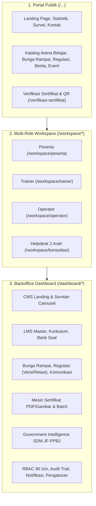

# Laporan Deep Audit Ekosistem Digital BegawiPengadaan
**Biro Pengadaan Barang dan Jasa Sekretariat Daerah Provinsi Lampung**

> [!IMPORTANT]
> **Metodologi Audit**: Audit ini dilakukan secara langsung terhadap **kondisi riil *source code*** (`app/Controllers`, `app/Services`, `app/Models`, `app/Filters`, `app/Config`, `app/Views`) dan **skema aktual database `db_begawipbj`** (89 tabel aktif, 784 rute terdaftar, 100 Controller, 48 Service), menggunakan [draft_info.md](file:///c:/laragon/www/begawipengadaan/draft_info.md) hanya sebagai pembanding awal.

---

## Ringkasan Eksekutif (Executive Summary)

Secara keseluruhan, fondasi arsitektur **BegawiPengadaan** berada pada tingkat kematangan yang **sangat tinggi (~91% fitur telah berjalan *end-to-end* di kondisi riil)**. Seluruh **784 rute HTTP** yang terdaftar pada [`app/Config/Routes.php`](file:///c:/laragon/www/begawipengadaan/app/Config/Routes.php) memiliki kelas Controller dan *method* yang valid (0 *broken controller handler*). Bahkan terdapat **2 modul strategis besar** yang sudah dibangun di dalam kode riil namun **belum terdokumentasi di dalam `draft_info.md`**, yaitu:
1. **Modul Government Intelligence SDM JF-PPBJ & Analisis Gap Kompetensi OPD** (`/dashboard/intelligence/*`)
2. **Modul Pusat Laporan Eksekutif & Riwayat Ekspor Terpadu** (`/dashboard/laporan/*`)

Namun, hasil inspeksi mendalam terhadap *database*, *query builder*, dan *log runtime* mengungkap **10 temuan teknis nyata (bug tersembunyi, *dual-path* penerbitan sertifikat yang membypass PDF engine, *schema mismatch*, dan pembengkakan *file log* hingga 163 MB/hari)** serta beberapa **fitur yang baru terimplementasi sebagian (*stub/placeholder*)** yang perlu segera disempurnakan.



---

## Bagian 1: Matriks Verifikasi Kondisi Riil vs `draft_info.md`

Berikut adalah perbandingan objektif antara klaim pada 9 Pilar di [draft_info.md](file:///c:/laragon/www/begawipengadaan/draft_info.md) dengan kondisi aktual *codebase* dan database `db_begawipbj`:

| Pilar | Klaim pada `draft_info.md` | Kondisi Riil Project (`Codebase` & `db_begawipbj`) | Status Riil |
| :--- | :--- | :--- | :---: |
| **1. Portal Publik & Landing Page** | Hero slider, statistik *real-time*, katalog Arena Belajar, Bunga Rampai, Regulasi, Berita, Event, Verifikasi Sertifikat, Kontak (`TKT-YYYYMMDD-XXXXX`), Survei Kepuasan (IKM). | **Berjalan penuh** di [`HomeController.php`](file:///c:/laragon/www/begawipengadaan/app/Controllers/Landing/HomeController.php), [`ArenaBelajarController.php`](file:///c:/laragon/www/begawipengadaan/app/Controllers/Landing/ArenaBelajarController.php), [`BungaRampaiController.php`](file:///c:/laragon/www/begawipengadaan/app/Controllers/Landing/BungaRampaiController.php), [`RegulationPublicController.php`](file:///c:/laragon/www/begawipengadaan/app/Controllers/Landing/RegulationPublicController.php), [`EventPublicController.php`](file:///c:/laragon/www/begawipengadaan/app/Controllers/Landing/EventPublicController.php), [`StatisticPublicController.php`](file:///c:/laragon/www/begawipengadaan/app/Controllers/Landing/StatisticPublicController.php). **Catatan Temuan**: Query `page_banners` di `HomeController::about()` & `contact()` memakai kolom `page_identifier` yang tidak ada di DB (nama kolom asli: `page_key`), serta `/pratinjau/403|404|500` memanggil view yang belum dibuat. | **95% Riil** |
| **2. Autentikasi & Registrasi Multi-Skenario** | Wizard registrasi 4 jalur profil (`ASN`, `Penyedia`, `Akademisi`, `Masyarakat Umum`) + berjenjang wilayah (`wilayah` 91.599 baris), lupa sandi SMTP, *account status gate* tanpa verifikasi token email. | **100% sesuai kondisi riil** di [`RegisterController.php`](file:///c:/laragon/www/begawipengadaan/app/Controllers/Dashboard/Auth/RegisterController.php), [`LoginController.php`](file:///c:/laragon/www/begawipengadaan/app/Controllers/Dashboard/Auth/LoginController.php), [`PasswordController.php`](file:///c:/laragon/www/begawipengadaan/app/Controllers/Dashboard/Auth/PasswordController.php), dan [`AccountStatusController.php`](file:///c:/laragon/www/begawipengadaan/app/Controllers/Dashboard/Auth/AccountStatusController.php). Dilengkapi proteksi *open-redirect* dan *session regeneration*. | **100% Riil** |
| **3. Workspace Peserta (`/workspace/peserta`)** | Ruang belajar mandiri (`study`), Pre-Test, Kuis Modul, Post-Test, *Auto-Grading* proporsional, pengumpulan tugas, presensi event 6 digit + klaim sertifikat *self-paced*, Helpdesk 2 arah (`/workspace/konsultasi`). | **Berjalan sangat lengkap** di [`ParticipantController.php`](file:///c:/laragon/www/begawipengadaan/app/Controllers/Workspace/ParticipantController.php) (2.926 baris) dan [`ConsultationController.php`](file:///c:/laragon/www/begawipengadaan/app/Controllers/Workspace/ConsultationController.php). **Catatan Temuan**: Fitur pengajuan role di `/workspace/profil/pengajuan-role` ([`RoleRequestController.php`](file:///c:/laragon/www/begawipengadaan/app/Controllers/Workspace/RoleRequestController.php)) masih berupa *stub redirect* ke halaman profil (belum ada form submit ke tabel `role_requests`). | **92% Riil** |
| **4. Workspace Trainer (`/workspace/trainer`)** | Kelola modul & *lesson*, Bank Soal & *Bulk Import CSV*, manajemen peserta (*Approve/Reject/Kick/Reactivate*), *grading* tugas & *feedback*, ekspor *Gradebook CSV*. | **100% terimplementasi penuh** di [`TrainerController.php`](file:///c:/laragon/www/begawipengadaan/app/Controllers/Workspace/TrainerController.php) (2.639 baris) dan terisolasi dengan aman oleh [`WorkspaceAuthFilter.php`](file:///c:/laragon/www/begawipengadaan/app/Filters/WorkspaceAuthFilter.php). | **100% Riil** |
| **5. Workspace Operator (`/workspace/operator`)** | Verifikasi akun & *bulk action*, *Side-by-Side Diff Viewer* perubahan profil, penugasan trainer, cetak daftar hadir event, *override* nilai dengan wajib justifikasi $\ge 10$ karakter, *Health Radar*. | **Berjalan lengkap** di [`OperatorController.php`](file:///c:/laragon/www/begawipengadaan/app/Controllers/Workspace/OperatorController.php) (2.199 baris). **Catatan Temuan Kritis**: Method `processCertificateIssuance()` di baris 1677–1694 melakukan `insert` langsung ke tabel `certificates` tanpa memanggil `CertificateGenerator`, sehingga sertifikat terbit **tanpa file PDF (`pdf_file_id = NULL`) dan tanpa `template_id`**. | **90% Riil** |
| **6. Dashboard Admin (`/dashboard`)** | Pusat Sorotan & Hero Carousel (`SpotlightHubController`), CMS Landing Page, LMS Master, Bunga Rampai, Regulasi (Versi, Relasi, Tahapan PBJ), RBAC Matrix, Email Broadcast SMTP, WhatsApp Widget. | **Berjalan lengkap** di seluruh modul Admin. **Catatan Temuan**: Route `/dashboard/pembelajaran/assessment/pre-test` ([`PreTestController.php`](file:///c:/laragon/www/begawipengadaan/app/Controllers/Learning/PreTestController.php)) dan `post-test` ([`PostTestController.php`](file:///c:/laragon/www/begawipengadaan/app/Controllers/Learning/PostTestController.php)) tidak mengirimkan variabel `$quizzes` dan `$stats` ke view, serta [`StudyController::progress()`](file:///c:/laragon/www/begawipengadaan/app/Controllers/Learning/StudyController.php#L41) masih memakai kolom `lm.course_id` yang sudah dihapus (seharusnya `lm.class_id`). | **92% Riil** |
| **7. Sistem Sertifikat Digital (`/dashboard/sertifikat`)** | `CertificateGenerator` terpusat, Template PDF *Auto-Placeholder Detection* & *Canva CID Stream Stripping*, Template Gambar, penomoran `SERT-{5d}/{Tipe}-{ID}/05/{Thn}`, QR SHA-256. | Mesin utama [`CertificateGenerator.php`](file:///c:/laragon/www/begawipengadaan/app/Services/CertificateGenerator.php), [`CertificatePdfPlaceholderService.php`](file:///c:/laragon/www/begawipengadaan/app/Services/CertificatePdfPlaceholderService.php), dan [`CleanTemplateFpdi.php`](file:///c:/laragon/www/begawipengadaan/app/Services/CleanTemplateFpdi.php) **berjalan 100% akurat**. Namun ditemukan **jalur ganda (*bypass*)** di [`CommunicationService::batchGenerateEventCertificates()`](file:///c:/laragon/www/begawipengadaan/app/Services/Communication/CommunicationService.php#L598-L667) yang menghasilkan nomor `CERT-EVT-...` dengan `pdf_file_id = NULL`. | **88% Riil** |
| **8. Sistem Notifikasi & Push Terpadu** | *Shared Notification Pool* (`shared:admin_operator`, `shared:helpdesk`), *Live Toast*, *Web Audio Chime*, *Tab Title Counter*, Broadcast & Ekspor CSV. | **100% terimplementasi penuh** di [`NotificationService.php`](file:///c:/laragon/www/begawipengadaan/app/Services/NotificationService.php), [`Admin\NotificationController.php`](file:///c:/laragon/www/begawipengadaan/app/Controllers/Admin/NotificationController.php), dan [`Workspace\NotificationController.php`](file:///c:/laragon/www/begawipengadaan/app/Controllers/Workspace/NotificationController.php). | **100% Riil** |
| **9. Keamanan, `file_assets` & Audit Trail** | Penyimpanan di `writable/uploads/`, tabel `file_assets` (116 aset), `AuditService` (`audit_logs` 507 baris), Filter RBAC *fail-closed* real-time DB. | **100% berjalan solid** melalui [`AuthenticationFilter.php`](file:///c:/laragon/www/begawipengadaan/app/Filters/AuthenticationFilter.php), [`WorkspaceAuthFilter.php`](file:///c:/laragon/www/begawipengadaan/app/Filters/WorkspaceAuthFilter.php), [`FileStorageService.php`](file:///c:/laragon/www/begawipengadaan/app/Services/FileStorageService.php), dan [`AuditController.php`](file:///c:/laragon/www/begawipengadaan/app/Controllers/Admin/AuditController.php). | **98% Riil** |
| **10. [Belum Ada di `draft_info.md`] Government Intelligence SDM JF-PPBJ** | *Tidak tercantum di `draft_info.md`.* | **Sudah dibangun di kode riil!** Mencakup Dashboard KPI SDM JF-PPBJ ([`IntelligenceDashboardController.php`](file:///c:/laragon/www/begawipengadaan/app/Controllers/Intelligence/IntelligenceDashboardController.php)), Pemetaan 46 OPD ([`OpdController.php`](file:///c:/laragon/www/begawipengadaan/app/Controllers/Intelligence/OpdController.php)), Data Personel & Jenjang Pertamanya/Muda/Madya ([`JfPpbjController.php`](file:///c:/laragon/www/begawipengadaan/app/Controllers/Intelligence/JfPpbjController.php)), Sertifikat Kompetensi ([`CompetencyCertificateController.php`](file:///c:/laragon/www/begawipengadaan/app/Controllers/Intelligence/CompetencyCertificateController.php)), dan Matriks Gap Kompetensi OPD. Saat ini bersifat *Read/Analytics* (belum ada CRUD tambah/ubah personel JF-PPBJ). | **Fitur Ekstra (75% Riil)** |
| **11. [Belum Ada di `draft_info.md`] Pusat Laporan Eksekutif (`/dashboard/laporan`)** | *Tidak tercantum secara khusus di `draft_info.md`.* | **Sudah dibangun penuh di kode riil!** Mencakup 5 laporan analitik (`pembelajaran`, `event`, `sertifikat`, `kompetensi`, `pengguna`), riwayat ekspor (`exports`), dan streaming CSV di [`ReportAnalyticsService.php`](file:///c:/laragon/www/begawipengadaan/app/Services/Admin/ReportAnalyticsService.php). | **Fitur Ekstra (100% Riil)** |

---

## Bagian 2: Temuan Bug, Inkonsistensi Arsitektur, & Masalah Performa Nyata

Berikut adalah **10 temuan nyata** berdasarkan bukti kode dan database yang wajib diketahui dan diperbaiki:

### 1. [KRITIS - Performa & Disk] Pembengkakan File Log 163 MB/Hari akibat Lowercase HTTP Method di `Routes.php`
- **Lokasi**: [`app/Config/Routes.php`](file:///c:/laragon/www/begawipengadaan/app/Config/Routes.php) (36 baris yang menggunakan `$routes->match(['get', 'post'], ...)` dengan huruf kecil, antara lain baris 82, 336–337, 743, 751–752, 757, 825–826, 840, 881–960, 974, 982–983).
- **Bukti Riil**: Di CodeIgniter 4.7+, pemanggilan `$routes->match(['get', 'post'], ...)` memicu *deprecation warning* beserta *full stack trace* sebanyak 72 kali (36 rute $\times$ 2 method) **pada setiap 1 request HTTP** (termasuk setiap *polling* notifikasi!). Akibatnya:
  - `writable/logs/log-2026-10-23.log` membengkak menjadi **114,71 MB**
  - `writable/logs/log-2026-10-24.log` membengkak menjadi **163,12 MB**
- **Dampak**: Memperlambat *response time* seluruh halaman karena I/O penulisan *log* ratusan megabyte dan berisiko memenuhi kapasitas penyimpanan *server*.

### 2. [KRITIS - Integritas Sertifikat] Dua Jalur "Bypass" yang Menerbitkan Sertifikat Tanpa File PDF (`pdf_file_id = NULL`)
Meskipun kontrak arsitektur di [`CertificateGenerator.php`](file:///c:/laragon/www/begawipengadaan/app/Services/CertificateGenerator.php#L19) menyatakan *"TIDAK ADA controller lain yang insert certificates"*, kenyataannya terdapat **2 jalur kode lain** yang melakukan `insert` manual ke tabel `certificates` tanpa merender PDF:
1. **Jalur Event Agenda (`/dashboard/komunikasi/event-agenda/{id}/batch-certificates`)**:
   - Memanggil [`EventController::batchCertificates()`](file:///c:/laragon/www/begawipengadaan/app/Controllers/Communication/EventController.php#L279-L300) $\rightarrow$ [`CommunicationService::batchGenerateEventCertificates()`](file:///c:/laragon/www/begawipengadaan/app/Services/Communication/CommunicationService.php#L598-L667).
   - Fungsi ini membuat nomor `CERT-EVT-YYYYMMDD-XXXX` secara manual dan melakukan `$db->table('certificates')->insert(...)` **tanpa `template_id` dan tanpa `pdf_file_id`**.
   - **Bukti Database (`db_begawipbj.certificates`)**: Sebanyak **8 dari 18 sertifikat** di database (ID `11, 12, 13, 17, 18, 21, 23`) memiliki format `CERT-EVT-20261021-...` dengan `template_id = NULL` dan `pdf_file_id = NULL`. Saat peserta atau admin mengklik tombol **Unduh PDF** pada sertifikat tersebut, [`CertificateDownloadController::download()`](file:///c:/laragon/www/begawipengadaan/app/Controllers/Certificate/CertificateDownloadController.php#L84-L86) menolak dengan pesan *"File PDF sertifikat belum tersedia"*.
2. **Jalur Workspace Operator (`/workspace/operator/verifikasi-sertifikat/{id}/terbitkan`)**:
   - Memanggil [`OperatorController::processCertificateIssuance()`](file:///c:/laragon/www/begawipengadaan/app/Controllers/Workspace/OperatorController.php#L1677-L1694).
   - Meskipun sudah menggunakan `CertificateGenerator::formatCertificateNumber()`, method ini masih melakukan `$this->db->table('certificates')->insert(...)` secara langsung tanpa memanggil `CertificateGenerator::generateDirect()`, sehingga `template_id` dan `pdf_file_id` bernilai `NULL`.

### 3. [TINGGI - Bug SQL Schema Mismatch] Query Kolom `lm.course_id` yang Sudah Tidak Ada di Tabel `learning_modules`
- **Lokasi**: [`app/Controllers/Learning/StudyController.php`](file:///c:/laragon/www/begawipengadaan/app/Controllers/Learning/StudyController.php#L39-L43)
- **Bukti Riil**: Tabel `learning_modules` di `db_begawipbj` menggunakan kolom `class_id` (`id, class_id, title, description, sort_order, is_required, status`), bukan `course_id`. Namun pada `StudyController::progress()` baris 39–43 tertulis:
  ```php
  $totalLessons = (int) $db->table('lessons l')
      ->join('learning_modules lm', 'lm.id = l.module_id')
      ->join('learning_classes lc', 'lc.course_id = lm.course_id')
      ->where('lc.id', $p['class_id'])
      ->countAllResults();
  ```
- **Dampak**: Jika method `StudyController::progress()` dipanggil, MySQL akan melempar `DatabaseException: Unknown column 'lm.course_id' in 'on clause'` (tercatat 21 kali di file log).

### 4. [SEDANG - Bug Variabel View Kosong] `PreTestController` & `PostTestController` Tidak Mengirim Data ke View
- **Lokasi**: [`app/Controllers/Learning/PreTestController.php`](file:///c:/laragon/www/begawipengadaan/app/Controllers/Learning/PreTestController.php#L9-L18) dan [`app/Controllers/Learning/PostTestController.php`](file:///c:/laragon/www/begawipengadaan/app/Controllers/Learning/PostTestController.php#L9-L18).
- **Bukti Riil**: Kedua controller me-render view `dashboard/learning/assessments/index` hanya dengan mengirim `title`, `pageTitle`, dan `assessmentType`, tanpa mengirimkan `$quizzes`, `$stats`, dan `$filters` (berbeda dengan [`QuizController::index()`](file:///c:/laragon/www/begawipengadaan/app/Controllers/Learning/QuizController.php#L9-L49) yang melakukan query lengkap).
- **Dampak**: Saat Admin membuka `/dashboard/pembelajaran/assessment/pre-test` atau `/post-test`, daftar kuis tampak kosong meskipun di database terdapat data Pre-Test dan Post-Test.

### 5. [SEDANG - Missing View File] Rute `/pratinjau/403`, `/pratinjau/404`, `/pratinjau/500` Error karena View Tidak Ada
- **Lokasi**: [`app/Controllers/Landing/HomeController.php`](file:///c:/laragon/www/begawipengadaan/app/Controllers/Landing/HomeController.php#L881-L893) dan [`app/Config/Routes.php`](file:///c:/laragon/www/begawipengadaan/app/Config/Routes.php#L1040-L1042).
- **Bukti Riil**: Method `HomeController::errorPreview()` memanggil `view('landing/home/error_preview', ...)`, padahal file `app/Views/landing/home/error_preview.php` tidak ada di dalam direktori `app/Views/`.

### 6. [SEDANG - Silent Query Failure] Query `page_banners` di Halaman Tentang & Kontak Menggunakan Nama Kolom yang Salah
- **Lokasi**: [`app/Controllers/Landing/HomeController.php`](file:///c:/laragon/www/begawipengadaan/app/Controllers/Landing/HomeController.php#L462-L465) dan [baris 524–527](file:///c:/laragon/www/begawipengadaan/app/Controllers/Landing/HomeController.php#L524-L527).
- **Bukti Riil**: Tabel `page_banners` di `db_begawipbj` memiliki kolom `page_key` (tanpa kolom `page_identifier` maupun `is_active`). Karena dibungkus `try { ... } catch (\Throwable) {}`, *error* tidak menghentikan halaman, tetapi menyebabkan:
  1. Banner kustom halaman Tentang (`/tentang`) dan Kontak (`/kontak`) dari tabel `page_banners` selalu gagal dimuat (`null`).
  2. CodeIgniter tetap mencatat `[ERROR] Unknown column 'page_identifier' in 'where clause'` ke dalam file log (tercatat 108 kali).

### 7. [SEDANG - Broken Public Link di Sorotan Carousel] Tautan Publik Course & Kelas pada `SpotlightHubController`
- **Lokasi**: [`app/Controllers/Admin/Landing/SpotlightHubController.php`](file:///c:/laragon/www/begawipengadaan/app/Controllers/Admin/Landing/SpotlightHubController.php#L710) dan [baris 754](file:///c:/laragon/www/begawipengadaan/app/Controllers/Admin/Landing/SpotlightHubController.php#L754).
- **Bukti Riil**:
  - Baris 710 menghasilkan `'public_url' => site_url('course/' . ($r['slug'] ?? $r['id']))`, padahal rute publik yang benar di `Routes.php` adalah `site_url('arena-belajar/course/' . ...)`.
  - Baris 754 menghasilkan `'public_url' => site_url('kelas/' . ($r['code'] ?? $r['id']))`, padahal rute publik yang benar adalah `site_url('arena-belajar/kelas/' . ...)`.

### 8. [RENDAH - Polusi Data Pengujian di Database] Data Sampah (`test_resource`) di Tabel `approvals`
- **Lokasi Database**: Tabel `approvals` pada `db_begawipbj`.
- **Bukti Riil**: Dari total **18 baris** di tabel `approvals`, sebanyak **17 baris** adalah data *testing* (`resource_type = 'test_resource'` dan `'test_single_resource'` dengan action `'test_action_1'`, `'test_action_2'`). Hanya 1 baris yang merupakan data riil (`resource_type = 'certificate'`).
- **Dampak**: Mengotori daftar dan metrik pada halaman Antrean Persetujuan (`/dashboard/sistem/approval` dan `/workspace/operator/approval`).

### 9. [RENDAH - Keamanan State-Change via GET] Rute Aksi Hapus/Duplikat/Toggle Menerima Method `GET`
- **Lokasi**: [`app/Config/Routes.php`](file:///c:/laragon/www/begawipengadaan/app/Config/Routes.php) pada grup `dashboard/landing/*`, `dashboard/komunikasi/*`, dan `dashboard/sistem/approval/*`.
- **Bukti Riil**: Rute seperti `pesan-masuk/hapus/(:segment)`, `newsletter/hapus/(:segment)`, `slider/hapus/(:segment)`, dan `approval/(:segment)/setujui` didaftarkan dengan `$routes->match(['get', 'post'], ...)`. Mengizinkan operasi *state-changing* (hapus/setujui/tolak) melalui `GET` melewati proteksi CSRF token CodeIgniter.

### 10. [RENDAH - Dead Code / Duplikasi Service & Controller] File Warisan yang Tidak Terpakai
- **Controller tidak terhubung ke `Routes.php`**:
  - [`app/Controllers/Certificate/CertificateApprovalController.php`](file:///c:/laragon/www/begawipengadaan/app/Controllers/Certificate/CertificateApprovalController.php) (digantikan oleh `Admin\ApprovalController`).
  - [`app/Controllers/ExportController.php`](file:///c:/laragon/www/begawipengadaan/app/Controllers/ExportController.php) (digantikan oleh `DashboardController::exportHistory`).
- **Service duplikat/tidak pernah dipanggil**:
  - [`app/Services/OrganizationService.php`](file:///c:/laragon/www/begawipengadaan/app/Services/OrganizationService.php) (duplikat dari [`app/Services/Admin/OrganizationService.php`](file:///c:/laragon/www/begawipengadaan/app/Services/Admin/OrganizationService.php)).
  - [`app/Services/AccessControlService.php`](file:///c:/laragon/www/begawipengadaan/app/Services/AccessControlService.php) dan [`app/Services/RoleAccessService.php`](file:///c:/laragon/www/begawipengadaan/app/Services/RoleAccessService.php) (digantikan oleh [`app/Services/Identity/AuthorizationService.php`](file:///c:/laragon/www/begawipengadaan/app/Services/Identity/AuthorizationService.php)).
  - [`app/Services/PPBJService.php`](file:///c:/laragon/www/begawipengadaan/app/Services/PPBJService.php) (digantikan oleh [`app/Services/Admin/IntelligenceAnalyticsService.php`](file:///c:/laragon/www/begawipengadaan/app/Services/Admin/IntelligenceAnalyticsService.php)).

---

## Bagian 3: Rekomendasi Penyempurnaan Fitur (Refinement & Bug Fixes)

Berikut adalah langkah konkret untuk menyempurnakan fitur yang sudah ada agar 100% bebas *bug* dan optimal:

1. **Standardisasi Uppercase HTTP Method di `Routes.php` & Pembersihan Log**:
   - Mengubah seluruh `$routes->match(['get', 'post'], ...)` pada [`app/Config/Routes.php`](file:///c:/laragon/www/begawipengadaan/app/Config/Routes.php) menjadi `['GET', 'POST']` (atau khusus rute hapus/toggle diubah menjadi `$routes->post(...)`).
   - Menghapus file log bengkak (`log-2026-10-23.log` dan `log-2026-10-24.log` yang memakan ~278 MB).
2. **Penyatuan Jalur Penerbitan Sertifikat ke `CertificateGenerator::generateDirect()`**:
   - Mengubah [`CommunicationService::batchGenerateEventCertificates()`](file:///c:/laragon/www/begawipengadaan/app/Services/Communication/CommunicationService.php#L598-L667) dan [`OperatorController::processCertificateIssuance()`](file:///c:/laragon/www/begawipengadaan/app/Controllers/Workspace/OperatorController.php#L1677-L1694) agar memanggil `(new CertificateGenerator())->generateDirect($sourceType, $sourceId, $actorId)`.
   - Menambahkan fitur **"Regenerate / Perbaiki PDF Sertifikat"** pada `/dashboard/sertifikat/{id}` agar 8 sertifikat historis (`CERT-EVT-...`) yang `pdf_file_id`-nya masih `NULL` dapat digenerate ulang PDF-nya menggunakan template aktif.
3. **Perbaikan Query SQL & Controller View Data**:
   - Memperbaiki join pada [`StudyController.php`](file:///c:/laragon/www/begawipengadaan/app/Controllers/Learning/StudyController.php#L41) dari `lc.course_id = lm.course_id` menjadi `lc.id = lm.class_id`.
   - Memperbaiki query `page_banners` pada [`HomeController.php`](file:///c:/laragon/www/begawipengadaan/app/Controllers/Landing/HomeController.php#L463) agar menggunakan `->where('page_key', 'about')` dan `->where('page_key', 'contact')`.
   - Memperbaiki URL publik Course & Kelas pada [`SpotlightHubController.php`](file:///c:/laragon/www/begawipengadaan/app/Controllers/Admin/Landing/SpotlightHubController.php#L710).
   - Melengkapi query filter tipe kuis (`pre_test` dan `post_test`) pada [`PreTestController.php`](file:///c:/laragon/www/begawipengadaan/app/Controllers/Learning/PreTestController.php) dan [`PostTestController.php`](file:///c:/laragon/www/begawipengadaan/app/Controllers/Learning/PostTestController.php).

---

## Bagian 4: Rekomendasi Melengkapi Fitur (Completing Partial Features)

Beberapa fitur sudah memiliki tabel database, *service*, dan halaman *review* di sisi Admin, tetapi **belum terhubung penuh di sisi pengguna/operasional**:

### 1. Melengkapi Alur Pengajuan Tambah/Pindah Peran (`/workspace/profil/pengajuan-role`)
- **Kondisi Saat Ini**:
  - Sisi Admin (`/dashboard/akses/permohonan-role` melalui [`RoleRequestReviewController.php`](file:///c:/laragon/www/begawipengadaan/app/Controllers/Admin/RoleRequestReviewController.php)) dan [`RoleRequestService.php`](file:///c:/laragon/www/begawipengadaan/app/Services/Admin/RoleRequestService.php) **sudah 100% siap** (mendukung *approve*, *reject*, *request revision*, dan otomatis mengaktifkan role di `user_roles`).
  - Namun di sisi pengguna, [`Workspace\RoleRequestController.php`](file:///c:/laragon/www/begawipengadaan/app/Controllers/Workspace/RoleRequestController.php) masih berupa *stub* yang hanya me-*redirect* ke halaman profil, sehingga tabel `role_requests` memiliki `0 baris`.
- **Rekomendasi Pelengkapan**:
  - Membangun halaman riwayat & formulir pengajuan peran di `/workspace/profil/pengajuan-role` (misalnya: Peserta ASN yang ingin mengajukan peran sebagai **Trainer / Narasumber** atau **Evaluator** dengan mengunggah SK/Sertifikat pendukung dan alasan pengajuan).

### 2. Melengkapi CRUD Data SDM JF-PPBJ & Sertifikat Kompetensi pada Modul Government Intelligence (`/dashboard/intelligence`)
- **Kondisi Saat Ini**:
  - Modul `/dashboard/intelligence` ([`IntelligenceDashboardController`](file:///c:/laragon/www/begawipengadaan/app/Controllers/Intelligence/IntelligenceDashboardController.php), [`JfPpbjController`](file:///c:/laragon/www/begawipengadaan/app/Controllers/Intelligence/JfPpbjController.php), [`CompetencyCertificateController`](file:///c:/laragon/www/begawipengadaan/app/Controllers/Intelligence/CompetencyCertificateController.php)) sudah menampilkan grafik sebaran personel, jenjang (Pertama, Muda, Madya), dan analisis *gap* kompetensi OPD dengan sangat baik.
  - Namun baru `OpdController` yang memiliki fitur tambah (`opd-unit/tambah`), sedangkan data personel (`jf_ppbj_records`), riwayat mutasi/jabatan, dan sertifikat kompetensi LKPP (`competency_certificates` yang masih `0 baris`) baru bersifat *Read-Only* (diisi dari *baseline seeder*).
- **Rekomendasi Pelengkapan**:
  - Menambahkan fitur **Tambah / Ubah / Import CSV Personel JF-PPBJ**, **Pencatatan Sertifikat Kompetensi LKPP (Level 1 / PPK Tipe A-B-C / Pokja)** beserta tanggal kedaluwarsa, dan **Tombol "Hitung & Simpan Snapshot Gap Kompetensi OPD"** ke tabel `competency_gap_snapshots`.

### 3. Melengkapi Ruang Kerja Khusus Evaluator (`/workspace/evaluator`)
- **Kondisi Saat Ini**:
  - Di database terdapat role `evaluator` (`Role #14` dengan 15 *permissions*), tabel `class_evaluators`, serta [`EvaluatorService.php`](file:///c:/laragon/www/begawipengadaan/app/Services/EvaluatorService.php) yang sudah memiliki fungsi lengkap (`getSummary`, `getAssignments`, `getClassSubmissions`, `gradeSubmission`, `getClassGradingSheet`).
  - Namun di `Routes.php` belum ada sub-grup `/workspace/evaluator/*` (meskipun komentar di `WorkspaceAuthFilter.php` sudah menyebutkan `workspace/evaluator`).
- **Rekomendasi Pelengkapan**:
  - Membangun `Workspace\EvaluatorController` dan rute `/workspace/evaluator` agar pengguna dengan peran Evaluator dapat fokus menilai tugas/studi kasus dan melihat *grading sheet* tanpa harus diberi akses penuh ke `/dashboard`.

### 4. Melengkapi Tab Filter Bookmark di Workspace (`/workspace/bookmark/*`)
- **Kondisi Saat Ini**:
  - Rute `/workspace/bookmark/pembelajaran`, `/bunga-rampai`, `/regulasi`, `/komunikasi`, dan `/sertifikat` pada [`Workspace\BookmarkController.php`](file:///c:/laragon/www/begawipengadaan/app/Controllers/Workspace/BookmarkController.php#L27-L50) semuanya hanya memanggil `$this->index()` tanpa memfilter kategori aktif.
- **Rekomendasi Pelengkapan**:
  - Meneruskan parameter filter kategori (`$activeTab`) ke view `main/workspace/pages/bookmark.php` sehingga sub-rute *bookmark* langsung menampilkan tab atau filter yang sesuai.

---

## Bagian 5: Rekomendasi Penambahan Fitur Baru (Inovasi Bernilai Tinggi)

Untuk menjadikan **BegawiPengadaan** sebagai platform ekosistem PBJ terbaik di tingkat provinsi (dan unggulan dalam penilaian MCP KPK, Indeks Tata Kelola Pengadaan/ITKP LKPP, serta Inovasi Daerah), berikut adalah rekomendasi fitur baru yang memanfaatkan fondasi database yang sudah ada:

### 1. Integrasi Otomatis Kelulusan LMS/Event ke Peta Kompetensi SDM JF-PPBJ & PPK (`Intelligence Auto-Sync`)
- **Konsep**: Saat seorang peserta berprofil **ASN Pemprov Lampung** lulus dari Kelas Pelatihan (`learning_classes`) atau Workshop/Bimtek (`events`) dan menerima sertifikat di BegawiPengadaan, sistem secara otomatis menautkan sertifikat tersebut ke profil personelnya di modul **Government Intelligence** (`competency_certificates` & `user_procurement_roles`) serta memperbarui kalkulasi **Gap Kompetensi OPD** asal peserta tersebut secara *real-time*.

### 2. Sistem Peringatan Dini Masa Berlaku Sertifikat & Penugasan PBJ (*Expiry Early Warning System*)
- **Konsep**: Memanfaatkan tabel `competency_certificates`, `certificates.expires_at`, dan `EmailQueueService` + `NotificationService` untuk mengirimkan notifikasi otomatis (H-90, H-60, H-30 sebelum kedaluwarsa) kepada personel Pokja Pemilihan / PPK / Pejabat Pengadaan dan Kepala UKPBJ/OPD apabila sertifikat kompetensi PBJ mereka akan habis masa berlakunya.

### 3. Generator Dokumen KAK / HPS / Rancangan Kontrak Terbimbing (*Interactive Document Builder*)
- **Konsep**: Saat ini modul `/bunga-rampai/template-dokumen` hanya menyediakan unduhan file statis (`.docx`/`.xlsx`). Menambahkan fitur **Interactive PBJ Document Wizard** di Workspace di mana PPK/Pejabat Pengadaan cukup mengisi formulir langkah-demi-langkah (Nama Paket, Pagu, Metode Pemilihan, Jenis Kontrak) lalu sistem men-generate draf KAK / Spesifikasi Teknis / Daftar Simak Reviu Persiapan Pengadaan dalam format PDF/Word menggunakan mesin *placeholder* yang sudah kita bangun.

### 4. Forum Diskusi Kelas & Bedah Kasus Terbimbing (*Class Discussion & Case Review Thread*)
- **Konsep**: Menambahkan tab **Diskusi Kelas** di dalam Ruang Belajar (`/workspace/peserta/kelas/{slug}/belajar` dan `/workspace/trainer/kelas/{slug}`) agar peserta dan pengajar dapat mendiskusikan studi kasus pengadaan langsung per modul/materi tanpa harus keluar ke WhatsApp atau membuat tiket Helpdesk umum.

### 5. Kalkulator Angka Kredit & Jam Pelajaran (JP) Otomatis untuk ASN / JF-PPBJ
- **Konsep**: Menambahkan atribut **Jumlah Jam Pelajaran (JP)** pada setiap Kelas (`learning_classes`) dan Event (`events`), sehingga:
  - Placeholder `{{jumlah_jp}}` dan `{{struktur_kurikulum}}` dapat dicetak langsung di halaman depan/belakang Sertifikat PDF.
  - Setiap peserta ASN memiliki **Transkrip Akumulasi JP Tahunan** (minimal 20 JP/tahun sesuai mandat pengembangan kompetensi ASN) yang dapat diunduh sebagai bukti dukung SKP / BKD.
