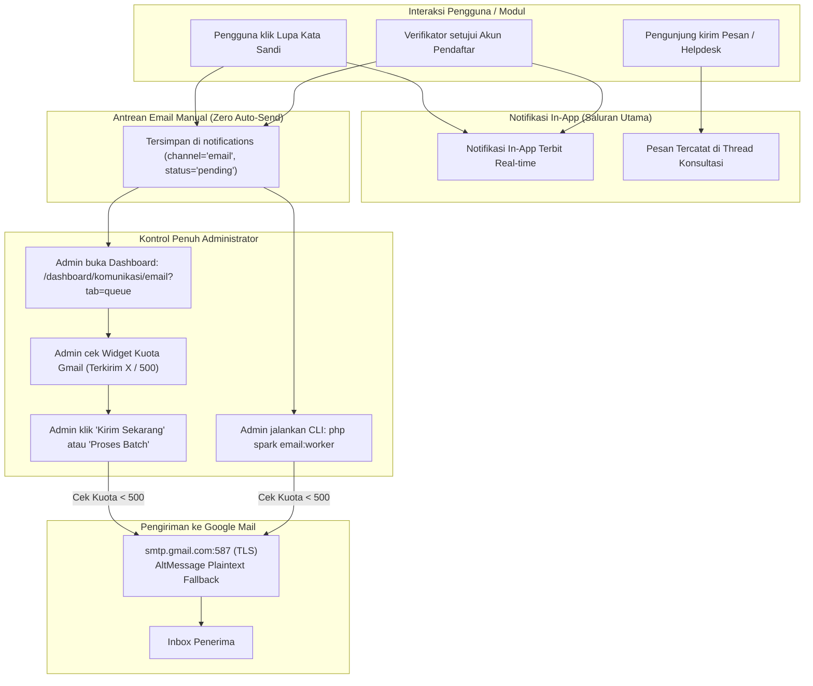

# Laporan Remediasi Sistem Email & Kebijakan 100% Kontrol Manual (Zero Automated Email)
**Sistem Aplikasi**: BegawiPengadaan Provinsi Lampung  
**Tanggal Eksekusi**: 26 Oktober 2026  
**Status**: Berhasil Diimplementasikan & Terverifikasi Penuh (48/48 Checks Passed)  
**Kepatuhan Arsitektur**: 100% Zero-Migration Compliant  

---

## 1. Ringkasan Eksekutif Perubahan

Sesuai arahan pengguna, seluruh tipe pengiriman email di sistem BegawiPengadaan telah diubah secara menyeluruh menjadi **100% Kontrol Manual oleh Administrator (Zero Automated Background Email)**.

### Prinsip Utama yang Diterapkan:
1. **Notifikasi In-App sebagai Saluran Utama**:  
   Sistem notifikasi bawaan di dalam aplikasi ([`notifications`](file:///c:/laragon/www/begawipengadaan/app/Services/NotificationService.php)) tetap bekerja secara real-time untuk seluruh peristiwa pengguna (balasan helpdesk, pendaftaran acara, persetujuan akun, sertifikat, dll.).
2. **Email Berstatus Opsional & Terkontrol Penuh**:  
   Tidak ada proses background yang menembak koneksi Google Mail SMTP secara otomatis tanpa intervensi sadar dari Administrator.
3. **Penanganan Reset Password & Persetujuan Akun**:  
   Permintaan reset kata sandi dan persetujuan akun kini dimasukkan ke dalam **Draf Antrean Email Manual** (`status = 'pending'`). Administrator memiliki wewenang penuh untuk meninjau dan mengeksekusi pengiriman email via dashboard atau CLI secara manual.
4. **Proteksi Kuota Google Mail (500 Email/24 Jam)**:  
   Telah dipasang sistem pelacak kuota bergulir (*rolling 24-hour quota tracker*) dengan indikator visual di dashboard dan pembatas otomatis (*circuit breaker*) agar kuota Gmail tidak pernah jebol.

---

## 2. Rincian Modifikasi & Berkas yang Diperbarui

### 2.1 Inisialisasi Data Default Database (`site_settings`)
Telah diinisialisasi 14 baris pengaturan default pada tabel `site_settings` untuk grup `email` dan `notification` tanpa migrasi baru:
- `email.smtp_host` = `smtp.gmail.com`
- `email.smtp_port` = `587`
- `email.smtp_crypto` = `tls`
- `email.from_name` = `BegawiPengadaan Provinsi Lampung`
- `email.dispatch_mode` = `manual` *(Menegaskan kebijakan kontrol manual)*
- `notification.email_enabled` = `1`
- `notification.in_app_enabled` = `1`

### 2.2 Lapisan Layanan Email ([`EmailService.php`](file:///c:/laragon/www/begawipengadaan/app/Services/Email/EmailService.php))
- **Auto AltMessage (Anti-Spam)**: Menambahkan konversi otomatis HTML body ke teks biasa via `$email->setAltMessage(...)` pada `sendDirect()` untuk menurunkan skor penalti SpamAssassin.
- **Quota Tracking Methods**: Menambahkan `getDailySentCount()` dan `getDailyQuotaInfo(500)` untuk menghitung pemakaian email 24 jam terakhir dan sisa kuota aman.
- **Manual Queue Helpers**:
  - `queuePasswordReset(...)`: Menempatkan email token pemulihan ke draf antrean manual dengan payload URL reset.
  - `queueAccountApproved(...)`: Menempatkan notifikasi persetujuan ke draf antrean manual dengan payload tautan login.

### 2.3 Penghapusan Auto-Send pada Lupa Kata Sandi ([`PasswordResetService.php`](file:///c:/laragon/www/begawipengadaan/app/Services/Identity/PasswordResetService.php))
- Mengubah alur pengiriman langsung `sendPasswordReset(...)` menjadi `queuePasswordReset(...)`.
- Menambahkan notifikasi in-app untuk pengguna sehingga permintaan tercatat aman di riwayat sistem tanpa mengirim email otomatis di background.

### 2.4 Penghapusan Auto-Send pada Persetujuan Pengguna ([`ProfileVerificationService.php`](file:///c:/laragon/www/begawipengadaan/app/Services/Admin/ProfileVerificationService.php))
- Mengubah alur pengiriman langsung `sendAccountApproved(...)` menjadi `queueAccountApproved(...)`.
- Notifikasi in-app tetap terbit seketika, sedangkan email persetujuan masuk ke antrean manual untuk diproses oleh admin.

### 2.5 Proteksi Kuota Antrean ([`EmailQueueService.php`](file:///c:/laragon/www/begawipengadaan/app/Services/Email/EmailQueueService.php))
- Pada `processItem()` dan `processReadyBatch()`, ditambahkan pengecekan `getDailyQuotaInfo()`. Jika sisa kuota $\le 0$, proses pengiriman otomatis dihentikan dengan pesan peringatan agar akun Gmail tidak dibekukan oleh Google.

### 2.6 Widget Pelacak Kuota & Antarmuka Dashboard ([`EmailBroadcastController.php`](file:///c:/laragon/www/begawipengadaan/app/Controllers/Admin/Communication/EmailBroadcastController.php) & [`index.php`](file:///c:/laragon/www/begawipengadaan/app/Views/dashboard/communication/email/index.php))
- Menampilkan card overview **"Kuota Harian Gmail (24 Jam)"** dengan progress bar kapasitas (500 limit), jumlah terkirim, sisa kuota aman, dan badge *100% Manual Admin*.
- Pada [Pengaturan Notifikasi](file:///c:/laragon/www/begawipengadaan/app/Views/dashboard/settings/notification.php), ditambahkan alert penjelasan kebijakan sistem: *Zero Automated Email & Kontrol Manual*.

### 2.7 Perintah Spark CLI Manual ([`EmailWorker.php`](file:///c:/laragon/www/begawipengadaan/app/Commands/EmailWorker.php))
- Dibuat perintah CLI: `php spark email:worker [--limit 25] [--dry-run]`
- Memungkinkan administrator memicu pengiriman antrean secara terkontrol dari terminal server dengan perlindungan burst pause (0.2 detik per email).

---

## 3. Matriks Alur Kerja Baru (Zero Automated Email)

---

## 4. Hasil Pengujian & Verifikasi Komprehensif

Seluruh skenario pengujian diverifikasi menggunakan test suite resmi:

1. **Email System Test (`php spark test:email-system`)**:
   - **48/48 checks PASSED (100% Green)**.
   - Terverifikasi: Zero migrations (16 berkas migrasi utuh), resolver konfigurasi, template responsif, penghitungan kuota, proteksi anti-spam `AltMessage`, queue integration pada `PasswordResetService` & `ProfileVerificationService`, serta perintah `email:worker`.
2. **Auth System Test (`php spark auth:system:test`)**:
   - **22/22 checks PASSED (100% Green)**.
   - Terverifikasi: Login captcha, register review captcha & honeypot, lupa sandi token invalidation, dan alur pendaftaran.
3. **Pesan & Ticketing Test (`php spark test:messaging-ticketing`)**:
   - **11/11 checks PASSED (100% Green)**.
   - Terverifikasi: In-app notification pada balasan tiket dan integrasi thread.
