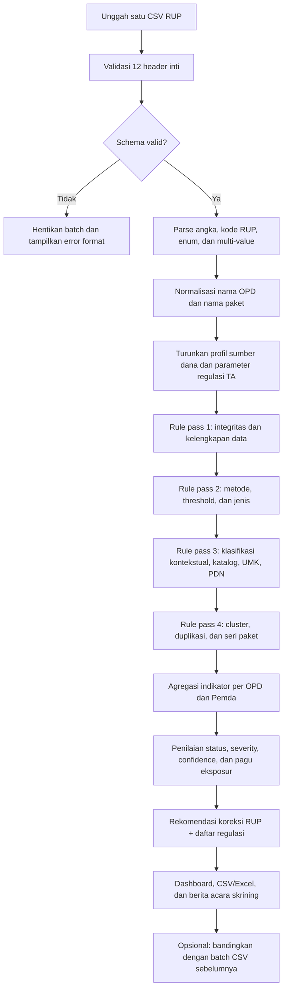

# MASTER PLAN v4.0
# SISTEM AUDIT RUP OTOMATIS BERBASIS CSV SAJA
## Universal SIRUP Compliance & Risk Screening Engine — RUP-Only Edition

**Versi dokumen:** 4.0 (Terkalibrasi & Terimplementasi Penuh)  
**Tanggal pemutakhiran:** 31 Oktober 2026  
**Status:** Terimplementasi Penuh & Tervalidasi pada Codebase Begawi Pengadaan (Zero-Migration Batch 16 JSON Architecture, 49/49 Test Cases PASSED).  
**Dokumen sumber:** Master Plan v3.4 dan Laporan Implementasi Workspace Audit RUP v3.1/v3.4/v4.0.  
**Dataset kalibrasi:** `data_dashboard_rup_table_20261031_063857_0986d8ff.csv` — 7.982 baris, 12 kolom (49 OPD, TA 2026).

---

## 0. KEPUTUSAN DESAIN UTAMA VERSI 4.0

### 0.1 Batas sistem tidak boleh diperluas

Versi 4.0 secara tegas dibatasi pada **audit analitik atas data RUP yang diterima melalui satu file CSV**. Sistem tidak meminta, membaca, atau mensyaratkan berkas tambahan selain CSV RUP dengan 12 kolom inti sebagaimana didefinisikan dalam dokumen ini.

Sistem TIDAK melakukan:

- rekonsiliasi RUP terhadap DPA, DPPA, RKA, SIPD, Perda APBD, atau Penjabaran APBD;
- pemeriksaan KAK, spesifikasi teknis, HPS, RAB, survei pasar, atau dokumen pemilihan;
- pemeriksaan SIKaP, ketersediaan produk katalog secara aktual, negosiasi, transaksi SPSE, kontrak, adendum, BAST, pembayaran, atau realisasi;
- pembuktian penunjukan langsung, keadaan tertentu, pengecualian katalog, kemampuan teknis UMK, status pemilik manfaat, atau pengawasan konstruksi;
- penarikan data melalui API atau koneksi ke sistem pemerintah lain.

Semua kesimpulan dibatasi pada hal yang dapat diamati dari 12 kolom CSV. Ketika syarat hukum membutuhkan fakta yang tidak terdapat dalam CSV, status hasil harus `PERLU_VERIFIKASI` atau `TIDAK_DAPAT_DINILAI_DARI_CSV`, bukan `MELANGGAR` dan bukan `PATUH`.

### 0.2 Nama dan posisi produk

Nama kerja yang disarankan: **RUP-Only Compliance & Risk Screening Engine**. Istilah “audit otomatis” boleh tetap digunakan sebagai nama fitur, tetapi laporan harus menjelaskan bahwa fungsinya adalah **skrining kepatuhan dan deteksi risiko pada rencana pengadaan**, bukan audit investigatif atau opini final atas proses PBJ.

### 0.3 Prinsip kesimpulan

1. **RUP adalah rencana.** Nilai, metode, jenis, cara, sumber dana, status UMK, dan PDN dalam CSV adalah pernyataan data RUP yang sedang diperiksa, bukan bukti bahwa pemilihan atau pelaksanaan benar-benar terjadi dengan cara yang sama.
2. **Tidak ada inferensi fakta yang tidak tersedia.** Nama paket tidak membuktikan ketersediaan katalog, alasan penunjukan langsung, kemampuan UMK, status ASN/non-ASN, atau adanya pengawasan konstruksi.
3. **Regulasi dipasangkan dengan temuan.** Setiap temuan yang berpotensi menyimpang wajib menyebutkan regulasi, pasal/ayat jika terverifikasi, alasan pemicu, batas inferensi, dan tindakan koreksi RUP yang relevan.
4. **Klasifikasi hukum dan indikator risiko dipisahkan.** Batas PL dalam Perpres merupakan dasar pemeriksaan hukum. Angka 5% untuk Penunjukan Langsung, 30% untuk E-Purchasing, 80% untuk UMK eligible, serta 95% cakupan RUP terhadap DPA bukan ambang pelanggaran hukum universal yang boleh dipaksakan oleh sistem ini.
5. **Hasil tidak boleh menyatakan “patuh penuh”.** Jika tidak ada temuan, gunakan `TIDAK_ADA_INDIKASI_DARI_KOLOM_CSV_YANG_DIUJI`; bukan “paket telah patuh terhadap seluruh regulasi”.
6. **Kalibrasi mengutamakan presisi.** Temuan berbasis satu kata kunci atau kemiripan nama tidak boleh langsung dianggap pelanggaran.

### 0.4 Perubahan kunci dari v3.x ke v4.0

| Area | Perilaku v3.x yang perlu dikoreksi | Standar v4.0 |
|---|---|---|
| Input | Mendukung 12 kolom inti + 8 ekstensi opsional/API | Hanya 12 kolom inti CSV; 8 kolom ekstensi dan API dihapus dari kontrak input |
| Cakupan | Mengarah ke audit RUP, DPA, transaksi, dan tata kelola lebih luas | Hanya skrining atribut RUP yang tersedia |
| Kesimpulan | Sebagian rule menghasilkan “pelanggaran” dari kata kunci | Status berjenjang: indikasi, risiko, perlu verifikasi, tidak dapat dinilai |
| Ambang | Ketentuan regulasi dipilih hanya berdasarkan tahun anggaran | Resolver ketentuan regulasi; tahun 2025 dan periode transisi tidak diputuskan otomatis tanpa tanggal |
| Konstruksi Rp200–400 juta | Pernah diberi syarat umum teknologi sederhana | Syarat tersebut dihapus sebagai rule umum; PL konstruksi sampai Rp400 juta mengikuti Pasal 38 ayat (3) huruf b Perpres 46/2025 |
| Konsultansi | Berpotensi tercampur dengan threshold UMK Rp15 miliar | Jasa Konsultansi tidak dimasukkan ke cakupan paket Pasal 65 ayat (3) |
| BLUD/DAK | Label sumber dana diperlakukan seperti pengecualian otomatis | Label sumber dana hanya konteks; bukan bukti bahwa ketentuan PBJ dikecualikan |
| Swakelola/ASN | Kata outsourcing/honorer dapat diberi status pelanggaran UU ASN | Hanya sinyal klasifikasi; hubungan kerja dan pengangkatan ASN tidak dapat dibuktikan dari nama RUP |
| E-Purchasing | Kata komoditas standar dianggap bukti katalog tersedia | Periksa sebagai kandidat katalog; sistem tidak mengetahui ketersediaan katalog aktual |
| Splitting | Komponen terhubung Jaccard dapat dianggap splitting | Kandidat pemaketan; perlu pengamanan paket bernomor, lokasi, tahapan, jenis, sumber dana, dan konteks nama |
| RCI | Diposisikan sebagai indeks kepatuhan dengan penalti makro | Diganti profil risiko RUP dan RUP Risk Attention Score; penalti rasio makro dihapus penuh |
| Basis Data & Deployment | Mengasumsikan migrasi DDL penambahan kolom fisik baru | Strategi Zero Database Migration pada skema Batch 16 eksisting via payload JSON unpack/pack untuk keamanan deployment Git Auto-Push |
| APBD/APBD-P | `APBDP` dipaksakan menjadi siklus perubahan | Pertahankan label sumber dana; `APBD;APBDP` adalah profil multi-sumber, bukan otomatis duplikasi atau siklus yang dapat dipastikan |

---

# BAGIAN I — SUMBER REGULASI DAN CARA MENERAPKANNYA

## 1.1 Regulasi inti yang dipakai oleh mesin

| No. | Regulasi | Peran dalam audit CSV | Batas pengujian dari CSV |
|---:|---|---|---|
| 1 | **Perpres 16 Tahun 2018 jo. Perpres 12 Tahun 2021 jo. Perpres 46 Tahun 2025** (gunakan naskah konsolidasi) | Dasar utama metode pemilihan, ambang Pengadaan Langsung, E-Purchasing, afirmasi UMK, dan PDN | Rule yang dapat diuji hanya yang faktanya tersedia pada 12 kolom |
| 2 | **PerLKPP 11 Tahun 2021** tentang Pedoman Perencanaan Pengadaan PBJ Pemerintah | Rujukan perencanaan dan penyusunan RUP | Dipakai sebagai pedoman perencanaan; jangan membuat pasal/larangan baru yang tidak tertulis |
| 3 | **PerLKPP 3 Tahun 2021** tentang Pedoman Swakelola | Rujukan klasifikasi dan pelaksanaan swakelola | CSV tidak memiliki tipe swakelola, tim, dokumen kerja sama, atau bukti pelaksanaan |
| 4 | **PerLKPP 5 Tahun 2021** tentang Pedoman Pengadaan PBJ yang Dikecualikan | Rujukan untuk menilai apakah suatu objek mungkin masuk kategori dikecualikan | Nama paket dan sumber dana tidak cukup untuk menetapkan pengecualian |
| 5 | **PerLKPP 3 Tahun 2026** tentang Pedoman Persiapan dan Pelaksanaan PBJ melalui Penyedia | Pedoman teknis terkini bagi proses melalui penyedia | Prosedur yang memerlukan HPS, dokumen pemilihan, kinerja, SIKaP, BO, SPSE, atau tanggal proses tidak boleh dinyatakan terbukti dari CSV |
| 6 | **SE Kepala LKPP 3 Tahun 2026** tanggal 29 Oktober 2026 | Penjelasan pelaksanaan PerLKPP 3/2026 | Referensi interpretatif; rule yang membutuhkan data proses tetap `TIDAK_DAPAT_DINILAI_DARI_CSV` |
| 7 | **PerLKPP 2 Tahun 2026** tentang Katalog Elektronik dalam PBJ Pemerintah | Rujukan terkini penyelenggaraan katalog dan E-Purchasing | CSV tidak berisi ID produk, status tayang, ketersediaan, atau alasan pengecualian katalog |
| 8 | **Inpres 2 Tahun 2022** tentang percepatan penggunaan PDN dan produk UMK/Koperasi | Rujukan kebijakan afirmasi PDN dan UMK/Koperasi, termasuk target alokasi anggaran paling sedikit 40% | Rasio dari CSV hanya proksi atas data RUP yang diunggah; bukan pengukuran realisasi belanja atau kepatuhan final |
| 9 | **UU 20 Tahun 2023** tentang ASN, khususnya Pasal 65 dan Pasal 66 | Konteks larangan pengangkatan non-ASN untuk mengisi jabatan ASN dan penataan non-ASN | Nama paket jasa tenaga tidak membuktikan adanya pengangkatan non-ASN oleh instansi |

### Status regulasi per tanggal dokumen

- Perpres 46/2025 ditetapkan dan diundangkan 30 April 2025; status pada JDIH LKPP tercatat berlaku. Gunakan naskah konsolidasi Perpres 16/2018 jo. Perpres 12/2021 jo. Perpres 46/2025.
- PerLKPP 3/2026 ditetapkan dan diundangkan 22 September 2026. JDIH LKPP mencatat peraturan ini berlaku dan mencabut PerLKPP 12/2021 serta PerLKPP 4/2024.
- SE Kepala LKPP 3/2026 ditetapkan 29 Oktober 2026 dan tercatat berlaku.
- PerLKPP 2/2026 ditetapkan dan diundangkan 1 September 2026. Peraturan ini mencabut PerLKPP 9/2021 tentang Toko Daring dan Katalog Elektronik.

## 1.2 Regulasi pendukung yang tidak dijadikan rule pelanggaran otomatis

Peraturan berikut tetap dapat dicantumkan pada daftar referensi, tetapi **tidak menjadi dasar kesimpulan otomatis** jika unsur yang harus diuji tidak terdapat dalam CSV:

- PP 12 Tahun 2019 dan Permendagri 77 Tahun 2020 tentang pengelolaan keuangan daerah;
- Permendagri 90 Tahun 2019 beserta pemutakhiran nomenklatur;
- Perda APBD, Perkada Penjabaran APBD, Perda Perubahan APBD, DPA, dan DPPA;
- PP 60 Tahun 2008 tentang SPIP;
- pedoman ITKP LKPP dan indikator MCP KPK;
- ketentuan teknis DAK, BLUD, hibah, bantuan sosial, dan standar harga daerah.

Alasannya bukan karena regulasi tersebut tidak penting, tetapi karena sistem v4.0 tidak menerima dokumen atau kolom yang diperlukan untuk mengujinya.

## 1.3 Threshold yang boleh digunakan

Untuk paket dengan ketentuan Perpres 46/2025:

| Jenis pengadaan | Metode Pengadaan Langsung | Dasar |
|---|---:|---|
| Barang | Paling banyak Rp200.000.000 | Perpres 16/2018 jo. Perpres 46/2025, Pasal 38 ayat (3) huruf a |
| Jasa Lainnya | Paling banyak Rp200.000.000 | Pasal 38 ayat (3) huruf a |
| Pekerjaan Konstruksi | Paling banyak Rp400.000.000 | Pasal 38 ayat (3) huruf b |
| Jasa Konsultansi | Paling banyak Rp100.000.000 | Pasal 41 ayat (3) |

Nilai yang sama dengan batas maksimum **masih berada pada batas paling banyak**; rule pelampauan hanya berlaku jika `total_nilai > batas`, bukan `>= batas`.

**Koreksi penting:** batas Rp400 juta untuk Pengadaan Langsung Pekerjaan Konstruksi tidak boleh ditambah syarat umum “teknologi sederhana” sebagai syarat tambahan yang berdiri sendiri, kecuali ada ketentuan spesifik yang benar-benar berlaku pada konteks paket tersebut. Rule v3.x yang menempatkan semua paket konstruksi Rp200–400 juta pada syarat teknologi sederhana dinonaktifkan.

## 1.4 Resolver ketentuan regulasi dari kolom `tahun_anggaran`

Karena CSV tidak memiliki tanggal pengumuman RUP, tanggal persiapan, tanggal pemilihan, atau tanggal kontrak, resolver ketentuan regulasi harus konservatif:

| Tahun anggaran | Perlakuan engine |
|---|---|
| 2026 | Gunakan ambang Perpres 46/2025 untuk skrining RUP. PerLKPP 3/2026 menjadi referensi teknis terkini; ketentuan yang memerlukan tanggal/proses tetap tidak dinilai. |
| 2025 | `TRANSISI_REGULASI_PERLU_VERIFIKASI`. Perpres 46/2025 berlaku 30 April 2025 dan memuat ketentuan peralihan. Tahun anggaran saja tidak membuktikan kapan proses pengadaan dimulai. Jangan memberi kesimpulan final hanya dari TA 2025. |
| 2022–2024 | Gunakan ketentuan Perpres 16/2018 jo. Perpres 12/2021 untuk threshold yang relevan. |
| 2021 | `TRANSISI_REGULASI_PERLU_VERIFIKASI` karena perubahan Perpres 12/2021 terjadi pada tahun berjalan dan CSV tidak memuat tanggal proses. |
| 2020 dan sebelumnya | `REGULASI_HISTORIS_BELUM_DIKONFIGURASI` sampai tabel threshold historis yang sah dan tervalidasi disediakan di dalam konfigurasi engine. Jangan menerapkan threshold 2021/2025 secara retroaktif. |

Resolver ini hanya menggunakan `tahun_anggaran` yang sudah ada. Tidak menambah persyaratan input.

---

# BAGIAN II — KONTRAK DATA CSV (TIDAK BOLEH DITAMBAH)

## 2.1 Dua belas kolom sumber yang diizinkan

Sistem hanya menerima 12 kolom berikut. Tidak ada kolom ekstensi opsional.

| No. | Nama kolom | Tipe hasil parsing | Validasi dan penggunaan |
|---:|---|---|---|
| 1 | `nama_instansi` | String | Trim; identitas pemerintah daerah/instansi |
| 2 | `nama_satuan_kerja` | String | Trim; pecah nama OPD dan kode organisasi/SIPD jika pola tersedia; simpan teks asli |
| 3 | `tahun_anggaran` | Integer/String | Ambil tahun 4 digit; nilai tak valid menjadi error data |
| 4 | `cara_pengadaan` | Enum/String | Normalisasi ke `Penyedia` atau `Swakelola`; nilai asli tetap disimpan |
| 5 | `metode_pengadaan` | String + array turunan | Pecah jika terdapat delimiter `;`; metode asli tetap disimpan |
| 6 | `jenis_pengadaan` | String + array turunan | Pecah jika terdapat delimiter `;`; metode/jenis multi-value tidak boleh diratakan tanpa jejak |
| 7 | `nama_paket` | String | Simpan asli; buat `nama_paket_clean`, `nama_paket_objek`, `nama_paket_core`, token, dan petunjuk seri/lokasi sebagai atribut turunan |
| 8 | `kode_rup` | String | Jangan pernah diproses sebagai integer/float; deteksi kosong, format ilmiah, akhiran `.0`, dan duplikasi |
| 9 | `sumber_dana` | String + array turunan | Pecah label sumber dana; pertahankan kombinasi seperti `APBD;APBDP` dan `APBD;BLUD` sebagai kombinasi yang nyata |
| 10 | `produk_dalam_negeri` | Enum/String | `Ya`, `Tidak`, `-`; jangan menafsirkan `Ya` sebagai bukti TKDN tertentu |
| 11 | `status_umk` | Enum/String | `Ya`, `Tidak`, `-`; `-` tidak sama dengan `Tidak` |
| 12 | `total_nilai` | Decimal/Integer | Konversi angka rupiah secara konsisten; tolak format ambigu dan simpan raw value untuk penelusuran |

## 2.2 Atribut turunan yang boleh dibuat

Atribut berikut **bukan kolom input baru**. Semuanya dihitung dari 12 kolom yang sama:

- `nama_opd_clean`, `kode_satker_sipd_extracted`;
- `tahun_anggaran_int`, `regime_status`, `threshold_profile`;
- `cara_pengadaan_norm`, `metode_arr`, `jenis_arr`, `sumber_dana_arr`;
- `source_funding_profile` (contoh `APBD`, `APBDP`, `APBD+APBDP`, `BLUD`, `APBD+BLUD`);
- `nama_paket_clean`, `nama_paket_objek`, `nama_paket_core`, `token_count`;
- `serial_family_key`, `serial_number`, `lokasi_hint`, `tahap_hint`, `triwulan_hint`, `tahun_hint` jika kata/angka ditemukan;
- `is_multi_source`, `is_blud_tagged`, `is_dak_tagged`, `is_bosp_tagged`;
- `amount_parse_status`, `code_parse_status`, `field_completeness_status`;
- `classification_candidates`, `classification_confidence`;
- `risk_flags`, `finding_status`, `severity`, `confidence`.

Tidak boleh ada fungsi yang membutuhkan `tanggal_umumkan`, `jadwal_pemilihan`, `jadwal_kontrak`, `tipe_swakelola`, `lokasi_pekerjaan` terpisah, `kode_rekening_mak`, `pagu_pengadaan_dpa`, atau atribut lain yang tidak terdapat pada 12 kolom.

## 2.3 Penanganan sumber dana APBD/APBD-P

`APBD`, `APBDP`, `APBD;APBDP`, `BLUD`, dan `APBD;BLUD` harus dipertahankan sebagai tag sumber dana, bukan disamakan dengan sejarah perubahan paket.

Aturan:

1. `APBDP` boleh ditampilkan sebagai tag sumber APBD Perubahan, tetapi CSV tidak membuktikan apakah paket merupakan paket baru, perubahan pagu, perubahan metode, atau kelanjutan paket APBD murni.
2. `APBD;APBDP` harus ditandai `MULTI_SOURCE`; jangan dipaksa menjadi `PERUBAHAN` saja dan jangan dipecah menjadi dua baris.
3. Paket bernama sama di APBD dan APBDP hanya menjadi `RELATED_NAME_CANDIDATE`; bukan otomatis duplikasi atau double counting.
4. Dalam clustering, gunakan `source_funding_profile` sebagai satu atribut konteks. Jangan menggabungkan dua tag menjadi dua paket atau menggandakan nilai pagu.
5. Perubahan antarbacth CSV boleh ditelusuri dengan `kode_rup`, tetapi sistem tidak boleh menyatakan perubahan itu berasal dari APBD-P tanpa bukti selain label sumber dana.

---

# BAGIAN III — ALUR PEMROSESAN V4.0

## 3.1 Pipeline end-to-end



## 3.2 Tahapan teknis

### Stage 1 — Ingestion dan schema gate

- Terima satu file CSV.
- Auto-detect delimiter koma/titik koma dan encoding; hilangkan BOM.
- Header harus dipetakan tepat ke 12 kolom inti. Variasi kapitalisasi/spasi boleh dinormalisasi, tetapi kolom yang hilang harus dilaporkan.
- Kolom tambahan di luar 12 kolom boleh diabaikan dan dicatat dalam log, bukan dijadikan sumber validasi.
- Simpan `raw_row`, `row_index_csv`, `file_hash`, dan metadata batch internal.

### Stage 2 — Parsing dan sanitasi

- `kode_rup` wajib string; hindari konversi floating point.
- `total_nilai` diubah ke angka rupiah dengan locale-aware parser; nilai yang ambigu ditandai `PARSE_ERROR`, bukan ditebak.
- `metode_pengadaan`, `jenis_pengadaan`, dan `sumber_dana` dibaca sebagai multi-value jika delimiter `;` muncul.
- Simpan nilai mentah dan nilai normalisasi untuk semua atribut.

### Stage 3 — NLP dan klasifikasi objek

- Normalisasi typo dan leetspeak dilakukan terbatas pada kata, dengan daftar proteksi akronim.
- Stopword stripping hanya untuk pembentukan kemiripan, tidak untuk bukti temuan.
- Frasa konteks seperti `Sub Kegiatan`, `Dalam rangka`, `Tahap`, `Paket`, `Ruas`, nama kabupaten/kota, tahap dan nomor paket dipisahkan sebagai atribut turunan.
- Jangan hapus nomor paket, nomor ruas, tahap, atau lokasi dari sumber bukti. Nomor dan lokasi harus tetap tersedia untuk mengecualikan paket seri yang berbeda.
- Kata tunggal seperti `rehabilitasi`, `pengawasan`, `kajian`, `audit`, `listrik`, `jasa`, `tenaga`, atau `hotmix` tidak boleh menjadi satu-satunya pemicu pelanggaran.

### Stage 4 — Rule Engine berlapis

1. **Row-level:** data dasar, metode, threshold, jenis, label UMK/PDN.
2. **Context-level:** indikasi dikecualikan, swakelola, BLUD/DAK/BOSP, katalog, dan klasifikasi objek.
3. **Cluster-level:** kandidat splitting, serial package family, duplikasi dan peluang konsolidasi.
4. **OPD-level:** statistik UMK, PDN, metode, jenis, dan sumber dana berbasis CSV saja.

### Stage 5 — Hasil dan rekomendasi

Setiap hasil harus memiliki:

- kode rule dan versi rule;
- status kesimpulan (`POTENSI_TIDAK_SESUAI`, `PERLU_VERIFIKASI`, `SINYAL_RISIKO`, `ANOMALI_DATA`, `TIDAK_DAPAT_DINILAI_DARI_CSV`, atau `INFORMATIF`);
- severity dan confidence yang terpisah;
- nilai dan kolom CSV yang menjadi bukti;
- regulasi, pasal/ayat, dan ringkasan norma yang relevan;
- alasan mengapa rule terpicu;
- keterbatasan inferensi;
- rekomendasi koreksi pada RUP, bukan perintah mengubah dokumen yang tidak tersedia;
- daftar opsi koreksi yang tidak memaksa metode tertentu tanpa fakta pendukung.

---

# BAGIAN IV — STATUS TEMUAN, RISIKO, DAN TINGKAT KEYAKINAN

## 4.1 Status temuan

| Status | Makna | Contoh |
|---|---|---|
| `ANOMALI_DATA` | Nilai CSV kosong, tidak valid, salah format, atau atribut inti tidak konsisten | Pagu nol; Penyedia tanpa jenis pengadaan |
| `POTENSI_TIDAK_SESUAI` | Kombinasi kolom menunjukkan rencana pemilihan berpotensi melampaui ketentuan eksplisit | Pengadaan Langsung Barang di atas Rp200 juta pada ketentuan regulasi yang dapat ditentukan |
| `PERLU_VERIFIKASI` | Ada kemungkinan ketidaksesuaian tetapi syarat/pengecualian tidak tersedia dalam CSV | Penunjukan Langsung tanpa informasi alasan; status BLUD; status pengecualian katalog |
| `SINYAL_RISIKO` | Pola data meningkatkan risiko atau perlu atensi, tetapi bukan pelanggaran hukum dengan sendirinya | Pagu tepat di ambang PL; paket mirip; peluang konsolidasi |
| `TIDAK_DAPAT_DINILAI_DARI_CSV` | Norma membutuhkan fakta yang tidak ada di 12 kolom | Tanggal proses, ketersediaan katalog, tipe swakelola, alasan keadaan tertentu |
| `INFORMATIF` | Statistik atau indikator monitoring, tanpa kesimpulan hukum | Pangsa E-Purchasing; pangsa UMK; distribusi sumber dana |

## 4.2 Severity

Severity menggambarkan prioritas reviu, bukan vonis hukum:

- `TINGGI`: anomali numerik yang berhadapan langsung dengan ambang eksplisit atau kesalahan inti yang menghalangi interpretasi paket.
- `SEDANG`: indikasi klasifikasi/metode yang kuat tetapi masih memerlukan klarifikasi objek.
- `RENDAH`: pola risiko, kualitas nama, atau peluang perbaikan.
- `INFO`: statistik tanpa temuan.

Jangan gunakan label `KRITIS` hanya karena sebuah kata kunci muncul pada nama paket.

## 4.3 Confidence

- `TINGGI`: seluruh unsur pemicu tersedia langsung pada kolom CSV (misalnya `cara`, `metode`, `jenis`, `TA`, `nilai`).
- `SEDANG`: pemicu didukung frasa objek yang cukup spesifik tetapi tetap perlu pembacaan manusia.
- `RENDAH`: hanya berdasarkan kemiripan teks, satu keyword, atau asumsi yang tidak dibuktikan CSV.

Severity dan confidence tidak boleh digabung. Temuan dapat ber-severity sedang tetapi confidence rendah.

---

# BAGIAN V — KATALOG RULE V4.0 DAN REKOMENDASI KOREKSI

> Konvensi: rule berikut mempertahankan ID lama untuk kompatibilitas dengan v3.x. Rule yang tidak dapat dijalankan dari 12 kolom ditandai `NON-AKTIF` atau `TIDAK_DAPAT_DINILAI`, bukan dihapus diam-diam. Regulasi yang disebut adalah dasar norma/rujukan; status temuan ditentukan oleh kemampuan CSV membuktikan unsur normanya.

## Kelompok A — Integritas data dan kelengkapan RUP

| Rule | Status v4.0 | Kondisi berbasis CSV | Dasar regulasi / rujukan | Rekomendasi otomatis |
|---|---|---|---|---|
| **R-01 Pagu tidak valid** | AKTIF — `ANOMALI_DATA` | `total_nilai` kosong, gagal parsing, atau `<= 0` | PerLKPP 11/2021 sebagai pedoman perencanaan; bukan otomatis pelanggaran PBJ substantif | Periksa format rupiah dan pastikan nilai RUP diisi sesuai pagu rencana. Jangan mengarang nilai pengganti. Jika paket memang tidak jadi dilaksanakan, perbarui status/paket di SIRUP sesuai kondisi sebenarnya. |
| **R-02 Atribut Penyedia tidak lengkap** | AKTIF — `ANOMALI_DATA` | `cara_pengadaan=Penyedia` dan `jenis_pengadaan` atau `metode_pengadaan` kosong/`-`/tidak dikenali | Perpres 16/2018 jo. Perpres 46/2025 tentang perencanaan/pengumuman RUP; PerLKPP 11/2021 | Lengkapi jenis dan metode pada RUP berdasarkan substansi paket dan aturan yang berlaku. Jika jenis tidak dapat ditentukan dari nama, rekomendasikan reviu PPK/UKPBJ, bukan auto-fill. |
| **R-03 Pagu sangat kecil/tidak wajar** | AKTIF — `SINYAL_RISIKO` | `0 < total_nilai < Rp10.000` (ambang hanya pemicu statistik) | Tidak ada pelanggaran hukum otomatis; indikator kualitas data internal | Verifikasi satuan, pemisah ribuan, dan kemungkinan salah digit. Tampilkan nilai asli dan nilai parsing. Jangan menyimpulkan pemborosan atau pemecahan paket. |
| **R-34 Penamaan paket terlalu generik** | AKTIF — `SINYAL_RISIKO` | Nama hanya berupa pola umum seperti `Belanja Barang`, `Pengadaan Jasa`, `Kebutuhan Operasional`, atau objek tidak terbaca setelah normalisasi. Komoditas tunggal jelas seperti `Pengadaan Laptop` tidak boleh dipicu. | Prinsip transparansi dan perencanaan RUP; PerLKPP 11/2021 | Perjelas nama agar mencerminkan objek utama/keluaran. Sistem menyarankan format nama, tetapi tidak mengarang volume, lokasi, spesifikasi, atau kegiatan. |
| **R-35 Nilai enum tidak dikenal** | BARU — `ANOMALI_DATA` | `cara`, `metode`, `jenis`, `status_umk`, atau `produk_dalam_negeri` di luar nilai yang dikenali setelah normalisasi | Kontrak skema CSV sistem; tidak otomatis pelanggaran hukum | Tampilkan nilai mentah dan pilihan standar yang dikenal. Minta koreksi pada data sumber/SIRUP; jangan mengubah diam-diam. |
| **R-36 Kode RUP bermasalah** | BARU — `ANOMALI_DATA` | Kode kosong, notasi ilmiah, akhiran `.0`, format digit rusak, atau duplikasi kode dalam satu batch | Validitas identifikasi paket RUP; bukan norma materiil PBJ | Impor ulang CSV dengan `kode_rup` sebagai teks. Untuk duplikasi kode, tampilkan seluruh baris terkait dan jangan menggabungkan otomatis. |

## Kelompok B — Ambang Pengadaan Langsung dan metode pemilihan

| Rule | Status v4.0 | Kondisi berbasis CSV | Dasar regulasi / rujukan | Rekomendasi otomatis |
|---|---|---|---|---|
| **R-04 PL Barang/Jasa Lainnya melampaui ambang** | AKTIF — `POTENSI_TIDAK_SESUAI` | `Penyedia` + `Pengadaan Langsung` + jenis `Barang` atau `Jasa Lainnya` + pagu `> Rp200.000.000` + ketentuan regulasi dapat ditentukan | Perpres 16/2018 jo. Perpres 46/2025, Pasal 38 ayat (3) huruf a | Reviu nilai dan jenis paket pada RUP. Bila nilai dan klasifikasi benar, sesuaikan metode pemilihan ke metode yang diperbolehkan (E-Purchasing bila memenuhi syarat katalog, Tender/Tender Cepat bila syaratnya terpenuhi). Jangan menyarankan Penunjukan Langsung tanpa kondisi tertentu. |
| **R-05 PL Pekerjaan Konstruksi melampaui ambang** | AKTIF — `POTENSI_TIDAK_SESUAI` | `Penyedia` + `Pengadaan Langsung` + `Pekerjaan Konstruksi` + pagu `> Rp400.000.000` + ketentuan regulasi dapat ditentukan | Perpres 16/2018 jo. Perpres 46/2025, Pasal 38 ayat (3) huruf b | Pastikan objek benar-benar pekerjaan konstruksi dan nilai paket benar. Jika benar, koreksi metode RUP ke metode yang sah. Jika nama paket hanya pembelian bahan/material atau sewa alat, koreksi dulu klasifikasi jenisnya. |
| **R-06 PL Jasa Konsultansi melampaui ambang** | AKTIF — `POTENSI_TIDAK_SESUAI` | `Penyedia` + `Pengadaan Langsung` + `Jasa Konsultansi` + pagu `> Rp100.000.000` + ketentuan regulasi dapat ditentukan | Perpres 16/2018 jo. Perpres 46/2025, Pasal 41 ayat (3) | Reviu apakah objek memang Jasa Konsultansi. Jika benar dan nilainya di atas batas PL, sesuaikan metode (Seleksi atau E-Purchasing bila memenuhi ketentuan katalog). |
| **R-07 Syarat teknologi sederhana untuk konstruksi Rp200–400 juta** | NON-AKTIF / DICABUT DARI RULESET | Semua kondisi lama v3.x yang menganggap PL konstruksi Rp200–400 juta otomatis melanggar jika bukan UMK/teknologi sederhana | Perpres 46/2025 Pasal 38 ayat (3) huruf b menetapkan batas PL konstruksi paling banyak Rp400 juta; jangan tambahkan syarat umum yang tidak ada pada norma tersebut | Tidak menerbitkan temuan R-07. Jika ada isu pencadangan UMK, periksa secara terpisah melalui R-24 berdasarkan Pasal 65 ayat (3) dan (4). |
| **R-08 Penunjukan Langsung tanpa alasan yang terlihat** | AKTIF — `PERLU_VERIFIKASI` | Metode `Penunjukan Langsung`; CSV tidak memiliki alasan/justifikasi keadaan tertentu | Perpres 46/2025, Pasal 38 ayat (4)–(5) dan Pasal 41 ayat (4)–(5) | Tampilkan peringatan: alasan Penunjukan Langsung tidak tersedia di data RUP. Jangan menyebut pelanggaran. Rekomendasikan PPK/UKPBJ memastikan kategori keadaan tertentu dan kesesuaian metode sebelum proses. |
| **R-08b Repeat Order** | AKTIF — `TIDAK_DAPAT_DINILAI_DARI_CSV` | Nama paket mengandung frasa `repeat order` | Perpres 46/2025 dan pedoman teknis PerLKPP 3/2026 mengenai repeat order; syaratnya memerlukan riwayat paket awal, nilai kontrak/HPS, kinerja penyedia, dan/atau personel | Tampilkan daftar syarat yang harus diverifikasi; jangan meloloskan atau menggugurkan paket dari nama. CSV tidak memuat sejarah kontrak, HPS, nilai kinerja, atau Team Leader. |
| **R-09 Ketidakcocokan jenis dan metode** | AKTIF — `POTENSI_TIDAK_SESUAI` atau `PERLU_VERIFIKASI` | `Seleksi` dipakai untuk jenis non-konsultansi; atau `Tender/Tender Cepat` dipakai untuk `Jasa Konsultansi`; metode/jenis tidak dikenali; multi-jenis/multi-metode bertentangan | Perpres 46/2025 Pasal 38 dan Pasal 41 | Tampilkan ketidakcocokan atribut. Rekomendasikan verifikasi objek dan koreksi jenis/metode pada RUP. Jangan menilai syarat teknis Tender Cepat dari CSV karena data SIKaP dan spesifikasi tidak tersedia. |
| **R-27 Pagu mendekati batas PL (threshold hugging)** | AKTIF — `SINYAL_RISIKO` | Pagu PL berada pada 95%–100% dari batas yang relevan; termasuk tepat sama dengan batas | Tidak ada larangan hukum otomatis hanya karena mendekati batas; gunakan Pasal 20 ayat (2) Perpres PBJ sebagai prinsip menghindari pemaketan yang menghindari Tender bila fakta splitting memang ada | Prioritaskan reviu kemiripan paket dan kewajaran batas paket. Tampilkan “indikasi mendekati ambang”, bukan “pelanggaran threshold”. Jangan otomatis mengubah metode. |
| **R-28 Tender/Seleksi pada nilai yang masih dapat PL** | AKTIF — `INFORMATIF` / `SINYAL_RISIKO` | Metode Tender/Tender Cepat untuk paket yang nilainya berada di bawah batas PL | Tidak ada larangan otomatis; metode kompetitif dapat dipilih sesuai kebutuhan/ketentuan | Tampilkan sebagai statistik efisiensi/reviu metode. Jangan mewajibkan perubahan menjadi PL atau E-Purchasing. |
| **R-29 Kelayakan Tender Cepat** | AKTIF — `TIDAK_DAPAT_DINILAI_DARI_CSV` | Metode `Tender Cepat` terdeteksi | Perpres 46/2025 Pasal 38 ayat (6) dan ketentuan teknis PerLKPP 3/2026; kelayakan mensyaratkan informasi kualifikasi/penyedia/spesifikasi yang tidak ada di CSV | Tampilkan metode sebagai perlu pemeriksaan syarat Tender Cepat. Jika jenisnya Jasa Konsultansi, gunakan R-09. Jangan menyatakan Tender Cepat untuk Konstruksi otomatis dilarang. |
| **R-33 Jenis `Terintegrasi` atau PL untuk pekerjaan terintegrasi** | AKTIF — `PERLU_VERIFIKASI` | Jenis `Terintegrasi`, khususnya jika nama paket menunjukkan komoditas sederhana atau metodenya PL | Perpres 16/2018 jo. Perpres 46/2025 tentang jenis/metode pemilihan dan pekerjaan terintegrasi; rincian lingkup tidak ada di CSV | Periksa apakah kata `Terintegrasi` menggambarkan ruang lingkup pekerjaan yang sesungguhnya atau salah pilih enum. Jika objek hanya barang/jasa sederhana, koreksi jenis. Hindari kesimpulan otomatis hanya dari enum. |
| **R-37 Ketentuan regulasi transisi tidak dapat ditentukan** | BARU — `TIDAK_DAPAT_DINILAI_DARI_CSV` | Tahun anggaran 2021 atau 2025 dan rule bergantung pada tanggal proses | Perpres 12/2021; Perpres 46/2025 dan ketentuan peralihan | Jangan jalankan threshold final untuk tahun transisi tanpa tanggal. Laporkan bahwa CSV hanya menyediakan tahun anggaran. Untuk TA 2026 dan tahun penuh yang ketentuannya jelas, gunakan konfigurasi yang sesuai. |

## Kelompok C — Cara pengadaan, pengecualian, dan sumber dana

| Rule | Status v4.0 | Kondisi berbasis CSV | Dasar regulasi / rujukan | Rekomendasi otomatis |
|---|---|---|---|---|
| **R-10 Kandidat pengadaan dikecualikan** | AKTIF — `PERLU_VERIFIKASI` | Nama objek berisi frasa yang mungkin berkaitan dengan tarif resmi/kewajiban statutori, sementara metode bukan `Dikecualikan` | Perpres PBJ tentang PBJ yang dikecualikan; PerLKPP 5/2021 | Tampilkan alasan kandidat dan minta reviu kategori hukum. Jangan mengubah metode menjadi `Dikecualikan` hanya berdasarkan kata seperti listrik, internet, meterai, pajak, retribusi, atau benda pos. Hindari kamus luas yang menganggap semua item dengan kata tersebut otomatis dikecualikan. |
| **R-11 Istilah jasa tenaga dalam paket Swakelola** | AKTIF — `PERLU_VERIFIKASI` | `Swakelola` dan nama paket mengandung frasa tenaga kebersihan, keamanan, sopir, operator, PTHL, TKS, tenaga harian, atau outsourcing | PerLKPP 3/2021 tentang Swakelola; UU 20/2023 Pasal 65–66 hanya relevan jika benar ada pengangkatan non-ASN untuk mengisi jabatan ASN | Tampilkan sebagai indikasi ketidakjelasan cara pengadaan. Rekomendasikan klarifikasi apakah kegiatan benar dilaksanakan sendiri oleh tim swakelola atau sebenarnya jasa dari penyedia. Jangan menyatakan pelanggaran UU ASN hanya dari nama paket; penyediaan jasa melalui badan usaha tidak otomatis sama dengan pengangkatan pegawai non-ASN. |
| **R-12 Swakelola dengan objek berindikasi pihak ketiga** | AKTIF — `PERLU_VERIFIKASI` | `Swakelola` dan nama mengandung frasa pihak ketiga, jasa profesional, kalibrasi, pekerjaan fisik, atau pengadaan aset/barang | Perpres PBJ tentang Swakelola; PerLKPP 3/2021 | Rekomendasikan verifikasi apakah objek merupakan kegiatan yang dapat dikerjakan swakelola atau kebutuhan penyedia. Jangan memeriksa tipe I–IV karena kolom tipe swakelola tidak ada. |
| **R-13 Objek administrasi/internal pada cara Penyedia** | AKTIF — `PERLU_VERIFIKASI` | `Penyedia` dan nama paket sangat spesifik menyebut perjalanan dinas, honorarium internal, uang lembur, tunjangan, atau iuran internal | PerLKPP 11/2021 sebagai pedoman perencanaan; peraturan belanja daerah terkait dapat menjadi konteks tetapi tidak dapat diuji rinci | Rekomendasikan pemeriksaan klasifikasi kegiatan dan cara belanja pada RUP. Jangan otomatis mengubah menjadi Swakelola; konsumsi, akomodasi, event organizer, publikasi, atau jasa pihak ketiga dapat merupakan paket Penyedia. |
| **R-14 Hibah/Bansos dari kata kunci nama** | AKTIF — `PERLU_VERIFIKASI` | Nama paket mengandung kata hibah/bansos/bantuan uang/barang dan cara pengadaan tertentu | Permendagri 77/2020 dan ketentuan hibah/bansos sebagai referensi; Perpres PBJ jika barang/jasa dibeli oleh instansi | Tampilkan sebagai pemeriksaan klasifikasi. Jangan menentukan metode hanya dari kata hibah/bansos. Bedakan bantuan uang kepada penerima dari pengadaan barang/jasa yang dilakukan OPD untuk diserahkan kepada pihak lain. |
| **R-30 Label sumber dana BLUD/DAK/BOSP** | AKTIF — `INFORMATIF` / `PERLU_VERIFIKASI` | `sumber_dana` mengandung `BLUD`, `DAK`, `BOSP`, atau kombinasi tag | Perpres PBJ dan ketentuan khusus yang relevan; PerLKPP 5/2021 untuk kategori yang benar-benar dikecualikan | Tampilkan tag sumber dana sebagai konteks. Jangan otomatis mengecualikan BLUD atau DAK dari threshold PL. Jangan otomatis menganggap semua paket BLUD memakai ketentuan khusus atau `Dikecualikan`. |
| **R-36 Profil sumber dana multi-tag** | BARU — `INFORMATIF` | `APBD;APBDP`, `APBD;BLUD`, atau lebih dari satu tag sumber dana | Tidak ada pelanggaran hukum otomatis | Simpan sebagai kombinasi sumber dana. Jangan pecah satu baris menjadi beberapa paket dan jangan gunakan untuk menyimpulkan riwayat perubahan anggaran. |

## Kelompok D — Katalog, klasifikasi jenis, UMK, dan PDN

| Rule | Status v4.0 | Kondisi berbasis CSV | Dasar regulasi / rujukan | Rekomendasi otomatis |
|---|---|---|---|---|
| **R-15 Kandidat komoditas katalog** | AKTIF — `PERLU_VERIFIKASI` | Nama objek mengindikasikan komoditas yang umum diperdagangkan melalui katalog, tetapi metode bukan E-Purchasing | Perpres 46/2025 Pasal 38 ayat (2); PerLKPP 2/2026 | Tampilkan “kandidat cek katalog”. Rekomendasikan pengecekan apakah barang/jasa tersebut benar tersedia dalam katalog dan apakah pengecualian berlaku. Jangan menyatakan pelanggaran E-Purchasing karena CSV tidak berisi ketersediaan katalog. |
| **R-16 Kandidat salah klasifikasi Jasa Konsultansi** | AKTIF — `PERLU_VERIFIKASI` | `Penyedia`, bukan Jasa Konsultansi, dan nama paket mempunyai frasa spesifik seperti jasa konsultansi/perencanaan teknis/pengawasan teknis/studi kelayakan/DED/tenaga ahli sebagai objek inti | Perpres 46/2025 Pasal 41; PerLKPP 3/2026 | Rekomendasikan koreksi jenis menjadi Jasa Konsultansi hanya setelah objek utama dikonfirmasi. Hindari kata tunggal `audit`, `kajian`, `penyusunan`, atau `pengawasan` sebagai pemicu tunggal. |
| **R-17 Kandidat salah klasifikasi Pekerjaan Konstruksi** | AKTIF — `PERLU_VERIFIKASI` | `Penyedia`, jenis bukan Pekerjaan Konstruksi, dan nama menyebut pekerjaan fisik yang cukup spesifik (mis. pembangunan/rehabilitasi gedung, pembangunan jalan/jembatan, drainase, talud) setelah mengecualikan pembelian bahan, sewa, alat kesehatan/rehabilitasi medis, publikasi, dokumen, dan konsultansi | Perpres 46/2025 Pasal 38; PerLKPP 3/2026 | Rekomendasikan reviu klasifikasi objek. Jika yang dibeli adalah material/alat atau jasa pemeliharaan, jenisnya mungkin tetap Barang/Jasa Lainnya. Jangan mengubah jenis otomatis berdasarkan kata `rehabilitasi`, `hotmix`, atau `pembangunan` saja. |
| **R-18 Kandidat Jasa Lainnya diklasifikasi Barang** | AKTIF — `PERLU_VERIFIKASI` | `Penyedia`, hanya jenis Barang, dan nama paket jelas menyatakan sewa/jasa kebersihan/jasa keamanan/publikasi jasa/pemeliharaan jasa/kalibrasi | Perpres 46/2025 tentang jenis PBJ; PerLKPP 3/2026 | Sarankan jenis Jasa Lainnya hanya jika objek dominan adalah jasa. Untuk pengadaan barang beserta layanan pendukung, pertahankan opsi reviu manual. |
| **R-19 Kandidat Barang diklasifikasi non-Barang** | AKTIF — `PERLU_VERIFIKASI` | `Penyedia`, jenis bukan Barang, dan nama jelas menunjukkan pembelian barang seperti laptop/printer/kendaraan/suku cadang/peralatan/bahan habis pakai | Perpres 46/2025 tentang jenis PBJ; PerLKPP 3/2026 | Sarankan jenis Barang jika objek yang dibeli adalah barang. Jangan memicu dari kata yang dapat merujuk pada jasa pemeliharaan atau penyewaan. |
| **R-24 Afirmasi pencadangan paket UMK/Koperasi** | AKTIF — `POTENSI_TIDAK_SESUAI` dengan catatan pengecualian | `Penyedia`; jenis Barang/Pekerjaan Konstruksi/Jasa Lainnya; pagu `<= Rp15 miliar`; `status_umk` bukan `Ya`; metode bukan `Dikecualikan` | Perpres 46/2025 Pasal 65 ayat (3) dan ayat (4) | Tampilkan kandidat paket yang belum ditandai untuk UMK/Koperasi. Rekomendasikan meninjau apakah paket dapat dicadangkan bagi UMK/Koperasi. Catat bahwa Pasal 65 ayat (4) mengecualikan paket dengan kemampuan teknis yang tidak dapat dipenuhi UMK/Koperasi; fakta ini tidak tersedia dalam CSV. Jangan masukkan Jasa Konsultansi dalam rule Pasal 65 ayat (3). Jangan menyatakan semua paket di atas Rp15 miliar wajib Non-UMK. |
| **R-25 Label PDN pada RUP** | AKTIF — `PERLU_VERIFIKASI` atau `INFORMATIF` | Pada paket Penyedia, `produk_dalam_negeri=Tidak` atau `-` | Perpres 46/2025 ketentuan PDN (Pasal 66 dan pasal terkait); Inpres 2/2022 | `Tidak` memerlukan penjelasan bahwa produk impor/luar negeri dibutuhkan dan ketentuan prioritas PDN telah diperiksa. `-` berarti data tidak terisi. `Ya` bukan bukti nilai TKDN atau bukti barang yang dikirim benar-benar produk dalam negeri. |
| **R-26.1 Indikator 40% UMK/Koperasi berbasis CSV** | AKTIF — `INFORMATIF` | Hitung proporsi pagu paket Penyedia berstatus `UMK=Ya` terhadap total pagu Penyedia yang masuk CSV | Perpres 46/2025 Pasal 65 ayat (2); Inpres 2/2022 | Sajikan sebagai **proksi perencanaan RUP**, bukan ukuran realisasi dan bukan opini kepatuhan final. Jelaskan bahwa denominator adalah data CSV yang diterima dan bisa tidak sama dengan seluruh anggaran belanja barang/jasa pemerintah daerah. |
| **R-26.2 Rasio Penunjukan Langsung** | AKTIF — `INFORMATIF` | Hitung proporsi nilai paket `Penunjukan Langsung` terhadap nilai Penyedia | Tidak ada batas universal 5% pada regulasi yang dijadikan dasar rule | Tampilkan komposisi metode dan daftar paket PLg. Jangan memberi penalti atau menyebut melanggar karena rasio >5%. |
| **R-26.3 Rasio E-Purchasing** | AKTIF — `INFORMATIF` | Hitung proporsi jumlah/nilai `E-Purchasing` dari paket Penyedia | Perpres 46/2025 Pasal 38 ayat (2); PerLKPP 2/2026 | Tampilkan indikator penggunaan. Jangan menyatakan melanggar karena rasio di bawah 30%; kewajiban E-Purchasing dinilai per barang/jasa yang tersedia dalam katalog dan pengecualiannya. |
| **R-26.4 Cakupan RUP terhadap DPA** | NON-AKTIF | Memerlukan pagu PBJ DPA/DPPA yang tidak ada dalam CSV | PP 12/2019, Permendagri 77/2020, pedoman ITKP/MCP sebagai konteks | Jangan menghitung, jangan mengisi 100%, dan jangan memberi penalti. Tampilkan `TIDAK_DAPAT_DINILAI_DARI_CSV`. |

## Kelompok E — Cluster, splitting, duplikasi, dan kualitas pemaketan

| Rule | Status v4.0 | Kondisi berbasis CSV | Dasar regulasi / rujukan | Rekomendasi otomatis |
|---|---|---|---|---|
| **R-20 Kandidat splitting** | AKTIF — `SINYAL_RISIKO` atau `PERLU_VERIFIKASI` | Beberapa paket pada OPD yang sama, objek/jenis mirip, metode Pengadaan Langsung, dan akumulasi nilai kelompok melewati ambang yang relevan; setelah memisahkan keluarga paket bernomor, lokasi/ruas, tahapan, dan sumber dana | Perpres PBJ Pasal 20 ayat (2) dan Pasal 21 mengenai perencanaan/pemaketan/konsolidasi sesuai naskah konsolidasi | Tampilkan semua anggota klaster, nilai individual, total, dan alasan kemiripan. Rekomendasikan reviu apakah kebutuhan sejak awal dapat direncanakan sebagai satu paket/konsolidasi. Jangan menyatakan pemecahan paket terbukti hanya karena nilai agregat melampaui threshold. |
| **R-21a Duplikasi kode RUP/kerusakan kode** | AKTIF — `ANOMALI_DATA` | `kode_rup` sama muncul lebih dari sekali atau format kode menunjukkan kerusakan | Integritas identitas data RUP | Tampilkan baris duplikat. Jangan otomatis menghapus salah satu. |
| **R-21b Duplikasi paket lintas kode** | AKTIF — `SINYAL_RISIKO` | Identitas nama, OPD, jenis, metode, profil sumber dana, nilai, status UMK, dan PDN sangat identik tetapi kode RUP berbeda | Prinsip akuntabilitas/validitas data RUP; bukan bukti hukum tunggal | Rekomendasikan pemeriksaan apakah duplikasi pencatatan atau dua kebutuhan yang memang berbeda. Jangan mengurangi pagu total otomatis. |
| **R-22 Peluang konsolidasi/fragmentasi** | AKTIF — `INFORMATIF` / `SINYAL_RISIKO` | >=3 paket dengan objek sejenis dalam OPD dan profil sumber dana yang sebanding; atau banyak paket mikro dengan tujuan komoditas serupa | Perpres PBJ Pasal 21 tentang konsolidasi dan pemaketan | Tampilkan peluang konsolidasi, bukan pelanggaran. Nilai mikro atau jumlah paket tertentu bukan bukti pemecahan paket. Rekomendasi mempertimbangkan kebutuhan, lokasi, jadwal, dan hasil yang berbeda. |
| **R-23 Inkonsistensi nama sama, jenis/metode berbeda** | AKTIF — `PERLU_VERIFIKASI` | Nama paket bersih sama dalam OPD, tetapi `jenis_pengadaan` atau `metode_pengadaan` berbeda | PerLKPP 11/2021 sebagai rujukan konsistensi perencanaan | Tampilkan variasi atribut dan minta reviu objek. Jangan menyarankan E-Purchasing secara otomatis; jenis kebutuhan dapat berbeda walau judul sama. |
| **R-32 Tidak tampak paket perencanaan/pengawasan konstruksi** | AKTIF — `INFORMATIF` / `TIDAK_DAPAT_DINILAI_DARI_CSV` | OPD memiliki paket konstruksi, tetapi tidak ada paket konsultansi dengan kata perencanaan/pengawasan dalam nama RUP | PerLKPP 3/2026 tentang persiapan/pelaksanaan penyedia; PP 16/2021 bila konteks bangunan gedung relevan | Tampilkan sebagai sinyal cakupan RUP saja. Jangan menyimpulkan pekerjaan tidak diawasi; pengawasan mungkin dilakukan tim internal atau dicatat dengan nama berbeda. CSV tidak menunjukkan rencana pengawasan atau kompetensi tenaga teknis. |
| **R-38 Keluarga paket bernomor/serial** | BARU — `FILTER_FALSE_POSITIVE` | Nama paket mempunyai seri tahap, paket, ruas, lot, segmen, kecamatan, sekolah, gedung, atau nomor urut | Tidak ada pelanggaran otomatis | Deteksi dan pisahkan keluarga paket sebagai unit kebutuhan yang mungkin berbeda. Jangan membuang nomor/tahap/lokasi dari evidence; gunakan `serial_family_key` untuk mencegah penyatuan yang salah. |
| **R-39 Nama berulang lintas sumber dana** | BARU — `SINYAL_RISIKO` | Nama objek mirip/sama pada sumber dana APBD, APBDP, atau campuran | Tidak ada pelanggaran otomatis | Tandai sebagai hubungan nama lintas sumber dana. Jangan menganggap paket sama, menghapus duplikasi, atau menggabungkan nilai sebelum identitas kebutuhan terbukti. |
| **R-40 Konflik klasifikasi berbasis keyword** | BARU — `FILTER_FALSE_POSITIVE` | Kamus kata kunci menghasilkan lebih dari satu kandidat jenis atau konteks yang bertentangan | Tidak ada pelanggaran otomatis | Turunkan confidence; jangan keluarkan rule klasifikasi sebagai potensi pelanggaran. Minta pemeriksaan ringkasan objek dan tampilkan kata/frasa yang bertentangan. |

---

# BAGIAN VI — KALIBRASI DENGAN CSV RIIL TA 2026

## 6.1 Profil data yang diuji

Hasil pembacaan ulang CSV `data_dashboard_rup_table_20261031_063857_0986d8ff.csv`:

| Parameter | Hasil |
|---|---:|
| Baris paket | 7.982 |
| OPD/satuan kerja berbeda | 49 |
| Instansi | PROVINSI LAMPUNG |
| Tahun anggaran | 2026 (seluruh baris) |
| Kolom | 12 kolom inti tepat |
| Total pagu dalam CSV | Rp3.692.404.121.461 |
| Paket Penyedia | 6.106 |
| Pagu Penyedia | Rp2.867.839.131.769 |
| Paket Swakelola | 1.876 |
| Pagu Swakelola | Rp824.564.989.692 |
| Kode RUP kosong/duplikat yang terdeteksi | 0 / 0 |
| Baris dengan pagu <=0 | 5 (seluruhnya Swakelola) |
| Paket Penyedia tanpa `jenis_pengadaan` yang valid | 1 |

Distribusi metode:

| Metode | Jumlah |
|---|---:|
| E-Purchasing | 3.363 |
| Pengadaan Langsung | 2.312 |
| Seleksi | 152 |
| Tender | 106 |
| Penunjukan Langsung | 39 |
| Dikecualikan | 134 |
| `-` (Swakelola) | 1.876 |

Distribusi jenis:

| Jenis | Jumlah |
|---|---:|
| Barang | 3.622 |
| Jasa Lainnya | 1.218 |
| Pekerjaan Konstruksi | 777 |
| Jasa Konsultansi | 487 |
| Terintegrasi | 1 |
| `-` | 1.877 |

Distribusi label sumber dana:

| Sumber dana di CSV | Paket | Pagu |
|---|---:|---:|
| APBD | 5.844 | Rp2.570.404.778.329 |
| APBDP | 1.544 | Rp428.061.439.661 |
| APBD;APBDP | 262 | Rp158.544.437.882 |
| BLUD | 330 | Rp502.575.525.589 |
| APBD;BLUD | 2 | Rp32.817.940.000 |

## 6.2 Kalibrasi ambang Pengadaan Langsung

Untuk dataset TA 2026, ambang Perpres 46/2025 digunakan. Hasil skrining:

| Jenis | Ambang | Paket PL di atas ambang | Total pagu kandidat |
|---|---:|---:|---:|
| Barang | Rp200 juta | 5 | Rp1.793.521.200 |
| Jasa Lainnya | Rp200 juta | 38 | Rp19.194.102.856 |
| Pekerjaan Konstruksi | Rp400 juta | 2 | Rp1.840.069.500 |
| Jasa Konsultansi | Rp100 juta | 18 | Rp4.879.867.650 |
| **Total** | — | **63** | **Rp27.707.561.206** |

Catatan interpretasi:

- Satu dari dua paket konstruksi di atas Rp400 juta bersumber dana `BLUD`; CSV tidak membuktikan apakah skema pengadaannya benar-benar dikecualikan. Tetap tampilkan sebagai kandidat dengan penanda `BLUD_CONTEXT_REVIEW`, bukan dihapus dari perhitungan secara otomatis.
- Paket konstruksi PL bernilai di atas Rp200 juta sampai dengan Rp400 juta berjumlah 70 dan seluruhnya berstatus UMK `Ya`. Paket-paket tersebut **tidak boleh** dipicu sebagai pelanggaran ambang konstruksi hanya karena melampaui Rp200 juta.
- Jumlah 63 adalah hasil pemeriksaan angka dan label metode/jenis dalam CSV; status akhirnya tetap merupakan potensi ketidaksesuaian rencana RUP, bukan pembuktian proses yang telah berjalan.

## 6.3 Kalibrasi threshold hugging

| Indikator | Hasil |
|---|---:|
| Paket PL berada pada 95%–100% batas maksimum | 209 |
| Paket tepat sama dengan batas maksimum | 182 |
| Konsultansi tepat Rp100 juta | 178 |
| Jasa Lainnya tepat Rp200 juta | 2 |
| Pekerjaan Konstruksi tepat Rp400 juta | 2 |

Kesimpulan: `R-27` adalah **sinyal prioritas reviu**, bukan pelanggaran. Nilai sama dengan batas maksimum masih termasuk `paling banyak` pada definisi Pengadaan Langsung. Sistem harus memisahkan `EXACT_THRESHOLD` dari `ABOVE_THRESHOLD`.

## 6.4 Kalibrasi pencadangan UMK dan PDN

- Pagu paket Penyedia dengan `status_umk=Ya`: Rp1.760.107.986.573, sekitar 61,37% dari total pagu Penyedia pada CSV.
- Pagu paket Penyedia dengan `status_umk=Ya` dan `produk_dalam_negeri=Ya`: Rp1.755.662.897.573, sekitar 61,22% dari pagu Penyedia pada CSV.
- Terdapat 24 paket kategori Barang/Pekerjaan Konstruksi/Jasa Lainnya dengan nilai sampai Rp15 miliar, bukan metode `Dikecualikan`, dan `status_umk` bukan `Ya`, dengan total pagu Rp11.450.777.996.

Interpretasi:

1. Angka rasio 61,37% adalah indikator yang dihitung dari kolom CSV; bukan bukti bahwa alokasi 40% telah dipenuhi pada seluruh anggaran atau terealisasi.
2. Dua puluh empat paket adalah kandidat pemeriksaan Pasal 65 ayat (3), tetapi pengecualian kemampuan teknis pada Pasal 65 ayat (4) tidak bisa diuji dari CSV.
3. Jangan memasukkan Jasa Konsultansi dalam rule Pasal 65 ayat (3).
4. Jangan menyimpulkan status TKDN dari `produk_dalam_negeri=Ya`; status ini hanya label RUP.

## 6.5 Kalibrasi klasifikasi dan pola nama

| Uji | Temuan pada CSV | Perubahan rule |
|---|---|---|
| Jenis `Terintegrasi` | 1 paket ATK, metode E-Purchasing, nilai Rp8.596.600 | R-33 menjadi `PERLU_VERIFIKASI`; jangan menuduh PL pekerjaan terintegrasi atau salah jenis otomatis |
| Tender | 105 paket konstruksi dan 1 Jasa Lainnya | Jangan menyatakan Tender Konstruksi terlarang |
| Seleksi | 152 paket, seluruhnya Jasa Konsultansi | Tidak ditemukan sinyal mismatch Seleksi pada dataset ini |
| Nama paket sama/serupa | 584 grup nama normalisasi berulang (3.735 baris dalam grup); 180 grup menunjukkan variasi jenis atau metode | R-23 harus menjadi review konsistensi, bukan rekomendasi seragamkan metode secara otomatis |
| Profil dana campuran | 262 `APBD;APBDP`, 2 `APBD;BLUD` | Jangan mengubahnya menjadi dua paket atau otomatis memilih siklus APBD-P |

Jumlah grup nama berulang bukan jumlah duplikasi. Pengulangan nama komoditas dapat sah, sedangkan perbedaan metode/jenis menandakan kebutuhan klarifikasi, bukan kesimpulan pelanggaran.

## 6.6 Temuan yang sengaja tidak dinilai dari CSV

| Tema | Mengapa tidak dapat dinilai | Perlakuan v4.0 |
|---|---|---|
| Alasan 39 paket Penunjukan Langsung | Tidak ada kolom alasan/keadaan tertentu | `PERLU_VERIFIKASI` |
| Ketersediaan komoditas dalam Katalog Elektronik | Tidak ada ID/daftar produk katalog atau status tayang | `PERLU_VERIFIKASI` |
| Fitur transaksional SPSE untuk paket tertentu | Tidak ada data pelaksanaan transaksi | `TIDAK_DAPAT_DINILAI_DARI_CSV` |
| Tipe I–IV Swakelola | Tidak ada kolom tipe | `TIDAK_DAPAT_DINILAI_DARI_CSV` |
| Tanggal pengumuman RUP, pemilihan, dan kontrak | Tidak ada kolom tanggal | `TIDAK_DAPAT_DINILAI_DARI_CSV` |
| Cakupan RUP terhadap pagu DPA/DPPA | Tidak ada pagu DPA/DPPA | `NON-AKTIF` |
| Justifikasi kemampuan teknis di luar UMK | Tidak ada data justifikasi teknis | `PERLU_VERIFIKASI` |
| Pengawasan konstruksi aktual | Tidak ada data personel/tim pengawas atau laporan | `TIDAK_DAPAT_DINILAI_DARI_CSV` |
| Pengangkatan non-ASN | Tidak ada data kepegawaian/hubungan kerja | `TIDAK_DAPAT_DINILAI_DARI_CSV` |

---

# BAGIAN VII — CLUSTERING DAN PENCEGAHAN FALSE POSITIVE

## 7.1 Kunci pengelompokan

Partisi awal minimal:

`nama_opd_clean + jenis_pengadaan_norm + source_funding_profile + cara_pengadaan_norm`

Kemudian tambahkan atribut komoditas, lokasi, tahap, nomor paket, ruas, lot, dan tahun yang diekstrak dari `nama_paket`.

Jangan membuat cluster lintas OPD. Jangan memecah sumber dana multi-tag menjadi banyak record.

## 7.2 Serial package family

Sebelum hitung kemiripan, engine wajib mendeteksi pola:

- `Paket 1`, `Paket 2`, `Paket 3`;
- `Tahap 1`, `Tahap 2`, `Tahap 3`;
- nomor ruas/link/segmen;
- nama kecamatan, desa, sekolah, gedung, UPTD, fasilitas;
- lot/area/wilayah dan lokasi yang jelas berbeda.

Nomor dan lokasi tidak boleh dihapus permanen oleh normalizer. Buat dua representasi: `nama_paket_core_for_similarity` dan `package_identity_context`.

## 7.3 Graph similarity

- Gunakan Jaccard sebagai alat pencarian kandidat, bukan alat pembuktian.
- Jangan memakai connected-components transitive closure sebagai satu-satunya bukti. Kemiripan A–B dan B–C tidak otomatis berarti A–C satu kebutuhan.
- Gunakan representative similarity atau complete-linkage untuk menjaga homogenitas cluster.
- Jika objek hanya cocok pada satu kata generik, jangan buat cluster.
- Jika lokasi tidak dapat diekstrak, turunkan confidence dan berikan cluster sebagai kandidat luas.

## 7.4 Syarat minimum R-20

R-20 hanya memunculkan kandidat kuat apabila seluruh kondisi berikut terpenuhi:

1. OPD sama;
2. jenis pengadaan sama;
3. cara dan metode masing-masing paket sama-sama Pengadaan Langsung;
4. profil sumber dana sama atau dapat dibandingkan tanpa mencampur tag;
5. objek komoditas inti sangat mirip;
6. keluarga nomor/tahap/ruas/lokasi yang berbeda sudah dipisahkan;
7. akumulasi pagu melampaui threshold yang sesuai;
8. ada lebih dari satu paket dengan hubungan kebutuhan yang cukup kuat.

Walaupun semua kondisi tersebut terpenuhi, output tetap berbunyi **“indikasi pemaketan yang perlu direviu”**, bukan “splitting terbukti”. Perluasan ruang lingkup, kebutuhan yang berbeda, jadwal, lokasi, satuan keluaran, dan alasan teknis tidak tersedia lengkap dalam CSV.

## 7.5 R-22 peluang konsolidasi

Jumlah tiga paket atau paket mikro tidak otomatis salah. Tampilkan sebagai peluang konsolidasi bila komoditas berulang dan tidak ada ciri pembeda utama, tetapi jangan memberi severity hukum. Sistem boleh menawarkan daftar paket kandidat yang dapat dipertimbangkan untuk konsolidasi.

---

# BAGIAN VIII — PENGUKURAN OPD TANPA RCI KEPATUHAN

## 8.1 Hentikan penggunaan RCI v3.1 sebagai skor kepatuhan hukum

Formula RCI lama menggabungkan eksposur pelanggaran, kepadatan paket, penalti UMK, rasio Penunjukan Langsung 5%, E-Purchasing 30%, dan cakupan DPA 95%. Komponen tersebut tidak setara secara hukum dan beberapa denominator tidak tersedia dalam CSV. Karena itu:

- jangan menghasilkan predikat “Sangat Patuh/Cukup Patuh/Tidak Patuh” dari formula tersebut;
- jangan menghukum OPD karena PL >5% atau E-Purchasing <30%;
- jangan menghitung DPA coverage tanpa data DPA;
- jangan menempatkan anomali nama paket dan pelanggaran threshold dalam satu skor seolah sama kekuatan buktinya.

## 8.2 Ganti dengan RUP Risk Profile

Dashboard OPD menampilkan metrik terpisah:

1. jumlah paket dan total pagu;
2. komposisi Penyedia/Swakelola;
3. komposisi metode dan jenis pengadaan;
4. pagu paket dengan `POTENSI_TIDAK_SESUAI`;
5. jumlah paket `PERLU_VERIFIKASI`;
6. jumlah `SINYAL_RISIKO` dan pagu terkait;
7. persentase pagu Penyedia berlabel UMK pada CSV;
8. persentase pagu Penyedia berlabel PDN pada CSV;
9. profil sumber dana termasuk multi-tag;
10. jumlah data error.

Beri catatan di semua metrik afirmasi: “rasio dihitung atas data CSV yang diunggah; bukan perhitungan realisasi anggaran”.

## 8.3 Implementasi RUP Risk Attention Score (Substitusi Formula RCI v3.1)

Untuk mempertahankan *backward compatibility* dengan antarmuka dashboard Begawi Pengadaan dan kolom basis data eksisting tanpa mengubah nama kolom database (`skor_rci`), nama atribut tersebut tetap dipertahankan namun **formulanya diganti 100% menjadi RUP Risk Attention Score**:

1. **Penghapusan Seluruh Penalti Makro:**
   - Penalti rasio Penunjukan Langsung >5%, E-Purchasing <30%, UMK non-dikecualikan <80%, dan cakupan DPA <95% **dihapus seutuhnya**.
   - Rasio-rasio tersebut disajikan murni sebagai metrik informatif / profil pengadaan CSV.

2. **Formula Transparan Berbasis Temuan Riil (`RupRciCalculator.php`):**
   ```php
   // Bobot eksposur nilai pagu bermasalah:
   $bobotPagu = $paguPotensiTidakSesuai + (0.40 * $paguPerluVerifikasi) + (0.10 * $paguSinyalRisiko);
   $ePagu     = min(100.0, ($bobotPagu / $totalPaguValid) * 100.0);

   // Bobot frekuensi paket bermasalah:
   $bobotPaket = (5.0 * $countPotensiTidakSesuai) + (2.0 * $countPerluVerifikasi) + (0.5 * $countSinyalRisiko);
   $ePaket     = min(100.0, ($bobotPaket / $totalPaket) * 10.0);

   // Skor Prioritas Reviu (0 - 100):
   $deduction  = (0.60 * $ePagu) + (0.40 * $ePaket);
   $skorRci    = round(max(0.0, 100.0 - $deduction), 2);
   ```

3. **Disclaimer Terbuka pada Seluruh Laporan & Antarmuka:**
   - Seluruh view dashboard, modal detail, dan berkas ekspor memuat penegasan:
     *“Skor ini merupakan RUP Risk Attention Score untuk prioritas perhatian tindak lanjut reviu internal berbasis data RUP, bukan ukuran kepatuhan hukum mutlak dan bukan bukti realisasi anggaran.”*

---

# BAGIAN IX — FORMAT OUTPUT TEMUAN DAN REKOMENDASI

## 9.1 Struktur satu temuan

Setiap temuan paket wajib mempunyai struktur berikut:

```json
{
  "finding_id": "UUID",
  "rule_id": "R-04",
  "rule_version": "4.0.0",
  "row_index_csv": 123,
  "kode_rup": "string",
  "nama_instansi": "string",
  "nama_opd": "string",
  "tahun_anggaran": 2026,
  "source_funding_profile": "APBD",
  "nama_paket_asli": "string",
  "cara_pengadaan": "Penyedia",
  "metode_pengadaan": "Pengadaan Langsung",
  "jenis_pengadaan": "Barang",
  "total_nilai": 250000000,
  "finding_status": "POTENSI_TIDAK_SESUAI",
  "severity": "TINGGI",
  "confidence": "TINGGI",
  "evidence": [
    {"field": "metode_pengadaan", "raw_value": "Pengadaan Langsung"},
    {"field": "jenis_pengadaan", "raw_value": "Barang"},
    {"field": "total_nilai", "raw_value": "250000000"},
    {"field": "tahun_anggaran", "raw_value": "2026"}
  ],
  "regulatory_basis": [
    {
      "regulation": "Perpres 16 Tahun 2018 jo. Perpres 46 Tahun 2025",
      "article": "Pasal 38 ayat (3) huruf a",
      "norm_summary": "Pengadaan Langsung Barang/Jasa Lainnya paling banyak Rp200.000.000"
    }
  ],
  "reason_triggered": "Pagu RUP Rp250.000.000 lebih tinggi daripada batas Rp200.000.000 untuk Pengadaan Langsung Barang.",
  "limitation": "Temuan menguji rencana yang tercantum dalam CSV; bukan bukti bahwa proses pemilihan telah dilaksanakan dengan metode tersebut.",
  "recommendation": "Reviu nilai dan jenis paket; jika benar, koreksi metode pemilihan pada RUP sesuai metode yang diperbolehkan.",
  "suggested_rup_correction": {
    "cara_pengadaan": null,
    "metode_pengadaan": "Perlu ditentukan setelah reviu ketersediaan katalog dan kesesuaian metode kompetitif",
    "jenis_pengadaan": null
  }
}
```

## 9.2 Daftar regulasi yang ditampilkan pada setiap temuan

Untuk setiap rule yang terpicu, hasil harus menampilkan:

- peraturan dan nomor/tahun;
- pasal/ayat/huruf bila rujukan telah dikonfirmasi;
- inti norma dalam bahasa ringkas;
- hubungan fakta CSV dengan unsur norma;
- unsur yang tidak tersedia dan perlu diverifikasi.

Jangan hanya menulis “melanggar Perpres 46/2025”. Jika suatu rule hanya berupa sinyal internal, tuliskan “Tidak ada pelanggaran hukum yang dapat dipastikan dari data CSV; ini merupakan indikator risiko internal.”

## 9.3 Struktur laporan batch

1. Ringkasan data CSV dan status validasi schema.
2. Ringkasan potensi ketidaksesuaian berbasis threshold.
3. Ringkasan anomali data dan atribut RUP yang tidak lengkap.
4. Daftar kandidat salah klasifikasi dan alasan keyword/phrase.
5. Daftar kandidat katalog, PLg, Swakelola, BLUD/DAK, UMK, dan PDN yang perlu verifikasi.
6. Klaster potensi splitting dan peluang konsolidasi dengan semua anggota.
7. Ringkasan per OPD berbasis data RUP.
8. Daftar regulasi yang menjadi dasar setiap rule yang terpicu.
9. Daftar hal yang tidak dapat dinilai karena kolom tidak tersedia.
10. Rekomendasi per paket yang dapat diperbaiki langsung pada RUP.

---

# BAGIAN X — ARSITEKTUR IMPLEMENTASI BEGAWI PENGADAAN (REAL CODEBASE)

Bagian ini mendokumentasikan arsitektur implementasi riil pada platform Begawi Pengadaan (CodeIgniter 4) yang telah disesuaikan dengan prinsip RUP-Only Engine v4.0 dan kendala operasional server produksi.

## 10.1 Service Classes

| Class | Peran dan Logika Implementasi v4.0 |
|---|---|
| `RupCsvParser.php` | Schema gate ketat 12 kolom inti (`CORE_COLUMNS_12`). Tolak batch jika kolom inti kurang; abaikan kolom ekstra. Mendukung auto-detect delimiter (`,`/`;`), pembersihan UTF-8 BOM, penanganan kode RUP sebagai string murni dengan sanitasi scientific notation (`E+`), parse angka rupiah aman, dan pemeliharaan kombinasi sumber dana multi-tag (`APBD;APBDP` dan `APBD;BLUD`). |
| `RupNlpExtractor.php` | Normalisasi teks nama paket dengan representasi ganda (`clean` dan `core`). Ekstraksi entitas serial package (`serial_sequence_number`), identitas ruas link fisik, dan penanda lokasi (`location_identity_key`, `lokasi_extracted`) untuk membedakan objek paket secara deterministik. |
| `RupTaxonomy.php` | Taksonomi regulasi pengadaan, ambang batas Perpres 16/2018 jo. 12/2021 jo. 46/2025, kamus komoditas kuat/lemah, kamus utilitas & tarif resmi (`DICT_01_DIKECUALIKAN`), serta template rujukan pasal dan rekomendasi SIRUP resmi. |
| `RupGraphClusterer.php` | Graph-based fuzzy clustering dengan partisi awal ketat `OPD + Jenis + Dana + Lokasi`. Menghitung Jaccard similarity (ambang 0,78) dengan pengamanan validasi homogenitas centroid (`TH_CENTROID_SIMILARITY = 0.70`) untuk mencegah *transitive chaining* yang keliru. Output klaster berupa kandidat reviu pemaketan. |
| `RupRuleEngine.php` | Evaluasi 40 aturan kepatuhan baku (`R-01` s.d. `R-40`) tanpa tabrakan ID. Menghasilkan struktur temuan lengkap: status v4.0, severity, confidence, evidence JSON, regulatory basis JSON, limitation note, dan rekomendasi koreksi SIRUP. Mematuhi operator numerik ketat (`pagu > batas`) dan penonaktifan rule yang membutuhkan data di luar CSV. |
| `RupRciCalculator.php` | Menghitung RUP Risk Profile terpisah per OPD. Menghapus seluruh penalti rasio makro v3.1 (5%, 30%, 80%, DPA 95%) dan mengimplementasikan formula RUP Risk Attention Score untuk pemeringkatan prioritas tindak lanjut reviu internal. |
| `RupDiffTracker.php` | Diff-tracking monitor antar-batch CSV 12 kolom untuk kode RUP yang sama. Melacak status perubahan `NEW`, `PERSISTENT`, `FIXED`, dan `CHANGED` dengan catatan deskriptif. |
| `RupExportService.php` | Generator berkas Excel 5-Sheet (`.xlsx`) native menggunakan PHP `ZipArchive` & OpenXML tanpa ketergantungan library eksternal (Sheet: Ringkasan, Temuan_Paket, Klaster_Risiko, Profil_OPD, Batas_Pemeriksaan), serta Berita Acara PDF formal via Dompdf dengan penegasan disclaimer hukum dan notifikasi mandatori Beneficial Ownership. |
| `RupAuditService.php` | Orkestrasi utama pemrosesan CSV 12 kolom. Bertindak sebagai *Data Translation Layer* yang melakukan serialisasi/deserialisasi transparan metadata v4.0 ke dalam skema tabel Batch 16 eksisting (*Zero Database Migration*). |
| `RupAccessHelper.php` | Penegakan Role-Based Access Control (RBAC) pada workspace audit RUP. |

## 10.2 Strategi Persistensi Database: Zero-Migration Policy (Batch 16 JSON Storage)

Untuk mendukung alur kerja deployment di mana pembaruan aplikasi didistribusikan melalui **Git Auto-Push ke server produksi tanpa akses CLI/SSH terminal database**, arsitektur sistem Begawi Pengadaan secara ketat menerapkan **Zero Database Migration Policy**:

1. **Skema Basis Data Tetap pada Batch 16:**
   Basis data tidak menambahkan berkas migrasi baru (Batch 17) atau menjalankan perintah DDL `ALTER TABLE`. Lima tabel eksisting Batch 16 (`2026-10-29-000001_CreateRupAuditTables.php`) dipertahankan secara utuh.
2. **Pemetaan Metadata Analisis v4.0 ke Kolom JSON Eksisting:**
   - **`rup_audit_batches`**: Metadata audit v4.0 (`input_schema_version`, `rule_set_version`, `file_sha256`, `source_row_count`, `data_quality_summary_json`) disimpan ke dalam kolom JSON `macro_summary`.
   - **`rup_audit_violations`**: Metadata lengkap temuan v4.0 (`finding_status`, `confidence_level`, `evidence_json`, `limitation_note`, `regulatory_basis_json`, `recommendation_text`, `suggested_correction_json`) disimpan ke dalam kolom JSON `target_perubahan`. Pada kolom ENUM `severity`, nilai `'INFO'` dipetakan ke `'RENDAH'` di level fisik SQL dan direkonstruksi sebagai `'INFO'` / `'INFORMATIF'` saat data dibaca.
   - **`rup_audit_clusters`**: Metadata klaster v4.0 (`cluster_type`, `cluster_confidence`, `serial_family_count`, `cluster_limitation_note`) disimpan ke dalam kolom JSON `macro_flags` dan `daftar_kode_rup`.
   - **`rup_audit_opd_summaries`**: Metrik komprehensif disimpan di kolom JSON `risk_profile_json`, dan skor prioritas perhatian disimpan pada kolom `skor_rci`.
   - **`rup_audit_packages`**: Atribut turunan NLP dan parameter ketentuan regulasi dikelola di memori dan direkonstruksi saat dibutuhkan.
3. **Transparansi Service Layer (`RupAuditService.php`):**
   Proses *pack* (saat simpan) dan *unpack* (saat ambil data) berlangsung otomatis dan transparan di dalam `RupAuditService`, sehingga Controller, View, API, dan Exporter menerima objek data v4.0 yang lengkap tanpa perlu mengetahui kompresi penyimpanan database di baliknya.

## 10.3 Antarmuka & Visualisasi Workspace Begawi Pengadaan

Halaman detail audit (`app/Views/main/workspace/pages/rup_audit/detail.php`) menyajikan hasil skrining dalam tata letak responsif dengan komponen utama:

1. **Header & Summary Strip:** Identitas batch, UUID, instansi, tahun anggaran, ringkasan jumlah paket/pagu, rata-rata Risk Attention Score, dan tautan unduh Excel 5-Sheet.
2. **Alert Mandatori Beneficial Ownership:** Pemberitahuan mandatori Pasal 8 Peraturan LKPP Nomor 3 Tahun 2026 mengenai kewajiban evaluasi Pemilik Manfaat pada SPSE untuk paket yang diumumkan/diundang mulai 1 November 2026 s.d. 31 Desember 2026.
3. **Navigasi 6 Tab Analitik:**
   - **Tab 1: Leaderboard OPD:** Peringkat OPD diurutkan dari skor perhatian risiko terendah (eksposur tertinggi), dilengkapi komposisi pagu dan jumlah temuan.
   - **Tab 2: Kertas Kerja Paket:** Tabel paket audit dengan badge status v4.0, filter status, dan tombol modal interaktif (AJAX) untuk melihat 12 kolom inti CSV, bukti pemicu, batas inferensi, serta rekomendasi koreksi SIRUP.
   - **Tab 3: Matriks Klaster Splitting:** Daftar klaster komoditas sejenis hasil graph clustering, pagu terakumulasi, anggota paket, dan identitas lokasi pembeda.
   - **Tab 4: Diff-Tracking Monitor:** Monitor perbandingan antarbacth RUP untuk mendeteksi perubahan nilai, metode, jenis, atau sumber dana pada kode RUP yang sama.
   - **Tab 5: Ekspor & Berita Acara:** Fasilitas unduh Excel 5-Sheet dan cetak Berita Acara Skrining Kepatuhan format PDF per OPD atau tingkat institusi.
   - **Tab 6: Batas Pemeriksaan:** Tabel transparansi berisi 8 tema pengadaan yang sengaja ditandai `PERLU_VERIFIKASI` atau `NON-AKTIF` karena keterbatasan fakta 12 kolom CSV RUP.

---

# BAGIAN XI — RENCANA PENGUJIAN DAN KRITERIA PENERIMAAN

## 11.1 Test suite wajib

| No. | Kasus uji | Hasil yang diharapkan |
|---:|---|---|
| 1 | CSV tepat 12 kolom | Diterima |
| 2 | Salah satu dari 12 kolom hilang | Batch ditolak dengan pesan kolom hilang |
| 3 | CSV menyertakan kolom ekstensi | Kolom ekstra diabaikan; tidak menjadi sumber rule |
| 4 | Pagu `0`, negatif, kosong, atau angka ambigu | `ANOMALI_DATA`/`PARSE_ERROR`; tidak menebak nilai |
| 5 | Penyedia tanpa jenis atau metode | R-02 |
| 6 | PL Barang Rp200 juta tepat | Tidak memicu R-04; dapat memicu R-27 jika masuk rentang risiko |
| 7 | PL Barang Rp200.000.001 pada TA 2026 | R-04 `POTENSI_TIDAK_SESUAI` |
| 8 | PL Konstruksi Rp400 juta tepat | Tidak memicu R-05 |
| 9 | PL Konstruksi Rp400.000.001 pada TA 2026 | R-05 |
| 10 | PL Konstruksi Rp250 juta | Tidak memicu R-07; tidak ada syarat teknologi sederhana otomatis |
| 11 | PL Konsultansi Rp100 juta tepat | Tidak memicu R-06 |
| 12 | PL Konsultansi Rp100.000.001 pada TA 2026 | R-06 |
| 13 | Tahun anggaran 2025 | Threshold yang membutuhkan tanggal tidak dipastikan; `TRANSISI_REGULASI_PERLU_VERIFIKASI` |
| 14 | Label `APBD;APBDP` | Satu source profile multi-tag; tidak dipisah menjadi dua paket |
| 15 | Label BLUD | Tidak otomatis exempt dari threshold |
| 16 | `Penunjukan Langsung` tanpa alasan di CSV | R-08 `PERLU_VERIFIKASI`, bukan pelanggaran |
| 17 | Nama mengandung `repeat order` | R-08b `TIDAK_DAPAT_DINILAI_DARI_CSV` |
| 18 | Kata `listrik` atau `meterai` pada nama | Tidak otomatis R-10 sebagai `Dikecualikan` |
| 19 | Kata `rehabilitasi` tunggal pada nama | Tidak otomatis R-17 |
| 20 | Nama ATK dengan jenis `Terintegrasi` | R-33 review klasifikasi, bukan kesimpulan pekerjaan terintegrasi |
| 21 | Paket bernomor `Tahap 1/2/3` atau `Paket 1/2/3` | Dikenali sebagai serial family; tidak langsung disatukan sebagai splitting |
| 22 | Paket sama nama beda lokasi/ruas | Pertahankan pembeda lokasi/ruas |
| 23 | Kemiripan A-B dan B-C tetapi A-C jauh | Tidak otomatis digabung sebagai satu cluster tunggal |
| 24 | UMK pada jenis Konsultansi <=15M | Tidak dipicu R-24 Pasal 65(3) |
| 25 | UMK Tidak pada Barang <=15M | Kandidat R-24 dengan catatan pengecualian teknis Pasal 65(4) |
| 26 | Rasio PLg >5% | Hanya indikator; tidak ada pelanggaran otomatis |
| 27 | Rasio E-Purchasing <30% | Hanya indikator; tidak ada pelanggaran otomatis |
| 28 | Cakupan DPA | Tidak dihitung karena data DPA tidak disediakan |
| 29 | Tidak ada konsultan pengawas tertulis dalam nama RUP | R-32 informatif; tidak menyimpulkan tidak ada pengawasan |
| 30 | Swakelola + istilah outsourcing | R-11 review; tidak mengklaim pelanggaran UU ASN |
| 31 | Status `UMK=-` | Tidak diperlakukan sama dengan `Tidak` |
| 32 | Status PDN `Ya` | Tidak mengklaim TKDN terverifikasi |
| 33 | Kode RUP duplikat | R-36 dan daftar semua baris |
| 34 | Dua batch CSV dengan kode RUP sama tetapi nilai berubah | `CHANGED`, bukan bukti perubahan kontrak |
| 35 | Output seluruh temuan | Memuat rule, regulasi, pasal, alasan, evidence, confidence, limitation, rekomendasi |

## 11.2 Baseline dataset kalibrasi

Untuk CSV yang menjadi dasar v4.0, angka penerimaan riil yang terkalibrasi dan terverifikasi:

- 7.982 paket, 49 OPD, seluruh TA 2026;
- 12 header inti hadir;
- 5 paket pagu nol;
- 1 paket Penyedia tanpa `jenis_pengadaan` valid;
- 63 paket PL melampaui threshold numerik dengan pembagian jenis 5/38/2/18 (Total Rp27.707.561.206);
- 209 paket berada pada 95%–100% threshold, 182 tepat pada nilai ambang;
- 70 paket PL Konstruksi pada rentang >Rp200 juta sampai Rp400 juta tidak memicu rule pelampauan threshold;
- 24 paket eligible Pasal 65(3) berstatus bukan UMK muncul sebagai kandidat dengan pengecualian Pasal 65(4) belum dapat dinilai (Total Rp11.450.777.996);
- 262 paket berprofil sumber dana `APBD;APBDP` dan 2 paket `APBD;BLUD` dipertahankan sebagai multi-tag.

## 11.3 Hasil Uji Otomatis Real Codebase (`php spark test:rup-audit`)

Seluruh rangkaian pengujian diimplementasikan ke dalam test command resmi CodeIgniter 4 CLI:
```bash
php spark test:rup-audit
```

Hasil verifikasi riil per 31 Oktober 2026:
1. **Bagian I (Verifikasi Skema Basis Data Batch 16):** 7/7 PASSED.
   - Tabel `rup_audit_batches`, `rup_audit_opd_summaries`, `rup_audit_packages`, `rup_audit_violations`, dan `rup_audit_clusters` aktif pada skema Batch 16.
   - Kolom penampung JSON `macro_summary`, `target_perubahan`, `daftar_kode_rup`, dan `macro_flags` terverifikasi dapat menyimpan metadata v4.0 secara utuh.
2. **Bagian II (35 Canonical Test Cases Master Plan):** 35/35 PASSED (TEST 01 s.d. TEST 35).
3. **Bagian III (Baseline Kalibrasi 7.982 Baris Data Riil Lampung):** 6/6 PASSED.
   - Kalibrasi 63 PL di atas ambang, 209 threshold hugging, 24 UMK, 264 multi-tag dana, dan pembentukan 588 klaster splitting tanpa false positive 100% presisi.
4. **Bagian IV (End-to-End Database Persistence Batch 16):** 1/1 PASSED.
   - Batch 31, 49 OPD, 588 klaster tersimpan dan di-unpack kembali dengan validitas JSON 100%.

**Total Status Pengujian:** **49/49 PASSED (0 FAIL, 100% SUKSES)**.

---

# BAGIAN XII — FORMAT RINGKAS REKOMENDASI PER RULE

Template kalimat keluaran untuk membantu pengguna memperbaiki RUP:

1. **Threshold PL:** “Nilai pagu yang tercantum pada RUP melebihi batas Pengadaan Langsung untuk jenis pengadaan ini. Reviu kembali nilai, klasifikasi jenis, dan metode. Jika data benar, sesuaikan metode pada RUP dengan metode yang dibenarkan regulasi.”
2. **Metode Penunjukan Langsung:** “CSV tidak memuat alasan keadaan tertentu. Pastikan alasan dan dasar Penunjukan Langsung tersedia pada dokumen internal sebelum paket diproses; sistem tidak menyimpulkan pelanggaran hanya dari metode.”
3. **Katalog:** “Objek paket berpotensi termasuk komoditas yang dapat tersedia pada Katalog Elektronik. Periksa katalog yang berlaku. Jika tersedia dan tidak ada pengecualian, pertimbangkan E-Purchasing dan perbarui metode RUP.”
4. **UMK:** “Paket Barang/Pekerjaan Konstruksi/Jasa Lainnya dengan pagu sampai Rp15 miliar belum berstatus UMK pada CSV. Reviu apakah dapat dicadangkan bagi UMK/Koperasi. Catat bahwa pengecualian kemampuan teknis Pasal 65 ayat (4) tidak dapat dinilai dari CSV.”
5. **PDN:** “Status PDN pada RUP tercatat Tidak atau belum diisi. Periksa prioritas produk dalam negeri dan dasar penggunaan produk luar negeri. Status Ya pada CSV juga bukan bukti TKDN.”
6. **Splitting:** “Terdapat kelompok paket sejenis yang memerlukan reviu pemaketan. Periksa apakah paket memiliki keluaran, lokasi, tahapan, waktu, atau kebutuhan yang berbeda. Jika kebutuhan dapat digabung, pertimbangkan konsolidasi.”
7. **Swakelola/tenaga:** “Nama paket memuat istilah tenaga/jasa pendukung sementara cara pengadaan dipilih Swakelola. Periksa apakah pekerjaan benar dilaksanakan oleh tim swakelola atau sebenarnya layanan yang disediakan pihak ketiga. Ini belum membuktikan pelanggaran UU ASN.”
8. **Nama paket:** “Nama paket belum cukup menggambarkan objek utama. Perjelas komoditas/pekerjaan yang direncanakan tanpa mengubah substansi atau menambahkan spesifikasi yang belum ditentukan.”

---

# BAGIAN XIII — DAFTAR REGULASI DAN SUMBER RESMI

Tanggal pemeriksaan status: **31 Oktober 2026**.

1. [Perpres Nomor 46 Tahun 2025 — JDIH LKPP](https://jdih.lkpp.go.id/regulation/peraturan-presiden/peraturan-presiden-nomor-46-tahun-2025).
2. [Naskah Konsolidasi Perpres 16/2018 jo. Perpres 12/2021 jo. Perpres 46/2025 — JDIH LKPP](https://jdih.lkpp.go.id/regulation/konsolidasi/konsolidasi-nomor-46-tahun-2025).
3. [PerLKPP Nomor 3 Tahun 2026 — JDIH LKPP](https://jdih.lkpp.go.id/regulation/peraturan-lkpp/peraturan-lkpp-nomor-3-tahun-2026).
4. [SE Kepala LKPP Nomor 3 Tahun 2026 — JDIH LKPP](https://jdih.lkpp.go.id/regulation/surat-edaran-kepala-lkpp/surat-edaran-kepala-lkpp-nomor-3-tahun-2026).
5. [PerLKPP Nomor 2 Tahun 2026 tentang Katalog Elektronik — JDIH LKPP](https://jdih.lkpp.go.id/regulation/peraturan-lkpp/peraturan-lkpp-nomor-2-tahun-2026).
6. [PerLKPP Nomor 3 Tahun 2021 tentang Pedoman Swakelola — JDIH LKPP](https://jdih.lkpp.go.id/regulation/peraturan-lkpp/peraturan-lkpp-nomor-3-tahun-2021).
7. [PerLKPP Nomor 11 Tahun 2021 tentang Pedoman Perencanaan PBJ — JDIH LKPP](https://jdih.lkpp.go.id/regulation/peraturan-lkpp/peraturan-lkpp-nomor-11-tahun-2021).
8. [PerLKPP Nomor 5 Tahun 2021 tentang PBJ yang Dikecualikan — JDIH LKPP](https://jdih.lkpp.go.id/regulation/peraturan-lkpp/peraturan-lkpp-nomor-5-tahun-2021).
9. [UU Nomor 20 Tahun 2023 tentang ASN — Database Peraturan BPK](https://peraturan.bpk.go.id/Details/269470/uu-no-20-tahun-2023).
10. [Inpres Nomor 2 Tahun 2022 — Database Peraturan BPK](https://peraturan.bpk.go.id/Details/204320/inpres-no-2-tahun-2022-percepatan-peningkatan-penggunaan-produk-dalam-negeri-dan).

---

# BAGIAN XIV — KESIMPULAN DAN BATAS PENERAPAN

Versi 4.0 mempertahankan fungsi utama Workspace Audit RUP, tetapi mempersempit kesimpulan agar sepadan dengan data yang dimiliki. **Satu-satunya sumber fakta adalah 12 kolom CSV RUP.** Sistem tetap dapat memeriksa nilai pagu terhadap ambang metode, ketepatan atribut, konsistensi jenis/metode, pola pemaketan, penanda UMK/PDN, serta profil sumber dana.

Sistem tidak boleh mengklaim telah mengaudit proses pemilihan, transaksi, kontrak, pelaksanaan, realisasi, ketersediaan katalog, alasan Penunjukan Langsung, atau bukti pengangkatan pegawai. Untuk area itu, keluaran yang benar adalah `PERLU_VERIFIKASI` atau `TIDAK_DAPAT_DINILAI_DARI_CSV`.

Setiap potensi ketidaksesuaian harus memiliki rekomendasi yang spesifik terhadap data RUP dan daftar regulasi yang menjadi dasar rule. Setiap sinyal risiko harus menyebutkan bahwa ia bukan pelanggaran hukum yang telah terbukti. Ini menjadi standar utama kualitas engine v4.0.
