# Laporan Audit Menyeluruh & Rencana Implementasi Penyempurnaan `/workspace`

> [!IMPORTANT]
> **Kepatuhan Aturan Keras Database (Zero-Migration Guarantee)**
> Seluruh rancangan dalam dokumen ini **100% menggunakan struktur tabel, kolom (termasuk kolom JSON/teks/status), dan relasi yang sudah tersedia** di database `db_begawipbj` (89 tabel aktif). **Tidak ada** pembuatan file migration baru, modifikasi migration lama, maupun perintah `ALTER`, `CREATE`, atau `DROP`.

---

## BAGIAN 1: HASIL TEMUAN AUDIT KONDISI REAL (`/workspace`, `/dashboard`, & `register bertahap`)

Berdasarkan pemeriksaan kode sumber secara menyeluruh pada seluruh Controller, Service, Model, Route, dan View, berikut adalah temuan celah logika, ketidaklengkapan fitur, dan kendala UI/UX saat ini:

### 1. Temuan pada Standarisasi UI/UX & Tabel Data (Spesifikasi A)
1. **Engine Tabel & Paginasi Belum Terstandarisasi**:
   - File [`workspace-pagination.js`](file:///c:/laragon/www/begawipengadaan/public/assets/main/js/workspace-pagination.js) saat ini hanya melakukan pemotongan elemen DOM sederhana (`.ws-paginated-item` dengan default 4 item) **tanpa** fitur:
     - Pilihan jumlah baris per halaman (*Rows per page*: 10 / 25 / 50 / 100).
     - *Multi-column Sorting* (pengurutan kolom klik header tabel).
     - *Live Search* & *Multi-Filtering* (filter status, kategori, rentang tanggal) yang terintegrasi.
     - *Export Data* ke **CSV** dan **PDF** yang rapi dan siap cetak.
   - Sejumlah halaman Operator di [`OperatorController.php`](file:///c:/laragon/www/begawipengadaan/app/Controllers/Workspace/OperatorController.php) (seperti `attendance()`, `evaluations()`, `enrollments()`) masih me-render tabel statis via helper `renderOperasional()` dengan `limit(25)` atau `limit(35)` tanpa filter maupun ekspor.
2. **Kurangnya Micro-interactions, Counter Badge, & Helper Hints**:
   - Di [`sidebar.php`](file:///c:/laragon/www/begawipengadaan/app/Views/main/workspace/components/sidebar.php#L168-L183), *counter badge* baru dipasang pada menu **Notifikasi** (`$wsUnreadCount`), sedangkan menu penting lain seperti **Antrean Approval**, **Tugas Belum Dikerjakan/Dinilai**, **Tiket Konsultasi Aktif**, dan **Event Aktif** belum memiliki *counter badge* dinamis.
   - Form input di Workspace belum dilengkapi *contextual helper text* / *tooltip hint* yang memandu pengguna terkait aturan validasi (mis. format NIP 18 digit, NIB, batas ukuran berkas, syarat kelulusan).

---

### 2. Temuan pada Proses Belajar Mengajar & Hierarki Penugasan RBAC (Spesifikasi B)
1. **Celah Hak Akses Operator (Masih Melihat Semua Kelas)**:
   - Di [`OperatorController::classTrainers()`](file:///c:/laragon/www/begawipengadaan/app/Controllers/Workspace/OperatorController.php#L992-L1035), [`OperatorController::learningMonitoring()`](file:///c:/laragon/www/begawipengadaan/app/Controllers/Workspace/OperatorController.php#L1443-L1448), [`OperatorController::enrollments()`](file:///c:/laragon/www/begawipengadaan/app/Controllers/Workspace/OperatorController.php#L842-L875), [`OperatorController::evaluations()`](file:///c:/laragon/www/begawipengadaan/app/Controllers/Workspace/OperatorController.php#L1760-L1770), dan [`OperatorController::certificateVerification()`](file:///c:/laragon/www/begawipengadaan/app/Controllers/Workspace/OperatorController.php#L1521-L1533), query ke tabel `learning_classes` **belum difilter** berdasarkan penugasan Operator. Akibatnya, semua Operator dapat melihat dan memodifikasi seluruh kelas di sistem.
   - Di [`TrainerController::isPrivilegedOperator()`](file:///c:/laragon/www/begawipengadaan/app/Controllers/Workspace/TrainerController.php#L2558-L2577), pengecekan `assertTrainerOf($classId)` langsung me-return `true` untuk semua user ber-role `operator` tanpa memeriksa apakah Operator tersebut ditugaskan pada `$classId` terkait.
2. **Belum Ada Penugasan Operator ke Kelas dari Sisi Admin/Superadmin**:
   - Di [`LearningClassController::assignTrainer()`](file:///c:/laragon/www/begawipengadaan/app/Controllers/Learning/LearningClassController.php#L256-L293) dan [`TrainerAssignmentController::index()`](file:///c:/laragon/www/begawipengadaan/app/Controllers/Learning/TrainerAssignmentController.php#L73-L81), kandidat yang dimuat hanya user ber-role `trainer`. Admin/Superadmin belum difasilitasi untuk menugaskan **Operator** (atau **Operator & Multi-Trainer sekaligus**) ke suatu kelas.
3. **Akses Co-Manage Operator sebagai Asisten Trainer Belum Terintegrasi di UI**:
   - Walaupun [`TrainerController`](file:///c:/laragon/www/begawipengadaan/app/Controllers/Workspace/TrainerController.php) mengizinkan role `operator` mengakses route `/workspace/trainer/kelas/{id}`, pada daftar kelas Operator di `/workspace/operator/penugasan-trainer` belum tersedia tombol pintas **"Kelola Ruang Kelas (Co-Manage / Asisten Trainer)"** untuk langsung masuk ke manajemen Modul, Materi, Kuis, Tugas, dan Grading kelas yang ditugaskan kepadanya.

---

### 3. Temuan pada Event & Agenda untuk Peserta & Trainer (Spesifikasi C)
1. **Trainer Belum Memiliki Menu & Akses Event di Workspace**:
   - Di [`sidebar.php`](file:///c:/laragon/www/begawipengadaan/app/Views/main/workspace/components/sidebar.php#L99-L106), menu **Event Saya** dan **Presensi Saya** hanya muncul untuk `participant`, padahal **Trainer** juga dapat mendaftar atau ditugaskan pada Event/Agenda dari Landing Page (`/event/{slug}/daftar`) dan membutuhkan akses ke ruang Event serta Presensi di Workspace.
2. **Pendaftaran Event Langsung Terbuka Tanpa Gate Approval**:
   - Di [`EventPublicController::register()`](file:///c:/laragon/www/begawipengadaan/app/Controllers/Landing/EventPublicController.php#L583-L600), saat Peserta/Trainer mendaftar event dari Landing Page, status yang disimpan ke `event_registrations.status` langsung `'registered'`, dan di [`ParticipantController::eventDetail()`](file:///c:/laragon/www/begawipengadaan/app/Controllers/Workspace/ParticipantController.php#L1146-L1217) serta [`detail_event.php`](file:///c:/laragon/www/begawipengadaan/app/Views/main/workspace/pages/detail_event.php), pengguna dengan status `'registered'` (belum di-*approve* Operator/Admin) langsung bisa mengakses tautan Zoom/Meeting, mengunduh materi, mengerjakan Pre-test/Post-test, dan melakukan presensi.
   - Di [`OperatorController::eventParticipants()`](file:///c:/laragon/www/begawipengadaan/app/Controllers/Workspace/OperatorController.php#L1209-L1266), belum ada tombol aksi **Approve / Tolak Pendaftaran Peserta Event** (maupun Bulk Approve) untuk mengubah status `event_registrations.status` menjadi `'confirmed'` (Approved).
3. **Komponen Pembelajaran Opsional (Materi, Pre-Test, Post-Test) pada Detail Event**:
   - Di [`detail_event.php`](file:///c:/laragon/www/begawipengadaan/app/Views/main/workspace/pages/detail_event.php#L766-L950), section **Materi & Bahan Tayangan** (`#sectionMaterials`) serta section **Aktivitas Interaktif: Pre-Test & Post-Test** (`#sectionAssessments`) **selalu dirender** meskipun penyelenggara event tidak mengunggah materi atau tidak mengaktifkan Pre-test maupun Post-test di `/dashboard/komunikasi/event-agenda/tambah` (menampilkan kartu kosong "Pre-Test Tidak Disediakan" / "Belum Ada Materi"). Sesuai spesifikasi *Conditional Rendering*, komponen yang tidak dikonfigurasi pada event tersebut seharusnya disembunyikan secara bersih, atau hanya menampilkan komponen yang benar-benar diaktifkan (`enabled = true` / materi tersedia).
   - Selain itu, saat salah satu dari Pre-test atau Post-test saja yang aktif, layout grid di [`detail_event.php`](file:///c:/laragon/www/begawipengadaan/app/Views/main/workspace/pages/detail_event.php#L871-L950) tetap membagi 2 kolom (`col-lg-6`) dan menampilkan kotak "Tidak Aktif" di sebelahnya.

---

### 4. Temuan pada Fitur Personal: Konsultasi, Bookmark, Notifikasi, & Profil Dinamis (Spesifikasi D)
1. **Ruang Konsultasi & Ticketing (`/workspace/konsultasi`)**:
   - Tombol **"Buat Tiket Baru"** di [`ConsultationController::create()`](file:///c:/laragon/www/begawipengadaan/app/Controllers/Workspace/ConsultationController.php#L234-L241) saat ini me-redirect pengguna keluar dari Workspace menuju halaman publik `/kontak#form-pesan`, padahal `ConsultationController::store()` sudah ada di dalam controller namun belum memiliki form/modal pembuatan tiket di dalam `/workspace/konsultasi`.
   - Tampilan percakapan di [`konsultasi_detail.php`](file:///c:/laragon/www/begawipengadaan/app/Views/main/workspace/pages/konsultasi_detail.php) belum mendukung **lampiran berkas (file attachment)** pada balasan chat dan belum memiliki **Panel Historis Status (Vertical Roadmap/Timeline)** di sisi samping ruang chat.
   - Saat Admin/Operator membalas tiket dari `/workspace/konsultasi/detail/{ticket}/balas` ([`ConsultationController::reply()`](file:///c:/laragon/www/begawipengadaan/app/Controllers/Workspace/ConsultationController.php#L211-L228)), notifikasi hanya dikirim jika pengirim bukan Admin (`if (! $isAdmin)`), sehingga ketika Admin membalas dari Workspace, **pemilik tiket (Peserta/Trainer) belum menerima trigger notifikasi**.
2. **Manajemen Profil Dinamis (`/workspace/profil`) Belum Sesuai Skema Register Bertahap**:
   - Jika dibandingkan dengan [`RegisterController.php`](file:///c:/laragon/www/begawipengadaan/app/Controllers/Dashboard/Auth/RegisterController.php) dan [`UserController.php`](file:///c:/laragon/www/begawipengadaan/app/Controllers/Admin/UserController.php), form di [`profil.php`](file:///c:/laragon/www/begawipengadaan/app/Views/main/workspace/pages/profil.php) dan [`ProfileController.php`](file:///c:/laragon/www/begawipengadaan/app/Controllers/Workspace/ProfileController.php) kehilangan banyak field penting:
     - **Tipe Profil (`profile_type`)**: Belum ditampilkan sebagai input form yang dikunci (`readonly`/`disabled`) dengan keterangan jelas bahwa tipe profil bersifat statis.
     - **Wilayah Berjenjang (`user_profiles`)**: Hanya menampilkan `province_code` dan `address_line`. Field **Kabupaten/Kota (`regency_code`)**, **Kecamatan (`district_code`)**, dan **Kelurahan/Desa (`village_code`)** belum ditampilkan di form `/workspace/profil`.
     - **Profil ASN (`asn_profiles` + `user_procurement_roles`)**: Kehilangan field `origin_type` (Pemprov Lampung / Kab-Kota / Kementerian-Lembaga), `organization_unit_id` (pilihan Master OPD), `employment_status` (PNS / PPPK), `official_email`, dan `procurement_roles` (Peran Pengadaan: PPK, Pokja Pemilihan, Pejabat Pengadaan, KPA/PA, dll.).
     - **Profil Penyedia (`provider_profiles`)**: Hanya menampilkan 3 dari 8 kolom! Kehilangan `business_form` (PT/CV/UD/Koperasi/Perorangan), `business_field` (Bidang Usaha), `responsible_person` (Nama Penanggung Jawab), `business_email`, dan `business_address`.
     - **Profil Akademisi (`academic_profiles`)**: Kehilangan `institution_type`, `institution_email`, `professional_identifier` (NIDN/NIP/NIM), dan `portfolio_url`.
     - **Profil Masyarakat Umum (`public_profiles`)**: Kehilangan `occupation_status` (Pekerjaan), `interest_areas` (Bidang Minat PBJ), dan `usage_purpose` (Tujuan Penggunaan).
   - Selain itu, [`ProfileChangeRequestService::approve()`](file:///c:/laragon/www/begawipengadaan/app/Services/Admin/ProfileChangeRequestService.php#L160-L185) perlu disinkronkan agar saat Admin/Operator menyetujui permohonan perubahan profil, field `organization_unit_id` pada `asn_profiles` serta `procurement_roles` pada `user_procurement_roles` juga ikut diterapkan secara atomik.

---

## BAGIAN 2: PEMETAAN IMPLEMENTASI MURNI DENGAN DATABASE EKSISTING (TANPA MIGRASI)

Berikut adalah pemetaan teknis bagaimana seluruh fitur baru dan perbaikan diimplementasikan **tanpa mengubah skema database**:

```mermaid
flowchart TD
    subgraph RBAC["1. Hierarki Penugasan Kelas (Tabel: class_trainers)"]
        A1["Admin / Superadmin"] -->|"Assign Operator (role = 'operator')"| CT["Tabel: class_trainers\n(class_id, user_id, role, status='active')"]
        A1 -->|"Assign Multi-Trainer (role = 'primary' | 'co_trainer')"| CT
        OP["Operator Ter-assign"] -->|"Filter Query: Hanya Kelas Miliknya"| LC["Tabel: learning_classes"]
        OP -->|"Co-Manage / Assign Trainer ke Kelasnya"| CT
    end

    subgraph EVENT["2. Event & Agenda (Tabel: event_registrations, attendances, file_assets)"]
        LP["Landing Page (/event/{slug}/daftar)"] -->|"Insert status = 'registered' (Menunggu Approval)"| ER["Tabel: event_registrations"]
        OP2["Operator / Admin"] -->|"Approve Pendaftaran -> status = 'confirmed'"| ER
        ER -->|"Gate Check: status IN ('confirmed','attended','completed')"| ED["Workspace Detail Event\n(Peserta & Trainer)"]
        FA["Tabel: file_assets\n(resource_type = 'event_material' & 'event_assessment')"] -->|"Conditional Rendering"| ED
    end

    subgraph CONSULT["3. Konsultasi & Ticketing (Tabel: contact_messages & file_assets)"]
        CM["Tabel: contact_messages\n(admin_notes JSON)"] -->|"threads[] + attachments[]"| CHAT["Modern Room Chat UI"]
        CM -->|"logs[] + workflow_transitions"| ROADMAP["Vertical Status Roadmap Panel"]
    end

    subgraph PROFILE["4. Approval Perubahan Profil (Tabel: profile_change_requests)"]
        PF["Form Profil Dinamis\n(profile_type locked)"] -->|"Submit JSON diff"| PCR["Tabel: profile_change_requests\n(status = 'submitted')"]
        OP3["Admin / Operator"] -->|"Approve via ProfileChangeRequestService"| APPLY["Update Atomik ke users, user_profiles,\nasn/provider/academic/public_profiles"]
    end
```

### Rincian Pemetaan Tabel & Kolom Eksisting:

| Fitur / Kebutuhan | Tabel Database Eksisting | Kolom yang Dimanfaatkan | Mekanisme Implementasi Tanpa Migrasi |
| :--- | :--- | :--- | :--- |
| **Hierarki Penugasan Operator & Multi-Trainer ke Kelas** | `class_trainers` | `class_id`, `user_id`, `assigned_by`, `assigned_at`, `status` (`varchar(64)`), `role` (`varchar(64)`) | Kolom `role` bertipe `varchar(64)`: - Untuk **Operator** yang ditugaskan ke kelas: disimpan dengan `role = 'operator'` dan `status = 'active'`. - Untuk **Multi-Trainer**: disimpan dengan `role = 'primary'`, `'co_trainer'`, atau `'guest'` dan `status = 'active'`. - Skema mendukung `Admin -> Operator -> Trainer` maupun `Admin -> Operator & Multi-Trainer` sekaligus. |
| **Pembatasan Akses Kelas Operator (Strict Scope)** | `learning_classes`, `class_trainers` | `class_trainers.user_id`, `class_trainers.role`, `class_trainers.status` | Membuat helper terpusat `getOperatorAssignedClassIds(int $userId)` yang mengambil `class_id` aktif dari `class_trainers` untuk Operator tersebut. Jika user adalah `operator` murni (bukan `administrator`/`super_administrator`), seluruh query kelas, enrollment, tugas, monitoring, dan sertifikat kelas difilter `WHERE class_id IN (...)`. |
| **Integrasi Approval Pendaftaran Event (Peserta & Trainer)** | `event_registrations` | `status` (`varchar(64)`), `registered_at`, `cancelled_at` | - Saat daftar dari Landing Page: `status = 'registered'` (ditampilkan di Workspace sebagai **"Menunggu Persetujuan / Pending Approval"**). - Saat disetujui Operator/Admin: `status = 'confirmed'` (ditampilkan sebagai **"Disetujui / Approved"**). - Akses penuh ke Meeting Link, Materi, Pre-Test, Post-Test, dan Form Presensi hanya terbuka jika `status IN ('confirmed', 'attended', 'present', 'completed')`. |
| **Materi, Pre-Test, & Post-Test Opsional pada Event** | `file_assets` | `resource_type`, `resource_id`, `metadata` (JSON) | Memanfaatkan [`EventAssessmentService`](file:///c:/laragon/www/begawipengadaan/app/Services/EventAssessmentService.php): - `resource_type = 'event_material'` untuk daftar berkas materi. - `resource_type = 'event_assessment'` (`metadata` JSON berisi `pre_test`, `post_test`, `self_paced`). - `resource_type = 'event_quiz_attempt'` untuk riwayat pengerjaan peserta/trainer. - Di [`detail_event.php`](file:///c:/laragon/www/begawipengadaan/app/Views/main/workspace/pages/detail_event.php), section Materi, Pre-Test, dan Post-Test hanya di-render jika data/konfigurasinya aktif. |
| **Presensi Kehadiran Event (Peserta & Trainer)** | `attendances`, `event_registrations`, `events` | `attendances.event_registration_id`, `status` (`present`, `absent`, `excused`, `late`), `recorded_at`, `notes` | Peserta maupun Trainer yang terdaftar (`confirmed`) pada event dapat melakukan *check-in* mandiri dengan kode presensi (`events.attendance_code`) saat jendela presensi terbuka, atau dicatat/diverifikasi oleh Operator beserta rekap status kehadirannya. |
| **Room Chat Konsultasi, Lampiran File, & Roadmap Status** | `contact_messages`, `file_assets` | `contact_messages.admin_notes` (JSON), `status`, `created_at`, `replied_at`; `file_assets.resource_type = 'consultation_attachment'` | - JSON `admin_notes` sudah memiliki struktur `{"threads": [...], "logs": [...]}`. - Lampiran file pada chat disimpan ke `file_assets` (`resource_type = 'consultation_attachment'`, `resource_id = $ticketId`) dan metadatanya (`file_id`, `name`, `url`, `size`, `mime`) disimpan di dalam elemen `threads[].attachments`. - Panel **Roadmap Status** me-render kombinasi titik awal pembuatan tiket + array `logs[]` secara kronologis vertikal. |
| **Profil Dinamis Lengkap & Approval Workflow** | `users`, `user_profiles`, `asn_profiles`, `provider_profiles`, `academic_profiles`, `public_profiles`, `user_procurement_roles`, `profile_change_requests` | `profile_change_requests.requested_payload` (JSON), `status` (`submitted`, `in_review`, `approved`, `revision_required`, `rejected`) | - Field `profile_type` dikunci (`readonly`/`disabled`). - Seluruh field sesuai tipe profil ditampilkan lengkap mengikuti standar Register Bertahap. - Saat disubmit, perubahan disimpan sebagai JSON di `profile_change_requests.requested_payload` dengan status `'submitted'` (**Menunggu Persetujuan**). - Saat di-approve Admin/Operator, `ProfileChangeRequestService::approve()` menerapkan seluruh field ke tabel terkait. |

---

## BAGIAN 3: DESAIN PENATAAN ULANG MENU SIDEBAR WORKSPACE PER ROLE (SPESIFIKASI E)

Saat ini sidebar Workspace memiliki terlalu banyak menu tingkat atas (11 menu untuk Peserta, 11 menu untuk Operator, dan 15 menu untuk Admin), serta belum memfasilitasi menu Event untuk Trainer. Berikut adalah desain penataan ulang menu agar **ringkas, terstruktur dengan sub-tab internal, dan dilengkapi Counter Badge dinamis**:

### 1. Role: **Peserta (`participant`)** — *Diringkas dari 11 menjadi 7 Menu Utama*
| No | Menu Sidebar Baru | Ikon | Penjelasan Penggabungan / Peningkatan Fitur |
| :-: | :--- | :--- | :--- |
| 1 | **Beranda** | `fas fa-home` | Ringkasan progres belajar, jadwal event terdekat, status tiket, dan pintasan cepat. |
| 2 | **Pembelajaran Saya** *(Badge: Kelas Aktif)* | `fas fa-graduation-cap` | Menggabungkan **Kelas Saya**, **Tugas**, dan **Assessment** ke dalam satu pusat pembelajaran dengan 3 Tab navigasi di atas halaman (`Tab Kelas Saya`, `Tab Tugas & Submisi`, `Tab Assessment / Kuis`), sementara rute langsung `/workspace/peserta/tugas` dan `/workspace/peserta/assessment` tetap aktif dan otomatis membuka tab terkait. |
| 3 | **Event & Presensi** *(Badge: Event Aktif)* | `fas fa-calendar-check` | Menggabungkan **Event Saya** dan **Presensi Saya** dalam satu pusat kegiatan dengan Tab (`Event Aktif`, `Riwayat & Presensi Kehadiran`, `Klaim Sertifikat Event`) + form *Quick Check-in Kode Presensi*. |
| 4 | **Sertifikat Saya** | `fas fa-award` | Katalog seluruh sertifikat Kelas & Event yang telah terbit (`issued`), lengkap dengan tombol unduh PDF & QR Verifikasi. |
| 5 | **Konsultasi & Tiket** *(Badge: Balasan Baru)* | `fas fa-comments` | Ruang konsultasi 2 arah dengan tombol modal **"Buat Tiket Konsultasi"** langsung di Workspace, Room Chat modern, dan Roadmap Status. |
| 6 | **Bookmark & Notifikasi** *(Badge: Unread)* | `fas fa-bell` | Mengakses pusat Notifikasi (dengan filter kategori & tombol *Tandai Semua Dibaca*) serta tab/tautan cepat ke **Bookmark Saya** (atau tetap 2 item kompak di grup Personal). |
| 7 | **Profil Saya** *(Badge: Status Approval)* | `fas fa-user-circle` | Manajemen profil dinamis sesuai `profile_type` (terkunci statis), sistem pengajuan perubahan ber-approval, ubah kata sandi, dan pengajuan peran tambahan. |

### 2. Role: **Trainer (`trainer`)** — *Ditingkatkan dengan Ruang Kerja Kelas Terpusat & Fitur Event*
| No | Menu Sidebar Baru | Ikon | Penjelasan Penggabungan / Peningkatan Fitur |
| :-: | :--- | :--- | :--- |
| 1 | **Beranda Pengajar** | `fas fa-home` | Statistik kelas yang diampu, antrean tugas peserta yang perlu dinilai, dan jadwal event. |
| 2 | **Ruang Kelas Saya** *(Badge: Jml Kelas)* | `fas fa-chalkboard-teacher` | Daftar kelas yang ditugaskan. Saat masuk ke detail kelas (`/workspace/trainer/kelas/{id}`), seluruh pengelolaan terpusat dalam **Unified Class Workspace Tabs**: `Kurikulum & Modul`, `Materi`, `Pre-Test / Quiz / Post-Test`, `Manajemen Tugas`, dan `Peserta & Feedback`. |
| 3 | **Evaluasi & Grading Tugas** *(Badge: Perlu Dinilai)* | `fas fa-clipboard-check` | Menggabungkan **Submissions/Penilaian Tugas**, **Assessment**, dan **Progress Peserta** lintas kelas yang diampu agar Trainer dapat langsung menilai tugas yang masuk dari satu tempat. |
| 4 | **Event & Presensi Saya** *(Baru untuk Trainer)* | `fas fa-calendar-alt` | Memfasilitasi Trainer untuk melihat Event/Agenda yang diikuti/diampu dari Landing Page, mengakses ruang event setelah *Approved*, mengunduh materi/asesmen, dan melakukan **Presensi Kehadiran**. |
| 5 | **Grup Fitur Personal** | `fas fa-user-cog` | **Konsultasi & Tiket**, **Bookmark Saya**, **Notifikasi** *(Badge Unread)*, dan **Profil Saya** (dengan alur approval perubahan profil). |

### 3. Role: **Operator (`operator`)** — *Diringkas dari 11 Menu Operasional menjadi 6 Menu Terfokus (Scoped)*
| No | Menu Sidebar Baru | Ikon | Penjelasan Penggabungan / Peningkatan Fitur |
| :-: | :--- | :--- | :--- |
| 1 | **Beranda Operasional** | `fas fa-home` | KPI operasional (khusus kelas yang ditugaskan kepadanya + antrean verifikasi). |
| 2 | **Pusat Verifikasi & Approval** *(Badge: Total Antrean)* | `fas fa-stamp` | Menggabungkan 3 menu sejenis (**Approval Enrollment & Role**, **Verifikasi User Baru**, dan **Approval Perubahan Profil**) ke dalam satu halaman terpadu ber-tab dengan *counter badge* per tab. |
| 3 | **Kelas & Asisten Trainer** *(Badge: Kelas Ditugaskan)* | `fas fa-graduation-cap` | **Strict RBAC Scope**: Hanya menampilkan kelas yang ditugaskan oleh Admin/Superadmin kepada Operator ini. Dari sini Operator dapat: 1) Menugaskan **Multi-Trainer** ke kelasnya. 2) Klik **"Co-Manage Kelas (Asisten Trainer)"** untuk masuk ke ruang pengelolaan Modul, Materi, Soal Kuis, dan Grading Tugas. 3) Memantau progres peserta & override nilai di kelasnya. |
| 4 | **Operasional Event & Presensi** *(Badge: Pendaftar Baru)* | `fas fa-calendar-check` | Menggabungkan **Operasional Event** dan **Presensi** dalam satu alur: **Approve/Konfirmasi Pendaftaran Event** (Peserta & Trainer), kelola sesi kode presensi, update status kehadiran, dan cetak Daftar Hadir Resmi. |
| 5 | **Verifikasi Sertifikat** *(Badge: Siap Terbit)* | `fas fa-award` | Antrean penerbitan sertifikat kelulusan (untuk kelas yang dikelola Operator tersebut) beserta fitur Bulk Issue & Revoke. |
| 6 | **Log Aktivitas + Fitur Personal** | `fas fa-history` | Audit aktivitas operasional + grup **Fitur Personal** (Konsultasi, Bookmark, Notifikasi, Profil Saya). |

### 4. Role: **Admin / Super Admin (`administrator`, `super_administrator`)** — *Diringkas & Terintegrasi Penugasan Hierarki*
| No | Menu Sidebar Baru | Ikon | Penjelasan Penggabungan / Peningkatan Fitur |
| :-: | :--- | :--- | :--- |
| 1 | **Pusat Eksekutif Workspace** | `fas fa-crown` | Ringkasan eksekutif lintas seluruh kelas, event, pengguna, dan sertifikat. |
| 2 | **Hierarki Kelas, Operator & Trainer** | `fas fa-sitemap` | Halaman manajemen penugasan terpadu untuk skema: `Admin -> Operator -> Trainer` ATAU `Admin -> Operator & Multi-Trainer (bersamaan)` pada seluruh kelas. |
| 3 | **Pusat Approval & Perubahan Profil** *(Badge)* | `fas fa-user-check` | Akses langsung ke antrean Verifikasi Akun, Perubahan Profil, Enrollment, dan Role Upgrade. |
| 4 | **Monitoring Kelas, Evaluasi & Sertifikat** | `fas fa-chart-line` | Akses penuh tanpa batas (*unrestricted*) ke seluruh kelas, evaluasi nilai, dan penerbitan sertifikat. |
| 5 | **Operasional Event & Presensi** | `fas fa-calendar-alt` | Pengelolaan pendaftaran event, approval peserta/trainer, dan presensi. |
| 6 | **Dashboard Utama (`/dashboard`)** | `fas fa-tachometer-alt` | Pintasan kembali ke panel administrasi penuh (`/dashboard`). |

---

## BAGIAN 4: RENCANA TAHAPAN EKSEKUSI KODE (FILE-BY-FILE)

Setelah Anda menyetujui rencana ini, eksekusi akan dilakukan secara sistematis dalam **5 Paket Pekerjaan** tanpa menyentuh file migrasi maupun merusak aset Landing Page:

### Paket 1: Komponen Standarisasi Data Tabel, Export CSV/PDF, & Micro-interactions (Spesifikasi A)
- **[MODIFY] [`public/assets/main/js/workspace-pagination.js`](file:///c:/laragon/www/begawipengadaan/public/assets/main/js/workspace-pagination.js)**:
  - Meningkatkan engine menjadi ** Begawi Workspace Smart Table & Card Engine** yang otomatis memfasilitasi:
    1. **Toolbar Otomatis**: Live Search input, Multi-Filter dropdown (otomatis mendeteksi kolom Status/Kategori/Tipe atau atribut `data-ws-filter`), dan pemilih jumlah baris per halaman (`10`, `25`, `50`, `100`, `Semua`).
    2. **Multi-Column Sorting**: Klik pada `<th>` untuk mengurutkan secara Ascending/Descending (mendukung teks, angka/skor, dan tanggal).
    3. **Export CSV & PDF**: Tombol **"Export CSV"** (mengunduh berkas `.csv` UTF-8 BOM yang rapi) dan **"Export PDF / Cetak"** (membuka jendela cetak/PDF berformat kop resmi Biro PBJ Provinsi Lampung yang bersih tanpa kolom tombol aksi).
    4. ** Bootstrap Tooltip & Form Hint Initializer**: Mengaktifkan tooltip dan micro-interactions di seluruh form Workspace.
- **[MODIFY] [`public/assets/main/css/workspace.css`](file:///c:/laragon/www/begawipengadaan/public/assets/main/css/workspace.css)**:
  - Menambahkan styling khusus `.ws-table-toolbar`, `.ws-sortable-th`, semantic status badges, counter badges, dan vertical roadmap timeline (terisolasi di dalam `.workspace-body` agar 100% aman bagi Landing Page).

### Paket 2: Hierarki Penugasan Kelas (RBAC), Pembatasan Akses Operator, & Co-Management (Spesifikasi B)
- **[MODIFY] [`app/Controllers/Workspace/OperatorController.php`](file:///c:/laragon/www/begawipengadaan/app/Controllers/Workspace/OperatorController.php)**:
  - Menambahkan helper `getAssignedClassIds(int $userId): ?array` (mengembalikan `null` jika Admin/Superadmin = akses semua kelas; mengembalikan array `class_id` dari `class_trainers` dengan `status = 'active'` jika role `operator`).
  - Memperbarui `index()`, `classTrainers()`, `assignTrainer()`, `revokeTrainer()`, `learningMonitoring()`, `enrollments()`, `activateEnrollment()`, `overrideEnrollmentScore()`, `evaluations()`, `reviewSubmission()`, `overrideSubmission()`, dan `certificateVerification()` agar **Operator hanya dapat melihat dan mengelola kelas yang ditugaskan kepadanya**.
  - Memperbarui `classTrainers()` dan `assignTrainer()` agar:
    - **Admin/Superadmin** dapat menugaskan **Operator** (`role = 'operator'`) dan/atau **Multi-Trainer** (`role = 'primary' | 'co_trainer' | 'guest'`) secara bersamaan ke kelas mana pun.
    - **Operator** dapat menugaskan **Multi-Trainer** ke kelas yang telah ditugaskan kepadanya, serta memiliki tombol **"Kelola Kelas (Asisten Trainer)"** menuju `/workspace/trainer/kelas/{id}`.
- **[MODIFY] [`app/Controllers/Workspace/TrainerController.php`](file:///c:/laragon/www/begawipengadaan/app/Controllers/Workspace/TrainerController.php)**:
  - Memperbaiki `assertTrainerOf(int $classId)` dan seluruh query lintas kelas (`index()`, `myClasses()`, `allMaterials()`, `allQuizzes()`, `allParticipants()`, `allProgress()`, `allSubmissions()`) agar ketika diakses oleh **Operator**, hanya menampilkan dan mengizinkan akses ke kelas yang di-assign ke Operator tersebut di `class_trainers`.
  - Menyempurnakan tampilan **Unified Class Workspace** di [`app/Views/main/workspace/pages/trainer/class_detail.php`](file:///c:/laragon/www/begawipengadaan/app/Views/main/workspace/pages/trainer/class_detail.php) dengan navigasi Tab terpusat (Kurikulum/Modul, Materi, Pre-Test/Quiz/Post-Test, Tugas & Grading, Peserta & Feedback).
- **[MODIFY] [`app/Controllers/Learning/LearningClassController.php`](file:///c:/laragon/www/begawipengadaan/app/Controllers/Learning/LearningClassController.php) & [`TrainerAssignmentController.php`](file:///c:/laragon/www/begawipengadaan/app/Controllers/Learning/TrainerAssignmentController.php)**:
  - Mendukung penugasan **Operator** (`role = 'operator'`) maupun **Multi-Trainer** dari halaman `/dashboard/pembelajaran/kelas/{id}` dan `/dashboard/pembelajaran/trainer` sehingga alur dari `/dashboard` dan `/workspace` 100% sinkron.

### Paket 3: Integrasi Event & Agenda untuk Peserta & Trainer, Approval Gate, & Komponen Opsional (Spesifikasi C)
- **[MODIFY] [`app/Controllers/Workspace/ParticipantController.php`](file:///c:/laragon/www/begawipengadaan/app/Controllers/Workspace/ParticipantController.php) & [`app/Config/Routes.php`](file:///c:/laragon/www/begawipengadaan/app/Config/Routes.php)**:
  - Membuka akses `myEvents()`, `eventDetail()`, `submitEventQuiz()`, `downloadEventMaterial()`, `myAttendance()`, dan `submitAttendanceCode()` bagi **Peserta maupun Trainer** yang terdaftar pada event.
  - Menerapkan **Approval Gate**:
    - Ketika mendaftar dari Landing Page (`/event/{slug}/daftar`), status awal di `event_registrations` adalah `'registered'` (ditampilkan sebagai **"Menunggu Persetujuan / Pending Approval"** di Workspace).
    - Di `eventDetail()`, `submitEventQuiz()`, `downloadEventMaterial()`, dan `submitAttendanceCode()`, akses ke tautan Meeting, unduh Materi, pengerjaan Pre-test/Post-test, dan input Kode Presensi **dikunci** hingga status pendaftaran disetujui (`status IN ('confirmed', 'attended', 'present', 'completed')`).
- **[MODIFY] [`app/Controllers/Workspace/OperatorController.php`](file:///c:/laragon/www/begawipengadaan/app/Controllers/Workspace/OperatorController.php) & [`app/Views/main/workspace/pages/operator/event_participants.php`](file:///c:/laragon/www/begawipengadaan/app/Views/main/workspace/pages/operator/event_participants.php)**:
  - Menambahkan fitur **Approve / Konfirmasi Pendaftaran Event** (satuan & *Bulk Approve*) serta **Tolak/Batalkan** pada halaman Peserta Event Operator (mengubah `event_registrations.status` dari `'registered'`/`'waitlisted'` menjadi `'confirmed'` + mengirim notifikasi otomatis ke Peserta/Trainer).
  - Menambahkan fitur rekap dan pengelolaan status kehadiran (`present`, `excused`, `absent`, `late`) bagi Peserta dan Trainer.
- **[MODIFY] [`app/Views/main/workspace/pages/detail_event.php`](file:///c:/laragon/www/begawipengadaan/app/Views/main/workspace/pages/detail_event.php)**:
  - Menambahkan banner status **Menunggu Persetujuan (Pending Approval)** jika `registration['status'] === 'registered'` atau `'waitlisted'`, serta mengunci konten interaktif sampai berstatus `'confirmed'`.
  - Menerapkan **Conditional Rendering** murni untuk **Materi**, **Pre-Test**, dan **Post-Test**:
    - Section `#sectionMaterials` hanya ditampilkan jika `$materials` tidak kosong.
    - Section `#sectionAssessments` hanya ditampilkan jika minimal salah satu dari Pre-Test (`$preTest['enabled']`) atau Post-Test (`$postTest['enabled']`) diaktifkan pada event tersebut, dengan ukuran kolom adaptif (`col-12` jika hanya 1 yang aktif, `col-lg-6` jika keduanya aktif).

### Paket 4: Redesign Konsultasi (Room Chat + Status Roadmap), Bookmark, Notifikasi, & Profil Dinamis Ber-Approval (Spesifikasi D)
- **[MODIFY] [`app/Controllers/Workspace/ConsultationController.php`](file:///c:/laragon/www/begawipengadaan/app/Controllers/Workspace/ConsultationController.php), [`konsultasi.php`](file:///c:/laragon/www/begawipengadaan/app/Views/main/workspace/pages/konsultasi.php), & [`konsultasi_detail.php`](file:///c:/laragon/www/begawipengadaan/app/Views/main/workspace/pages/konsultasi_detail.php)**:
  - Menyediakan **Modal/Form Buat Tiket Konsultasi Baru** langsung di dalam `/workspace/konsultasi` (lengkap dengan lampiran berkas opsional).
  - Mendukung unggah **lampiran file (attachment)** pada saat membuat tiket maupun membalas chat (disimpan di `file_assets` dan direferensikan di JSON `admin_notes.threads[].attachments`).
  - Merombak tampilan [`konsultasi_detail.php`](file:///c:/laragon/www/begawipengadaan/app/Views/main/workspace/pages/konsultasi_detail.php) menjadi **Modern Room Chat** (bubble chat kanan/kiri dengan pembeda pengirim vs Helpdesk, preview/unduh lampiran file, indikator waktu & channel) + **Panel Historis Status (Vertical Roadmap/Timeline)** di kolom samping yang melacak progres tiket dari dibuat, ditanggapi, hingga selesai.
  - Memastikan trigger notifikasi dua arah berjalan sempurna (saat Peserta/Trainer membalas $\rightarrow$ notifikasi ke Helpdesk; saat Admin/Operator membalas atau mengubah status $\rightarrow$ notifikasi ke pemilik tiket).
- **[MODIFY] [`app/Controllers/Workspace/ProfileController.php`](file:///c:/laragon/www/begawipengadaan/app/Controllers/Workspace/ProfileController.php), [`app/Services/Admin/ProfileChangeRequestService.php`](file:///c:/laragon/www/begawipengadaan/app/Services/Admin/ProfileChangeRequestService.php), & [`app/Views/main/workspace/pages/profil.php`](file:///c:/laragon/www/begawipengadaan/app/Views/main/workspace/pages/profil.php)**:
  - Menyelaraskan struktur field form `/workspace/profil` dengan **Register Bertahap** ([`RegisterController`](file:///c:/laragon/www/begawipengadaan/app/Controllers/Dashboard/Auth/RegisterController.php)) dan `/dashboard/akses/pengguna/tambah`:
    - Menampilkan field **Tipe Profil (`profile_type`)** dalam kondisi **terkunci (`readonly`/`disabled`)**.
    - Menambahkan dropdown wilayah berjenjang lengkap (**Provinsi $\rightarrow$ Kabupaten/Kota $\rightarrow$ Kecamatan $\rightarrow$ Kelurahan/Desa**) menggunakan endpoint wilayah yang sudah ada (`/dashboard/daftar/wilayah/options`).
    - Melengkapi seluruh field spesifik untuk keempat tipe profil (**ASN** termasuk Master OPD & Peran Pengadaan; **Penyedia** lengkap 8 field; **Akademisi** lengkap 7 field; **Masyarakat Umum** lengkap 5 field).
    - Jika sedang ada pengajuan berstatus `submitted`/`in_review`, menampilkan nilai yang sedang diajukan beserta badge **"Menunggu Persetujuan (Pending Approval)"** dan perbandingan nilai lama vs nilai yang diajukan.

### Paket 5: Penataan Ulang Sidebar Menu & Counter Badges per Role (Spesifikasi E)
- **[MODIFY] [`app/Views/main/workspace/components/sidebar.php`](file:///c:/laragon/www/begawipengadaan/app/Views/main/workspace/components/sidebar.php)**:
  - Menerapkan struktur menu baru yang lebih ringkas dan ergonomis untuk **Peserta, Trainer, Operator, dan Admin/Super Admin** sesuai tabel pada Bagian 3.
  - Menambahkan query ringan penghitung *Counter Badge* kontekstual per role (jumlah notifikasi belum dibaca, antrean approval operator, tugas belum dinilai trainer, status pengajuan profil).

---

## Konfirmasi Sebelum Eksekusi

Silakan tinjau **Laporan Audit dan Rencana Implementasi** di atas. Apakah Anda setuju dengan seluruh rancangan pemetaan database tanpa migrasi dan penataan ulang menu per role ini untuk langsung saya eksekusi ke kode program?